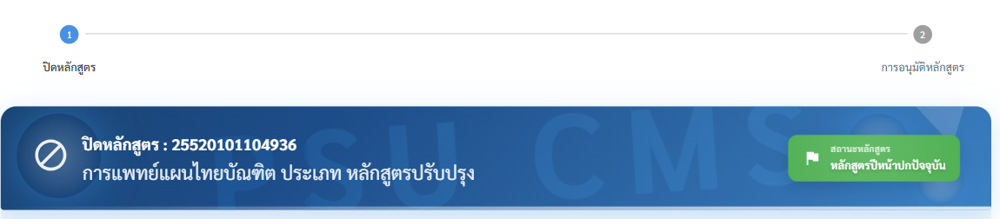
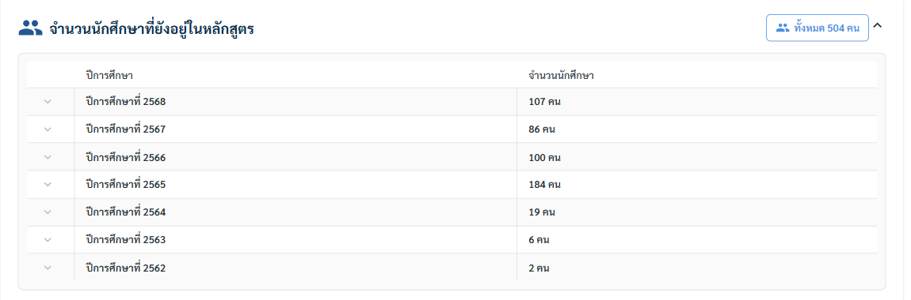
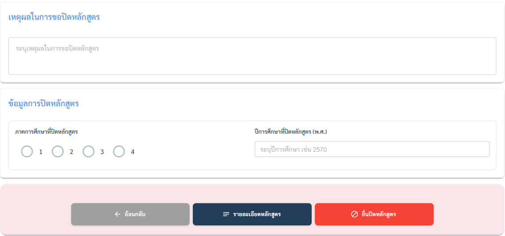

# 8. การปิดหลักสูตร

ใช้เมื่อต้องการปิดหลักสูตรอย่างเป็นทางการ หลักสูตรที่ปิดแล้วจะไม่รับนักศึกษาใหม่ แต่นักศึกษาเดิมยังคงสามารถเรียนต่อจนจบได้

กระบวนการแบ่งเป็น 2 ขั้นตอนหลัก


```
[ขั้น 1: ปิดหลักสูตร] → [ขั้น 2: การอนุมัติหลักสูตร]
```


<figure><figcaption><p>Stepper 2 ขั้น (ปิดหลักสูตร → การอนุมัติหลักสูตร) และหลักสูตรที่กำลังยื่นปิด</p></figcaption></figure>

## ความต่างระหว่าง "ระงับการรับนักศึกษา" กับ "ปิดดำเนินการ"

การปิดหลักสูตรมักมีสองช่วง

1. ระงับการรับนักศึกษา — หยุดรับนักศึกษาใหม่ แต่ยังมีนักศึกษาเก่าเรียนอยู่ (สถานะ "ระงับการรับนักศึกษา")
2. ปิดดำเนินการ — เมื่อนักศึกษาทุกคนสำเร็จการศึกษาหรือพ้นสภาพแล้ว จึงปิดหลักสูตรอย่างสมบูรณ์ (สถานะ "ปิดดำเนินการ")

## ขั้นตอนการดำเนินงาน

1. ไปที่เมนู **หลักสูตร → จัดการหลักสูตร** แล้วกดปุ่ม **"ปิดหลักสูตร"** (สีแดง) มุมขวาบน
2. หน้า "ปิดหลักสูตร" แสดงเฉพาะหลักสูตรที่ใช้งานปัจจุบัน ค้นหาหลักสูตรที่ต้องการ แล้วกดปุ่ม **"ปิด"** ท้ายแถว
3. ตรวจข้อมูลหลักสูตร (ข้อมูลพื้นฐาน, การจำแนกหลักสูตร, ข้อมูลการศึกษา, การปรับปรุงหลักสูตร) ว่าเลือกถูกหลักสูตร
4. ดู **จำนวนนักศึกษาที่ยังอยู่ในหลักสูตร** ระบบดึงจำนวนนักศึกษาคงค้างแยกตามปีการศึกษามาให้อัตโนมัติ (กดลูกศรหน้าแต่ละปีเพื่อดูรายละเอียด)

<figure><figcaption><p>ตัวอย่าง: ยังมีนักศึกษาคงค้างทั้งหมด 504 คน แยกตามปีการศึกษาที่เข้า</p></figcaption></figure>

5. กรอก **เหตุผลในการขอปิดหลักสูตร** ให้ชัดเจน (เช่น ปรับปรุงเป็นหลักสูตรใหม่, ความต้องการลดลง)
6. กรอก **ข้อมูลการปิดหลักสูตร**: เลือก **ภาคการศึกษาที่ปิดหลักสูตร** (1–4) และ **ปีการศึกษาที่ปิดหลักสูตร (พ.ศ.)** เช่น 2570
7. กด **"ยื่นปิดหลักสูตร"** (สีแดง) เพื่อส่งเรื่อง หรือ **ย้อนกลับ** / **รายละเอียดหลักสูตร** หากยังไม่พร้อม

<figure><figcaption><p>ช่องเหตุผล ภาค/ปีการศึกษาที่ปิด และปุ่ม "ยื่นปิดหลักสูตร"</p></figcaption></figure>


ควรเตรียม **แผนดูแลนักศึกษาหลังปิดหลักสูตร** ให้นักศึกษาเดิมเรียนจบได้ เพื่อใช้ประกอบการพิจารณาในขั้นอนุมัติ


8. หลังยื่นแล้ว หลักสูตรจะไปอยู่ในแท็บ **"ปิดหลักสูตร"** ของหน้าจัดการหลักสูตร เพื่อบันทึกผลการอนุมัติ
9. ส่งกระบวนการอนุมัติปิดหลักสูตร ซึ่งประกอบด้วย 4 แท็บ (ใช้ลำดับการอนุมัติชุดเดียวกับการเพิ่ม/ปรับปรุงหลักสูตร แต่ใช้เฉพาะลำดับ 1–2, 4, 5, 6)

| แท็บ   | ลำดับการอนุมัติ                   | ผู้พิจารณา / หน่วยงาน                                        |
| ------ | --------------------------------- | ------------------------------------------------------------ |
| แท็บ 1 | ลำดับ 1 และ 2 (รวมไว้ในแท็บเดียว) | คณะอนุกรรมการกลั่นกรอง PLOs และ คณะกรรมการประจำคณะ / ส่วนงาน |
| แท็บ 2 | ลำดับ 4                           | คณะกรรมการนโยบายการพัฒนาทรัพยากรมนุษย์และการจัดการศึกษา      |
| แท็บ 3 | ลำดับ 5                           | สภามหาวิทยาลัย                                               |
| แท็บ 4 | ลำดับ 6                           | สป.อว.                                                       |

> ⚠️ **การปิดดำเนินการอัตโนมัติ:** ระบบมีกลไกตรวจสอบและช่วยเปลี่ยนสถานะหลักสูตรที่เข้าเงื่อนไขการปิด/ระงับ พร้อมการแจ้งเตือนที่เกี่ยวข้อง ผู้รับผิดชอบควรติดตามการแจ้งเตือนเหล่านี้เพื่อยืนยันความถูกต้อง
