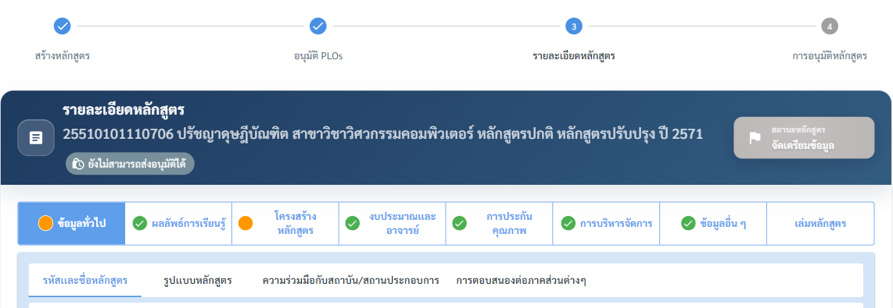
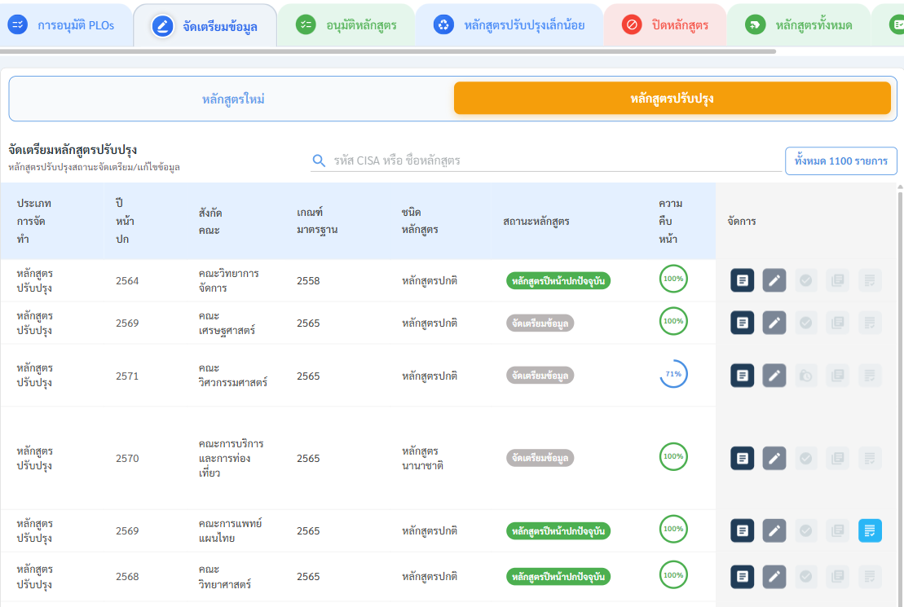

# การส่งอนุมัติหลักสูตร สำหรับผู้จัดทำหลักสูตร (เจ้าหน้าที่ระดับคณะ)

เมื่อกรอกข้อมูลรายละเอียดหลักสูตรในขั้นตอนที่ 3 ครบเรียบร้อยแล้ว ผู้จัดทำหลักสูตรจำเป็นต้อง ส่งหลักสูตร เข้าสู่กระบวนการอนุมัติ ด้วยตนเอง ระบบจะไม่ส่งให้โดยอัตโนมัติ

### 1. การตรวจสอบความครบถ้วนของข้อมูล

ระบบมีตัวบ่งชี้ความสมบูรณ์ของข้อมูล 2 ระดับ ได้แก่

| ระดับ                     | ตำแหน่ง                                        | การแสดงผล                                                                                                |
| ------------------------- | ---------------------------------------------- | -------------------------------------------------------------------------------------------------------- |
| สถานะบนหัวข้อชื่อหลักสูตร | ในหน้าฟอร์มรายละเอียดหลักสูตร (ในขั้นตอนที่ 3) | ทุกหมวด/แท็บมีจุดสถานะ (วงกลม) ต้องเป็นสี เขียวพร้อมเครื่องหมายถูกใน                                     |
| ภาพรวมทั้งหลักสูตร        | ในตารางหน้า จัดการหลักสูตร                     | ระบบรวมสถานะทุกแท็บเป็นค่าความครบถ้วนรวม (ครบทุกแท็บ / ยังไม่ครบ) ซึ่งใช้ควบคุมการเปิด-ปิดปุ่มส่งอนุมัติ |

<figure><figcaption>
แท็บหลักพร้อมจุดสถานะ: ✅ เขียว = ครบ, 🟠 ส้ม = ยังไม่ครบ (แท็บที่ยังไม่ได้กรอกเลยจะเป็นวงกลมสีเทา) และป้าย "ยังไม่สามารถส่งอนุมัติได้" ใต้ชื่อหลักสูตร
</figcaption></figure>

> ⚠️ หลักสูตรจะส่งอนุมัติได้ก็ต่อเมื่อ ทุกแท็บมีสถานะครบ (เขียว) ครบทั้งหมด เท่านั้น หากยังมีแท็บใดเป็นสีเทา ระบบจะยังไม่เปิดให้ส่ง

### 2. ตำแหน่งและสถานะของปุ่ม "ส่งอนุมัติ"

<figure><figcaption>
คอลัมน์ "ความคืบหน้า" และปุ่มในคอลัมน์จัดการ: 📄 ดูรายละเอียด · ✏️ แก้ไข · ปุ่มส่งอนุมัติ · 📚 เพิ่มหลักสูตรอ้างอิง · 📋 ดูผลการตรวจสอบข้อมูล
</figcaption></figure>

ปุ่มส่งอนุมัติอยู่ในคอลัมน์ปุ่มการดำเนินการ (ด้านขวาของแต่ละแถวหลักสูตร) ในตารางหน้า จัดการหลักสูตร โดยหน้าตาและความหมายของปุ่มจะเปลี่ยนตามสถานะของหลักสูตร ดังนี้

| สัญลักษณ์ปุ่ม                            | สถานะ              | ความหมาย (ข้อความเมื่อชี้เมาส์)                                 |
| ---------------------------------------- | ------------------ | --------------------------------------------------------------- |
| 🔒🕒 ไอคอนนาฬิกาล็อก (สีเทา, กดไม่ได้) | ข้อมูลยังไม่ครบ    | "ยังไม่สามารถส่งอนุมัติได้ — จำเป็นต้องกรอกข้อมูลให้ครบทุกแท็บ" |
| ➤ ไอคอนส่ง (สีเขียว, กดได้) | ข้อมูลครบ พร้อมส่ง | "ส่งอนุมัติ — คลิกเพื่อส่งหลักสูตรเพื่ออนุมัติ"                 |
| ✔ เครื่องหมายถูกในวงกลม (สีเทา, กดไม่ได้) | ส่งอนุมัติแล้ว     | "ส่งอนุมัติแล้ว"                                                |

### 3. การส่งอนุมัติ

ตรวจสอบให้แน่ใจว่าทุกแท็บของหลักสูตรมีสถานะครบ (ปุ่มเปลี่ยนเป็นสีเขียว ) คลิกปุ่ม ส่งอนุมัติ ที่แถวของหลักสูตรนั้น

ระบบแสดงกล่องยืนยัน "ยืนยันการส่งข้อมูลหลักสูตรเพื่ออนุมัติ?" คลิกปุ่ม ส่งอนุมัติ เพื่อยืนยัน

เมื่อสำเร็จ ระบบแจ้ง "ส่งข้อมูลหลักสูตรเพื่ออนุมัติเรียบร้อยแล้ว" และเปลี่ยนสถานะการดำเนินการของหลักสูตรเป็น "ส่งอนุมัติแล้ว" (ปุ่มเปลี่ยนเป็นไอคอนถูก ✅)

หลังการส่งอนุมัติ หลักสูตรจะเข้าสู่ ขั้นตอนที่ 5 — การอนุมัติหลักสูตร ซึ่งเป็นกระบวนการพิจารณาอนุมัติแบบหลายระดับ (8 ลำดับการอนุมัติ ผ่าน 7 แท็บ ดูรายละเอียดลำดับการอนุมัติที่ [5. การเพิ่มหลักสูตรใหม่](add-curriculum.md)) การส่งอนุมัติเป็นการยืนยันว่าข้อมูลหลักสูตรพร้อมเข้าสู่การพิจารณาอย่างเป็นทางการแล้ว


ระหว่างการอนุมัติ หลักสูตรจะผ่านขั้น **ตรวจสอบข้อมูล** 2 ระยะ (ก่อนอนุมัติขั้นที่ 5 และหลังอนุมัติโดยฝ่ายทะเบียน) — ดูวิธีตรวจและวิธีแก้ไขเมื่อถูกส่งคืนที่หน้า [การตรวจสอบข้อมูลหลักสูตร](data-review.md)

