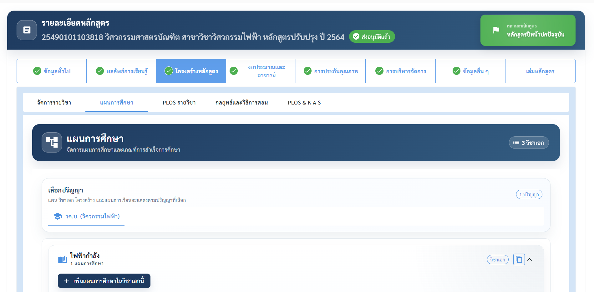
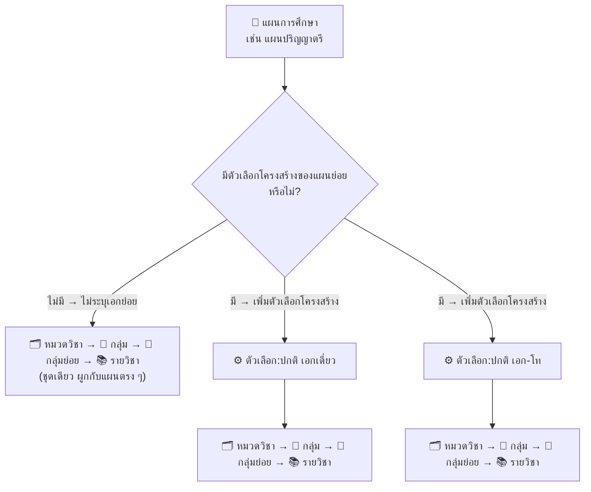

# การกรอกข้อมูลโครงสร้างหลักสูตร

หน้านี้อธิบาย **หมวดที่ 3 โครงสร้างหลักสูตร** แบบทีละขั้นตอน (ต่อจากหน้า [การกรอกข้อมูลรายละเอียดหลักสูตร](curriculum-form.md)) — เป็นหมวดที่ใช้เวลากรอกมากที่สุด จึงแนะนำให้ทำตามลำดับในหน้านี้ตั้งแต่ต้นจนจบ

## ภาพรวม: 5 แท็บย่อย ทำตามลำดับนี้

หมวดที่ 3 มี 5 แท็บย่อย **แต่ละแท็บต้องใช้ข้อมูลจากแท็บก่อนหน้า** จึงควรกรอกเรียงตามลำดับ

<table><thead><tr><th width="70">ลำดับ</th><th width="200">แท็บ</th><th>ทำอะไร</th><th width="220">ต้องทำอะไรก่อน</th></tr></thead><tbody><tr><td>1</td><td><strong>จัดการรายวิชา</strong></td><td>สร้างรายวิชาของหลักสูตรนี้</td><td>—</td></tr><tr><td>2</td><td><strong>แผนการศึกษา</strong></td><td>สร้างแผน → จัดหมวด/กลุ่ม/รายวิชา → จัดลงชั้นปี/ภาค → แผนการรับ → เกณฑ์จบ</td><td>มีรายวิชาจากขั้นตอนที่ 1</td></tr><tr><td>3</td><td><strong>PLOs รายวิชา</strong></td><td>บอกว่ารายวิชาไหนส่งเสริม PLO ข้อใด ระดับ I/R/M</td><td>มีรายวิชาในโครงสร้างหลักสูตร (ขั้นตอนที่ 2)</td></tr><tr><td>4</td><td><strong>กลยุทธ์และวิธีการสอน</strong></td><td>อธิบายวิธีสอนของแต่ละ PLO</td><td>มี PLO ของหลักสูตร</td></tr><tr><td>5</td><td><strong>PLOs &#x26; K A S</strong></td><td>สร้างคลัง K/A/S แล้วจับคู่กับ PLO</td><td>มี PLO ของหลักสูตร</td></tr></tbody></table>


ดูรายการฟิลด์บังคับกรอกแบบสรุปได้ในตารางที่หน้า [การกรอกข้อมูลรายละเอียดหลักสูตร](curriculum-form.md)


***

## ขั้นตอนที่ 1: เพิ่มรายวิชาของหลักสูตร (แท็บ "จัดการรายวิชา")

รายวิชาในแท็บนี้เป็น **รายวิชาของหลักสูตรนี้โดยเฉพาะ** (ไม่ใช่รายวิชากลาง/GenEd จากคลังส่วนกลาง) แต่ใช้ **รหัสประเภทวิชาชุดเดียวกัน** และแบบฟอร์มแบบเดียวกับรายวิชากลาง

<figure><figcaption></figcaption></figure>



#### กดปุ่ม "เพิ่มวิชาในหลักสูตร"

ระบบจะเปิดฟอร์มเพิ่มรายวิชา

> 💡 ถ้ามีรายวิชาจำนวนมาก ใช้เมนู **"นำเข้าข้อมูล"** แทนได้ — แยกเป็น **นำเข้ารายวิชา Excel** และ **นำเข้า CLOs Excel**



#### (ถ้ามี) เลือกหน่วยงานก่อนกำหนดรหัสวิชา

ถ้าหลักสูตรมี **หน่วยงานบริหารจัดการหลักสูตรมากกว่า 1 หน่วยงาน** ต้อง**เลือกหน่วยงานก่อน** เพราะเลขรหัสวิชาตัวหน้าจะเปลี่ยนตามหน่วยงานที่เลือก



#### กรอกข้อมูลให้ครบ 4 แท็บย่อย

1. **ข้อมูลรายวิชา**
2. **รายวิชาที่บังคับเรียนก่อน/ควบ**
3. **CLOs รายวิชา**
4. **ข้อมูลการเปิดสอนและการอนุมัติ** — ไม่มีช่องวันที่อนุมัติ เพราะรายวิชานี้ไม่ผ่านกระบวนการอนุมัติกลาง (ถือเป็นส่วนหนึ่งของการกรอกหลักสูตร)



#### กดบันทึก

ถ้ายังไม่กรอก CLOs ระบบจะถามยืนยันก่อนว่าจะ **"บันทึกโดยไม่มี CLOs"** หรือไม่


รายวิชาที่ไม่มี CLOs จะมีป้ายเตือนที่แถวนั้น และจะ**อนุมัติเปิดใช้งานไม่ได้** — ควรกลับมากรอก CLOs ให้ครบก่อนส่งอนุมัติ




**ตารางรายวิชาในหลักสูตร** แสดงเฉพาะรายวิชาที่หลักสูตรนี้เป็นเจ้าของ มีช่องค้นหารหัส/ชื่อวิชา และคอลัมน์: รหัสวิชา · ชื่อรายวิชา (พร้อมปีที่เปิดสอนครั้งแรกถ้ามี) · ประเภทวิชา · หน่วยกิต · ใช้งานร่วม/แชร์ · จัดการ (ดู/แก้ไข/ลบ)

🔗 ต้องการให้หลักสูตรอื่นใช้รายวิชานี้ร่วมด้วย

เปิดสวิตช์ **"ใช้งานร่วม/แชร์"** ที่แถวรายวิชานั้น หลักสูตรอื่นจะนำไปใช้ได้ทันที

ถ้าปิดสวิตช์ขณะที่มีหลักสูตรอื่นใช้อยู่ ระบบจะถามยืนยันก่อน พร้อมแจ้งจำนวนหลักสูตรที่ใช้อยู่

🗑️ ต้องการลบรายวิชา

* ลบได้เฉพาะรายวิชาที่หลักสูตรนี้เป็นเจ้าของ
* ถ้ารายวิชายังอยู่ในหมวดวิชา/แผนการเรียนของหลักสูตรนี้ → **ถอนออกจากหมวดก่อน** แล้วจึงลบ
* ถ้ามีหลักสูตรอื่นใช้อยู่ (ผ่านการแชร์) → **ลบไม่ได้** จนกว่าหลักสูตรอื่นจะเลิกใช้
* เลือกหลายรายการแล้วลบพร้อมกันได้ — ระบบจะข้ามรายวิชาที่ยังถูกใช้งานอยู่ให้อัตโนมัติ

***

## ขั้นตอนที่ 2: สร้างแผนการศึกษาและโครงสร้าง (แท็บ "แผนการศึกษา")

ขั้นตอนนี้ยาวที่สุด แบ่งเป็นขั้นย่อย 2.1 – 2.9 ดังนี้

<figure><figcaption></figcaption></figure>

### 2.1 ทำความเข้าใจลำดับชั้นก่อนเริ่มกรอก

ข้อมูลในแท็บนี้เรียงเป็นชั้น ๆ จากใหญ่ไปเล็ก — ไม่จำเป็นต้องมีครบทุกชั้น

```mermaid
flowchart TD
    A["🎓 วิชาเอก"] --> B["📘 แผนการศึกษา<br/>เช่น แผนปริญญาตรี"]
    B -.->|"ถ้ามีตัวเลือกโครงสร้างย่อย"| V["⚙️ ตัวเลือกโครงสร้างย่อย เช่น ปกติ สหกิจ"]
    B --> C1["🗂️ หมวดวิชาศึกษาทั่วไป"]
    B --> C2["🗂️ หมวดวิชาเฉพาะ"]
    V -.->|"ถ้าไม่มีตัวเลือก ข้ามตรงมาที่นี่"| C1
    C1 --> D1["📁 กลุ่มวิชา GE"]
    C2 --> D2["📁 กลุ่มวิชาบังคับ"]
    C2 --> D3["📁 กลุ่มวิชาเลือก"]
    D1 --> E1["📄 กลุ่มสาระ GE / กลุ่มย่อย"]
    D2 --> E2["📄 กลุ่มย่อย"]
    D3 --> E3["📄 กลุ่มย่อย"]
    E1 --> F1["📚 รายวิชา"]
    E2 --> F2["📚 รายวิชา"]
    E3 --> F3["📚 รายวิชา"]
```

<table><thead><tr><th width="60">ชั้น</th><th width="160">ระดับ</th><th>คืออะไร</th><th width="180">มีทุกหลักสูตรไหม</th></tr></thead><tbody><tr><td>1</td><td>🎓 <strong>วิชาเอก</strong></td><td>สาขาย่อยของ<strong>ทั้งหลักสูตร</strong> (เช่น เอกไฟฟ้า, เอกเครื่องกล) — แต่ละเอกมีแผนการศึกษาของตัวเอง</td><td>เฉพาะหลักสูตรที่แบ่งเอก</td></tr><tr><td>2</td><td>📘 <strong>แผนการศึกษา</strong></td><td>แผนการเรียนแบบหนึ่ง (เช่น แผนปกติ 4 ปี, แผนสหกิจศึกษา) — มีหน่วยกิตรวมและระยะเวลาเรียนของตัวเอง</td><td>ทุกหลักสูตร อย่างน้อย 1 แผน</td></tr><tr><td>3</td><td>⚙️ <strong>ตัวเลือกโครงสร้างของแผน</strong></td><td>การแยกย่อย<strong>ภายในแผนเดียวกัน</strong> (เช่น เอกเดี่ยว/เอก-โท)</td><td>เฉพาะแผนที่ต้องแยก</td></tr><tr><td>4</td><td>🗂️ <strong>หมวดวิชา</strong></td><td>หมวดใหญ่ในแผน (เช่น หมวดวิชาศึกษาทั่วไป, หมวดวิชาเฉพาะ)</td><td>ทุกแผน มีได้หลายหมวด</td></tr><tr><td>5</td><td>📁 <strong>กลุ่ม</strong></td><td>กลุ่มวิชาในหมวด (เช่น กลุ่มวิชาบังคับ, กลุ่มวิชาเลือก)</td><td>ทุกหมวด อย่างน้อยมี "ไม่ระบุกลุ่ม" ให้อัตโนมัติ</td></tr><tr><td>6</td><td>📄 <strong>กลุ่มย่อย</strong></td><td>แบ่งย่อยในกลุ่มอีกชั้น (รวมถึง Minor และกลุ่มสาระ GE)</td><td>เฉพาะกลุ่มที่ต้องแยกย่อย</td></tr><tr><td>7</td><td>📚 <strong>รายวิชา</strong></td><td>ตัวรายวิชาจริง (ชั้นล่างสุด)</td><td>ทุกกลุ่ม ยกเว้นติ๊ก "ไม่ระบุรายวิชา"</td></tr></tbody></table>

<figure><figcaption></figcaption></figure>


ชั้น **"🎓 วิชาเอก"** จะปรากฏเมื่อติ๊ก **"กลุ่มวิชาเอก/วิชาโท/กลุ่มสาขาวิชา" เป็น "มี"** ในหมวดที่ 1 (แท็บ "รหัสและชื่อหลักสูตร") และเลือกเอกไว้อย่างน้อย 1 รายการ — ดูเพิ่มที่หน้า [การกรอกข้อมูลรายละเอียดหลักสูตร](curriculum-form.md)



**อย่าสับสน "วิชาเอก" กับ "ตัวเลือกโครงสร้างของแผน (เอกเดี่ยว/เอก-โท)"**

* **วิชาเอก** (ชั้น 1) = แบ่งสาขาของ**ทั้งหลักสูตร** → ได้**หลายแผนการศึกษา**แยกตามเอก
* **ตัวเลือกโครงสร้างของแผน** (ชั้น 3) = แยกโครงสร้าง**ภายในแผนเดียว** (เช่น แผนปกติ 4 ปี แต่นักศึกษาเลือกเรียนเอกเดี่ยวหรือเอก-โทได้)

สองอย่างนี้ใช้ร่วมกันหรือแยกกันก็ได้ และไม่บังคับต้องมีทั้งคู่


### 2.2 ตัดสินใจ: แผนนี้มีตัวเลือกโครงสร้าง (เอกเดี่ยว/เอก-โท) หรือไม่

ก่อนเพิ่มหมวดวิชา ต้องเลือกก่อนว่าแผนนี้ใช้โครงสร้างเดียว หรือแยกเป็นหลายตัวเลือก

<table><thead><tr><th width="220">กรณี</th><th>ต้องทำอะไร</th></tr></thead><tbody><tr><td>🚫 <strong>ไม่มีตัวเลือกโครงสร้าง</strong> (กรณีส่วนใหญ่)</td><td>เลือก <strong>"ไม่ระบุเอกย่อย"</strong> → ข้ามไป 2.3 ได้เลย หมวด/กลุ่ม/รายวิชาจะผูกกับแผนโดยตรงชุดเดียว</td></tr><tr><td>⚙️ <strong>มีตัวเลือกโครงสร้าง</strong></td><td>เพิ่มตัวเลือกตามขั้นตอนด้านล่าง — แต่ละตัวเลือกมีหมวด/กลุ่ม/รายวิชา<strong>แยกอิสระจากกัน</strong> (แก้ของเอกเดี่ยวไม่กระทบเอก-โท)</td></tr></tbody></table>

<figure><figcaption></figcaption></figure>

<figure><figcaption></figcaption></figure>

**วิธีเพิ่มตัวเลือกโครงสร้าง**



#### กด "เพิ่มตัวเลือกโครงสร้าง"

แล้วเลือก **ประเภท** จากรายการ (เช่น เอกเดี่ยว / เอก-โท)



#### (ไม่บังคับ) กรอกหน่วยกิต/ระยะเวลาของตัวเลือกนี้ 🆕

กรอก **หน่วยกิตรวม**, **ระยะเวลาการศึกษา**, **ระยะเวลาที่ขอขยายได้** แยกจากแผนได้

* **กรอกไว้** → ใช้ค่านี้ (เช่น เอก-โท เรียนหน่วยกิตมากกว่าเอกเดี่ยว)
* **ปล่อยว่าง** → ใช้ค่าของแผนการศึกษาแทนอัตโนมัติ

การ์ดสรุป 3 ช่อง (หน่วยกิต / ระยะเวลาศึกษา / ระยะเวลาขยาย) จะแสดง**ค่าที่ใช้จริง**ให้เห็นทันที



#### ทำซ้ำจนครบทุกตัวเลือก

แต่ละการ์ดตัวเลือกมีปุ่ม **"โครงสร้าง"**, **"แผนการเรียน"**, **"คัดลอก"**, แก้ไข และลบ ของตัวเอง — กด **"โครงสร้าง"** บนการ์ดเพื่อไปขั้นถัดไป



<figure><figcaption></figcaption></figure>

<figure><figcaption></figcaption></figure>


* สลับระหว่าง **"ไม่ระบุเอกย่อย"** กับ **"มีตัวเลือกโครงสร้าง"** ได้**เฉพาะตอนที่ยังไม่มีข้อมูลโครงสร้างอยู่เท่านั้น**
* ตัวเลือกโครงสร้าง**ลบไม่ได้ถ้ายังมีหมวด/กลุ่ม/รายวิชาข้างใน** ต้องลบข้อมูลข้างในให้หมดก่อน และต้องกรอก **CAPTCHA** ทุกครั้งที่ลบ


### 2.3 เปิดหน้าจัดการโครงสร้าง

ในตาราง "แผนการศึกษา" แต่ละแถวมี 2 ปุ่ม:

* **"โครงสร้าง"** — เปิดหน้าต่างจัดการโครงสร้าง (ใช้ปุ่มนี้เพื่อแก้ไข)
* **"โครงสร้างหลักสูตร"** — ขยายแถวเพื่อดูโครงสร้างในหน้าเดิม

> ถ้าแผนมีตัวเลือกโครงสร้าง (จาก 2.2) ให้กดปุ่ม **"โครงสร้าง"** บนการ์ดของตัวเลือกนั้นแทน

<figure><figcaption></figcaption></figure>

หน้าจอจะเปิดเป็นแท็บ **"โครงสร้างหลักสูตร : {ชื่อแผน}"** (หนึ่งแท็บต่อหนึ่งแผน/วิชาเอก) ด้านบนมีการ์ดสรุป 2 ใบ

<table><thead><tr><th width="220">การ์ด</th><th>แสดงอะไร</th></tr></thead><tbody><tr><td><strong>ข้อมูลแผนการศึกษา</strong> (อ่านอย่างเดียว)</td><td>หน่วยกิตรวม · ระยะเวลาการศึกษา · ระยะเวลาที่ขอขยายได้</td></tr><tr><td><strong>สรุปหน่วยกิตหมวดวิชา</strong> (คำนวณสด)</td><td>หน่วยกิตรวม / เพิ่มแล้ว / คงเหลือหรือเกิน + แถบความคืบหน้า <strong>🟢 เขียว</strong> = ครบพอดี <strong>🔴 แดง</strong> = ยังไม่ครบ</td></tr></tbody></table>

### 2.4 เพิ่มหมวดวิชา



#### เลือกชื่อหมวดวิชา

เลือกจากรายการ (เช่น หมวดวิชาศึกษาทั่วไป, หมวดวิชาเฉพาะ, หมวดวิชาเลือกเสรี) — หมวดที่เลือกแล้วจะไม่แสดงให้เลือกซ้ำในแผนเดียวกัน

> ถ้าเลือก **"หมวดศึกษาทั่วไป"** ระบบจะตั้งเป็น **หมวด GE อัตโนมัติ** ปุ่มเพิ่มรายวิชาจะเปลี่ยนเป็นชุดของ GE (เพิ่มกลุ่มสาระ GE / เพิ่มกลุ่มย่อย)



#### กรอกจำนวนหน่วยกิตของหมวด

หรือติ๊กตัวเลือกพิเศษอย่างใดอย่างหนึ่ง (ใช้พร้อมกันไม่ได้):

<table><thead><tr><th width="240">ตัวเลือก</th><th>ผลลัพธ์</th><th width="240">ใช้เมื่อ</th></tr></thead><tbody><tr><td><strong>หมวด Audit / ไม่นับหน่วยกิต</strong></td><td>หน่วยกิตหมวด<strong>ล็อกเป็น 0</strong> แต่ยังเพิ่มรายวิชาได้ตามปกติ (หน่วยกิตของรายวิชาไม่ถูกนับรวม)</td><td>หมวดที่ต้องเรียนแต่ไม่นับหน่วยกิต เช่น กิจกรรมเสริม วิชาปรับพื้นฐาน</td></tr><tr><td><strong>ไม่ระบุรายวิชาในหมวดนี้</strong></td><td><strong>นับหน่วยกิตเต็มอัตโนมัติ</strong> ไม่ต้องใส่รายวิชา</td><td>หมวดที่ไม่ต้องลงรายละเอียดรายวิชา</td></tr></tbody></table>

> ถ้าหมวดมีรายวิชาอยู่แล้ว ระบบจะถามยืนยันก่อนเปลี่ยนเป็นโหมด Audit หรือ "ไม่ระบุรายวิชา" — รายวิชาเดิมยังอยู่ แต่จะไม่ถูกนับหน่วยกิตอีก



#### กด "บันทึกหมวดวิชา"

**ต้องบันทึกหมวดก่อน** จึงจะเพิ่มกลุ่ม/รายวิชาในหมวดนั้นได้



#### (ไม่บังคับ) ใส่หมายเหตุ 🆕

กดไอคอนดินสอ → พิมพ์หมายเหตุ (เช่น เหตุผล/ข้อยกเว้นของหมวด) → กดติ๊กเพื่อบันทึก




**ทางลัด:** ถ้าไม่ต้องแบ่งกลุ่ม ให้กดปุ่ม "เพิ่มรายวิชาในหลักสูตร" / "เพิ่มวิชาศึกษาทั่วไป" / "เพิ่มกลุ่มสาระ GE" ท้ายหมวดได้เลย — รายวิชาจะเข้ากลุ่ม **"ไม่ระบุกลุ่ม"** ให้อัตโนมัติ (ข้าม 2.5 ได้)



* ชื่อหมวด**ซ้ำกันในแผนเดียวกันไม่ได้**
* **"ลบหมวดวิชา"** จะลบทั้งหมวดพร้อมกลุ่ม/รายวิชาข้างใน — ถ้าหมวดถูกใช้ในแผนการเรียนแล้ว ต้องกรอก **CAPTCHA** ก่อนลบ


### 2.5 เพิ่มกลุ่มในหมวด



#### เลือกกลุ่ม

เลือกจากรายการกลุ่มที่ยังไม่ถูกใช้ในหมวดนี้ (แต่ละกลุ่มใช้ได้ครั้งเดียวต่อหมวด) หรือปล่อยเป็น **"ไม่ระบุกลุ่ม"**



#### กรอกหน่วยกิตกลุ่ม

* **บังคับกรอก** เมื่อเลือกกลุ่มจริง (ถ้าเป็น "ไม่ระบุกลุ่ม" ไม่ต้องกรอก — ใช้หน่วยกิตคงเหลือของหมวดแทน)
* ใส่ **0** = กลุ่ม Audit อัตโนมัติ (ไม่ต้องติ๊กแยก) จะเพิ่มได้เฉพาะรายวิชาแบบไม่นับหน่วยกิต
* ติ๊ก **"ไม่ระบุรายวิชาในกลุ่มนี้"** ได้ ถ้าไม่ต้องใส่รายวิชา (นับหน่วยกิตเต็มอัตโนมัติ — ติ๊กได้เฉพาะตอนกลุ่มยังว่าง)



#### กดปุ่มบันทึกกลุ่ม

ปุ่มเพิ่มรายวิชา/กลุ่มย่อยจะ**ใช้ไม่ได้**จนกว่าจะกรอกหน่วยกิตกลุ่มและบันทึกกลุ่มแล้ว (มีข้อความอธิบายใต้ปุ่ม)



<figure><figcaption></figcaption></figure>

### 2.6 เพิ่มรายวิชา / กลุ่มย่อย / Minor ในกลุ่ม

ใช้ปุ่มท้ายตาราง "รายวิชาในกลุ่ม" — ปุ่มที่เห็นจะต่างกันตามประเภทหมวด

<table><thead><tr><th width="200">ประเภทหมวด</th><th>ปุ่มที่ใช้ได้</th></tr></thead><tbody><tr><td><strong>หมวดทั่วไป</strong> (ไม่ใช่ GE)</td><td>"เพิ่มรายวิชาในหลักสูตร" · "เพิ่มวิชาศึกษาทั่วไป" (ถ้าหมวดอนุญาตให้ใส่วิชาประเภท G) · "เพิ่มกลุ่มย่อย"</td></tr><tr><td><strong>หมวด GE</strong></td><td>"เพิ่มกลุ่มสาระ GE" · "เพิ่มกลุ่มย่อย"</td></tr></tbody></table>

**เพิ่มกลุ่มย่อยและ Minor**

1. กด **"เพิ่มกลุ่มย่อย"** → เลือกกลุ่มย่อยหลัก + กรอกหน่วยกิตกลุ่มย่อย
2. ถ้าต้องการ Minor ซ้อนใต้กลุ่มย่อย → กดไอคอน **"เพิ่ม Sub minor"** (เพิ่มได้หลายรายการ แสดงเป็นแถวเยื้องเข้าไป)
3. แก้ไข/ลบ ได้ที่คอลัมน์ "จัดการ" ของแต่ละแถว

**เพิ่มกลุ่มสาระ GE** (เฉพาะหมวดศึกษาทั่วไป)

1. กด **"เพิ่มกลุ่มสาระ GE"** → เลือก **ประเภทกลุ่ม GE** และ **กลุ่ม GE**
2. กรอก **หน่วยกิต** — ระบุเป็น**ช่วง ต่ำสุด–สูงสุด** ได้
3. เพิ่มรายวิชาเข้ากลุ่มสาระได้โดยตรง หรือกด **"เพิ่ม Sub minor"** เพื่อซ้อนกลุ่มย่อยอีกชั้น

> ตาราง "รายวิชาในกลุ่ม" มีช่องค้นหา และคอลัมน์: รหัสวิชา · ชื่อรายวิชา · ประเภทวิชา · หน่วยกิต · ประเภทห้องเรียน · จัดการ — แถวกลุ่มย่อย/กลุ่มสาระ GE มีลูกศรให้ขยายดูรายวิชาข้างใน

### 2.7 ตรวจหน่วยกิตให้ครบ

ดูที่การ์ด **"สรุปหน่วยกิตหมวดวิชา"** ด้านบน — ต้องเป็น **🟢 เขียว** (ครบพอดีตามหน่วยกิตรวมของแผน) ถ้ายังขาดหรือเกิน ระบบจะมีข้อความเตือน

🧮 ระบบคำนวณหน่วยกิตอย่างไร

* **กลุ่ม** = ผลรวมหน่วยกิตของรายวิชา + กลุ่มย่อย/กลุ่มสาระ GE ในกลุ่ม
* **หมวด** = ผลรวมหน่วยกิตของทุกกลุ่มในหมวด
  * ยกเว้นหมวด Audit = **0**
  * ยกเว้นหมวดที่ติ๊ก "ไม่ระบุรายวิชา" = **หน่วยกิตเต็มของหมวด**
* **ทั้งแผน** = ผลรวมของทุกหมวด → แสดงที่การ์ด "สรุปหน่วยกิตหมวดวิชา"

📋 อยากกรอกเร็วขึ้น: เครื่องมือคัดลอก

<table><thead><tr><th width="240">ปุ่ม</th><th>ใช้ทำอะไร</th></tr></thead><tbody><tr><td><strong>คัดลอก</strong> (ต่อแผน/ตัวเลือกโครงสร้าง)</td><td>คัดลอกโครงสร้างหมวดวิชาทั้งหมดไปเป็นต้นแบบของแผน/วิชาเอกอื่น</td></tr><tr><td><strong>คัดลอกข้อมูลทั้งวิชาเอก</strong> (เฉพาะหลักสูตรที่แบ่งเอก)</td><td>คัดลอกทุกแผนของวิชาเอกหนึ่งไปพร้อมกัน — เหมาะเมื่อเอกใหม่มีโครงสร้างคล้ายเอกเดิม</td></tr></tbody></table>

⚠️ การคัดลอกจะ**เขียนทับข้อมูลปลายทาง** จึงต้องกรอก **CAPTCHA** ทุกครั้ง

### 2.8 จัดรายวิชาลงชั้นปี/ภาคการศึกษา (แท็บ "แผนการเรียน")

เมื่อเปิด "โครงสร้าง" ของแผน จะเห็น 2 แท็บคู่กัน: **"โครงสร้างหลักสูตร"** (2.3–2.7) และ **"แผนการเรียน"** (ขั้นนี้) — แท็บนี้**ไม่ได้สร้างหมวด/กลุ่มใหม่** แต่**หยิบรายวิชาที่มีในโครงสร้างแล้ว มาวางลงแต่ละปี/ภาค**


ค้นหารายวิชาไม่เจอ? รายวิชาต้อง**ถูกเพิ่มในแท็บ "โครงสร้างหลักสูตร" ก่อน** จึงจะเลือกได้ในแท็บนี้




#### เลือกรูปแบบของแต่ละปี

หน้าจอแสดง **"ปีที่ 1" ถึง "ปีที่ N"** ตามระยะเวลาการศึกษา (กดพับ/ขยายได้ มีชิปหน่วยกิตรวมของปี) เลือกรูปแบบได้อิสระทีละปี:

<table><thead><tr><th width="200">รูปแบบ</th><th>ลักษณะ</th></tr></thead><tbody><tr><td><strong>แผนรายภาคการศึกษา</strong></td><td>แยกการ์ดตามภาค (จำนวนภาคตามที่ตั้งในหมวดที่ 2 "ระบบการจัดการศึกษา" — ปกติ 3 ภาค) แต่ละภาคมีปุ่ม "เพิ่มรายวิชา" ของตัวเอง</td></tr><tr><td><strong>แผนรายปีการศึกษา</strong></td><td>รวมรายวิชาทั้งปีไว้ในการ์ดเดียว "รายวิชาทั้งปี"</td></tr></tbody></table>

> สลับรูปแบบได้ตลอด — ถ้าปีนั้นมีรายวิชาแล้ว ต้องกรอก **CAPTCHA** ยืนยัน เพราะระบบจะย้าย/รวมรายวิชาให้อัตโนมัติ และบันทึกทันที



#### กด "เพิ่มรายวิชา" ในภาค/ปีที่ต้องการ

ไดอะล็อกจะแสดงเฉพาะรายวิชาที่**ยังไม่อยู่ในภาค/ปีนั้น** และ**ยังมีหน่วยกิตเหลือให้จัด** พร้อมบอกว่า **"จัดลงแผนแล้ว X จากทั้งหมด Y หน่วยกิต"** และ **"คงเหลือ Z หน่วยกิต"**

* วิชาที่**แบ่งหน่วยกิตได้** (เช่น โครงงาน/วิทยานิพนธ์) → ลงหลายภาคได้ จนครบหน่วยกิตรวม
* **วิชา Audit/ไม่นับหน่วยกิต** → ลงซ้ำได้หลายภาคไม่จำกัด
* วิชาที่**แบ่งไม่ได้** → ลงได้ครั้งเดียวทั้งแผน



#### ตรวจการ์ด "ความคืบหน้าหน่วยกิตรายหมวด" 🆕

อยู่บนสุดของหน้า แสดงว่า**หมวดไหนจัดลงแผนการเรียนครบแล้ว** เช่น "5 / 7 หมวดครบ" พร้อมการ์ดย่อยต่อหมวด (ป้ายสถานะสี · หน่วยกิตที่จัดแล้ว/ที่ต้องมี · หน่วยกิตที่ยังขาด · แถบความคืบหน้า)

> การ์ดนี้ต่างจาก "สรุปหน่วยกิตหมวดวิชา" ใน 2.7 — อันนั้นเช็กว่า**ผูกรายวิชากับหมวดครบ** ส่วนอันนี้เช็กว่า**จัดลงปี/ภาคครบ** ต้องครบทั้งคู่



* **ลบรายวิชาออกจากภาค/ปี:** กดไอคอนถังขยะที่แถวนั้น (ไม่ได้ลบออกจากโครงสร้างหลักสูตร)
* รายวิชาในแต่ละภาค/ปีจะแสดงจัดกลุ่มตาม **หมวด → กลุ่ม** ส่วนวิชา GE จะซ้อนชั้นเป็น **กลุ่ม GE หลัก → Minor GE → รายวิชาใน Minor**


รายวิชาที่อยู่ภายใน Minor GE **ไม่นับหน่วยกิตซ้ำ และลบทีละวิชาไม่ได้** — ต้องลบที่ตัว Minor แทน


### 2.9 กรอกแผนการรับนักศึกษา



#### กดปุ่ม "แผนการรับ" ที่แถวของแผน

ในตารางรายการ "แผนการศึกษา" (แยกแท็บย่อยตามแผน/วิชาเอก)



#### กรอกจำนวนรับในแต่ละปีการศึกษา

<table><thead><tr><th width="220">คอลัมน์</th><th>กรอกอะไร</th></tr></thead><tbody><tr><td><strong>ปีการศึกษา</strong></td><td>หนึ่งแถวต่อหนึ่งปีที่รับนักศึกษา</td></tr><tr><td><strong>การรับนักศึกษา</strong></td><td>ติ๊ก <strong>นักศึกษาไทย</strong> / <strong>นักศึกษาต่างชาติ</strong></td></tr><tr><td><strong>โครงการปกติ / โครงการพิเศษ</strong></td><td>จำนวนรับแยกตามโครงการ (แสดงเฉพาะโครงการที่หลักสูตรเปิดใช้)</td></tr><tr><td><strong>จำนวนรวม</strong></td><td>ถ้าไม่แยกโครงการ กรอกจำนวนรวมช่องเดียว</td></tr></tbody></table>

แถว "รวม" ท้ายตารางคำนวณให้อัตโนมัติ



#### กดบันทึก

ดูสถานะกำกับ: **"มีการเปลี่ยนแปลงที่ยังไม่ได้บันทึก"** หรือ **"ข้อมูลถูกบันทึกแล้ว"**




**ผลของตัวเลือก "การบริหารจัดการวิชาเอก" ในหมวดที่ 1**

* ตั้งเป็น **"ไม่แยก"** → ขึ้นข้อความ "หลักสูตรนี้บริหารวิชาเอกร่วมกัน แผนการรับชุดนี้จึงใช้ร่วมกันทุกแผนและทุกวิชาเอก" กรอก**ครั้งเดียวใช้ร่วมกันทุกเอก**ที่ใช้ชื่อแผนเดียวกัน
* ตั้งเป็น **"แยก"** → แต่ละวิชาเอกกรอกจำนวนรับของตัวเอง


### 2.10 กรอกเกณฑ์การสำเร็จการศึกษา

กดปุ่ม "โครงสร้างหลักสูตร" หรือลูกศรขยายแถวของแผน จะเห็น 2 ส่วน

<table><thead><tr><th width="240">ส่วน</th><th>ต้องทำอะไร</th></tr></thead><tbody><tr><td><strong>เกณฑ์มาตรฐาน</strong></td><td>ไม่ต้องทำอะไร — อ่านอย่างเดียว ดึงจากมาตรฐานกลางตามปี พ.ศ. ที่หลักสูตรใช้</td></tr><tr><td><strong>เกณฑ์สูงกว่ามาตรฐาน</strong></td><td>(ถ้ามี) กด <strong>"เพิ่มเกณฑ์"</strong> → ระบุลำดับข้อ + รายละเอียด — แก้ไข/ลบได้ทีละรายการ</td></tr></tbody></table>

***

## ขั้นตอนที่ 3: จับคู่รายวิชากับ PLO (แท็บ "PLOs รายวิชา")

หน้าจอ **"ตารางเชื่อมโยงรายวิชากับ PLOs"** — แถวคือรายวิชา (จัดกลุ่มตามหมวด → กลุ่ม → กลุ่มย่อย/GE เหมือนในโครงสร้าง) คอลัมน์คือ PLO แต่ละข้อ (รวม sub-PLO)



#### (ถ้ามีหลายชุด) เลือกชุด PLOs

ถ้าหลักสูตรมี PLOs มากกว่า 1 ชุด ให้เลือกชุดจากแท็บ "เลือกชุด PLOs" ก่อน



#### เลือกระดับจากแถบเครื่องมือด้านบน

<table><thead><tr><th width="120">ระดับ</th><th width="140">สี</th><th>ความหมาย (โดยทั่วไป)</th></tr></thead><tbody><tr><td><strong>I</strong></td><td>🔵 ฟ้า</td><td>Introduce — เริ่มสอน</td></tr><tr><td><strong>R</strong></td><td>🟡 เหลือง/ส้ม</td><td>Reinforce — เน้นย้ำ</td></tr><tr><td><strong>M</strong></td><td>🟢 เขียว</td><td>Master — เชี่ยวชาญ</td></tr></tbody></table>



#### คลิกช่องที่ต้องการ (เหมือนใช้พู่กันแต้ม)

* คลิกช่อง → ใส่ระดับที่เลือกไว้ทันที
* คลิกช่องเดิมซ้ำ → ล้างค่า



#### กด "บันทึก"

ปุ่มจะกดได้เมื่อมีการเปลี่ยนแปลงที่ยังไม่บันทึก




ไม่เห็นรายวิชาในตาราง? ต้อง**เพิ่มรายวิชาในโครงสร้างหลักสูตรก่อน** (ขั้นตอนที่ 2)

ปุ่ม **"รีเซ็ท"** จะล้างค่าที่จับคู่ทั้งหมด (หรือเฉพาะแผนที่กรองอยู่) และ**บันทึกทันที** — ใช้ด้วยความระมัดระวัง


> ℹ️ รายวิชา/กลุ่มย่อยที่ใช้ร่วมหลายแผนอาจมีค่าต่างกันในแต่ละแผน — ช่องจะแสดงเป็นป้ายเล็กหลายอัน เอาเมาส์วางเพื่อดูว่าแผนไหนตั้งค่าอะไรไว้

***

## ขั้นตอนที่ 4: กรอกกลยุทธ์และวิธีการสอน

ตารางจับคู่ **PLO** (แถว) กับ **วิธีการสอน 3 ด้าน** (คอลัมน์) — แถว PLO แบ่งเป็น **PLOs ที่ผูกกับทุกแผน** (อยู่บนสุด) และ **PLOs เฉพาะบางแผน** (แยกหัวข้อตามชื่อแผน)



#### พิมพ์คำอธิบายในแต่ละช่อง

พิมพ์กลยุทธ์/วิธีการสอนของ PLO ข้อนั้นในด้านนั้น ๆ (จัดตัวหนา/ตัวเอียง/ลิสต์ได้)


แต่ละแถวต้อง**กรอกครบทั้ง 3 ช่อง หรือเว้นว่างทั้งแถว** — กรอกแค่บางช่องระบบจะเตือนใต้แถวนั้น




#### ดูสีขอบช่องเพื่อเช็กสถานะ

<table><thead><tr><th width="160">สีขอบช่อง</th><th>ความหมาย</th></tr></thead><tbody><tr><td>🟠 ส้ม</td><td>กรอกแล้ว ยังไม่ได้บันทึก</td></tr><tr><td>🟢 เขียว</td><td>บันทึกแล้ว</td></tr><tr><td>🔴 แดง</td><td>กรอกไม่ครบ 3 ช่อง</td></tr></tbody></table>



#### กด "บันทึก"

มีกล่องยืนยันก่อนเสมอ — ถ้ากด **"ยกเลิก"** ทุกช่องจะกลับเป็นค่าที่บันทึกล่าสุด



***

## ขั้นตอนที่ 5: จับคู่ PLO กับ K A S

K A S = **K**nowledge (ความรู้) / **A**ttitude (ทัศนคติ) / **S**kill (ทักษะ) — มี 2 โหมด สลับด้วยปุ่มด้านบน: **"จัดการคลัง K/A/S"** และ **"PLOs K/A/S"**


บังคับกรอกเฉพาะ**หลักสูตรที่ใช้ปีหน้าปกตั้งแต่ พ.ศ. 2564 ขึ้นไป** — หลักสูตรก่อนปี 2564 ข้ามขั้นตอนนี้ได้




#### สร้างคลัง K/A/S (โหมด "จัดการคลัง K/A/S")

เลือกแท็บ **K / A / S** แล้วกด **"เพิ่ม K" / "เพิ่ม A" / "เพิ่ม S"**

* มีรายการเยอะ → ใช้ **"นำเข้า K/A/S ด้วย Excel"**
* จัดลำดับ → **ลาก**รายการเพื่อเรียงใหม่
* ลบหลายรายการ → กด **"เลือกรายการ"** → ติ๊ก (หรือ "เลือกทั้งหมด") → **"ลบรายการที่เลือก"**



#### จับคู่กับ PLO (โหมด "PLOs K/A/S")

ตารางมี PLO เป็นแถว และ K / A / S เป็นคอลัมน์ — กดปุ่ม **"เลือก"** ท้ายช่อง แล้วเลือกรายการจากคลัง (เลือกได้หลายรายการต่อช่อง)

* นำออก → กด **✕** บนชิป (มีกล่องยืนยัน)
* **บันทึกทันที**ทุกครั้งที่เพิ่ม/นำออก ไม่ต้องกดบันทึกรวม



<figure><figcaption></figcaption></figure> <figure><figcaption></figcaption></figure> <figure><figcaption></figcaption></figure>


ปุ่ม "เลือก" กดไม่ได้? แปลว่าคลังของประเภทนั้นยังว่าง — กลับไปเพิ่มรายการในโหมด "จัดการคลัง K/A/S" ก่อน


***

## สรุป: ปัญหาที่พบบ่อยและวิธีแก้

<table><thead><tr><th width="280">อาการ</th><th>วิธีแก้</th></tr></thead><tbody><tr><td>รายวิชามีป้ายเตือน / อนุมัติไม่ได้</td><td>รายวิชายังไม่มี CLOs → แก้ไขรายวิชาแล้วกรอกแท็บ "CLOs รายวิชา" (ขั้นตอนที่ 1)</td></tr><tr><td>ลบรายวิชาไม่ได้</td><td>ถอนรายวิชาออกจากหมวดก่อน หรือรอหลักสูตรอื่นที่แชร์ใช้อยู่เลิกใช้</td></tr><tr><td>เพิ่มกลุ่ม/รายวิชาในหมวดไม่ได้</td><td>ยังไม่ได้กด "บันทึกหมวดวิชา" (2.4)</td></tr><tr><td>ปุ่มเพิ่มรายวิชาในกลุ่มกดไม่ได้</td><td>ยังไม่กรอกหน่วยกิตกลุ่ม หรือยังไม่บันทึกกลุ่ม (2.5)</td></tr><tr><td>สลับ "ไม่ระบุเอกย่อย" / ลบตัวเลือกโครงสร้างไม่ได้</td><td>ยังมีหมวด/กลุ่ม/รายวิชาอยู่ข้างใน → ลบออกให้หมดก่อน (2.2)</td></tr><tr><td>การ์ดสรุปหน่วยกิตเป็นสีแดง</td><td>หน่วยกิตรวมยังขาด/เกินจากหน่วยกิตรวมของแผน (2.7)</td></tr><tr><td>หารายวิชาไม่เจอในแผนการเรียน / ตาราง PLO</td><td>เพิ่มรายวิชานั้นในแท็บ "โครงสร้างหลักสูตร" ก่อน (2.4–2.6)</td></tr><tr><td>ระบบขอให้กรอก CAPTCHA</td><td>เป็นเรื่องปกติเมื่อลบสิ่งที่ถูกใช้ในแผนการเรียนแล้ว, ลบตัวเลือกโครงสร้าง, คัดลอกโครงสร้าง หรือสลับรูปแบบปีที่มีรายวิชาแล้ว — เพื่อกันลบ/เขียนทับผิดโดยไม่ตั้งใจ</td></tr><tr><td>ช่องกลยุทธ์การสอนเป็นขอบแดง</td><td>กรอกให้ครบทั้ง 3 ช่องของแถว หรือล้างให้ว่างทั้งแถว (ขั้นตอนที่ 4)</td></tr><tr><td>ปุ่ม "เลือก" ใน PLOs K/A/S กดไม่ได้</td><td>คลัง K/A/S ประเภทนั้นยังว่าง (ขั้นตอนที่ 5)</td></tr></tbody></table>
