# การกรอกข้อมูลโครงสร้างหลักสูตร

หน้านี้อธิบาย **หมวดที่ 3 โครงสร้างหลักสูตร** แบบทีละขั้นตอน ครบทุกวิธีใส่รายวิชา พร้อมตัวอย่างจากหลักสูตรจริงในระบบ (ต่อจากหน้า [การกรอกข้อมูลรายละเอียดหลักสูตร](curriculum-form.md))

## ภาพรวม: ใส่รายวิชาได้ 3 ชั้น ต้องทำตามลำดับ

<table><thead><tr><th width="70">ชั้น</th><th width="220">ทำที่ไหน</th><th>ทำอะไร</th></tr></thead><tbody><tr><td><strong>1</strong></td><td>แท็บ <strong>"จัดการรายวิชา"</strong></td><td>สร้างรายวิชาของหลักสูตรเอง (ทีละวิชา หรือนำเข้า Excel)</td></tr><tr><td><strong>2</strong></td><td>แท็บ <strong>"แผนการศึกษา"</strong> → ปุ่ม <strong>"โครงสร้าง"</strong></td><td>หยิบรายวิชามาใส่ใน หมวด → กลุ่ม → กลุ่มย่อย</td></tr><tr><td><strong>3</strong></td><td>แท็บ <strong>"แผนการศึกษา"</strong> → ปุ่ม <strong>"แผนการเรียน"</strong></td><td>หยิบรายวิชาที่อยู่ในโครงสร้างแล้ว ไปวางในแต่ละปี/ภาค</td></tr></tbody></table>


แต่ละชั้นเลือกได้เฉพาะของที่มีในชั้นก่อนหน้า **ยกเว้น** รายวิชากลาง, วิชา GE และวิชาที่หลักสูตรอื่นเปิดแชร์ ซึ่งใส่ลงชั้น 2 ได้เลยโดยไม่ต้องสร้างในชั้น 1


หมวดที่ 3 มีแท็บย่อยทั้งหมด 6 แท็บ แนะนำให้กรอกตามลำดับนี้:

<table><thead><tr><th width="70">ลำดับ</th><th width="220">แท็บ</th><th>ทำอะไร</th></tr></thead><tbody><tr><td>1</td><td><strong>จัดการรายวิชา</strong></td><td>สร้างรายวิชาของหลักสูตร (ขั้นตอนที่ 1)</td></tr><tr><td>2</td><td><strong>แผนการศึกษา</strong></td><td>สร้างแผน → จัดโครงสร้าง → จัดแผนการเรียน (ขั้นตอนที่ 2–4)</td></tr><tr><td>3</td><td><strong>แผนการรับนักศึกษา</strong></td><td>จำนวนรับนักศึกษาแต่ละปี (ขั้นตอนที่ 5)</td></tr><tr><td>4</td><td><strong>PLOs &#x26; รายวิชา</strong></td><td>จับคู่รายวิชากับ PLO ระดับ I/R/M (ขั้นตอนที่ 6)</td></tr><tr><td>5</td><td><strong>กลยุทธ์และวิธีการสอน</strong></td><td>อธิบายวิธีสอนของแต่ละ PLO (ขั้นตอนที่ 7)</td></tr><tr><td>6</td><td><strong>PLOs &#x26; K A S</strong></td><td>สร้างคลัง K/A/S แล้วจับคู่กับ PLO (ขั้นตอนที่ 8)</td></tr></tbody></table>

***

## ขั้นตอนที่ 1: สร้างรายวิชาของหลักสูตร (แท็บ "จัดการรายวิชา")

รายวิชาในแท็บนี้เป็น **รายวิชาของหลักสูตรนี้โดยเฉพาะ** (ไม่ใช่รายวิชากลาง/GE) เพิ่มได้ 3 ช่องทาง:

<table><thead><tr><th width="200">ช่องทาง</th><th width="300">ปุ่ม</th><th>เหมาะกับ</th></tr></thead><tbody><tr><td>เพิ่มทีละวิชา</td><td><strong>"เพิ่มวิชาในหลักสูตร"</strong></td><td>วิชาจำนวนน้อย หรือต้องกรอกละเอียด</td></tr><tr><td>นำเข้าหลายวิชา</td><td><strong>"นำเข้าข้อมูล" → "นำเข้ารายวิชา Excel"</strong></td><td>วิชาจำนวนมาก</td></tr><tr><td>นำเข้า CLOs</td><td><strong>"นำเข้าข้อมูล" → "นำเข้า CLOs Excel"</strong></td><td>เติม CLOs ให้หลายวิชาพร้อมกัน</td></tr></tbody></table>

<figure>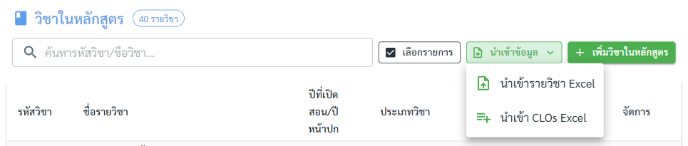<figcaption>
ปุ่ม "เพิ่มวิชาในหลักสูตร" และเมนู "นำเข้าข้อมูล"
</figcaption></figure>

### 1.1 เพิ่มทีละวิชา



#### กด "เพิ่มวิชาในหลักสูตร"

ระบบเปิดฟอร์มที่มี 4 แท็บ

> ถ้าหลักสูตรมี **หน่วยงานบริหารจัดการมากกว่า 1 หน่วยงาน** ให้เลือกหน่วยงานก่อน เพราะเลขรหัสวิชาตัวหน้าจะเปลี่ยนตามหน่วยงาน



#### แท็บ 1 — ข้อมูลรายวิชา

**รหัสวิชา มี 2 รูปแบบ** ระบบเลือกรูปแบบให้ตาม **ปีหน้าปกของหลักสูตร**

<table><thead><tr><th width="170">รูปแบบ</th><th width="250">ใช้เมื่อ</th><th>ตัวอย่าง</th></tr></thead><tbody><tr><td><strong>① แบบมีขีด</strong></td><td>หลักสูตรปีหน้าปก <strong>ก่อน 2571</strong> (ค่าเริ่มต้น)</td><td><code>500-101</code>, <code>464-311</code></td></tr><tr><td><strong>② แบบใหม่ 10 หลัก</strong></td><td>หลักสูตรปีหน้าปก <strong>2571 ขึ้นไป</strong> ใช้อัตโนมัติ (เปลี่ยนกลับเป็นแบบมีขีดไม่ได้) หลักสูตรก่อน 2571 เลือกใช้ได้ โดยกดปุ่ม <strong>"รหัสวิชารูปแบบใหม่"</strong></td><td><code>ENG01D1001</code></td></tr></tbody></table>

**① แบบมีขีด**

<figure>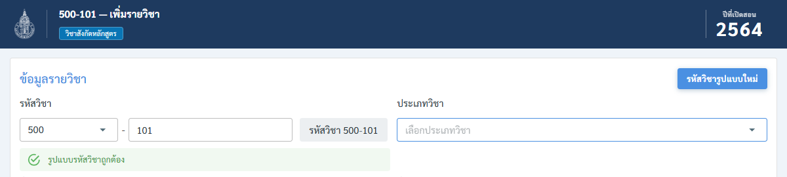<figcaption>
ตัวหน้า (500) ระบบเติมให้ตามหน่วยงาน กรอกเฉพาะตัวหลัง (101) ช่องสีเทาแสดงรหัสที่ได้ "รหัสวิชา 500-101" และขึ้น ✓ รูปแบบรหัสวิชาถูกต้อง
</figcaption></figure>

1. ตัวหน้า: ระบบเติมให้ตามหน่วยงานบริหารจัดการ (ถ้ามีหลายหน่วยงาน เลือกจากรายการได้)
2. ตัวหลัง: กรอกเลขรายวิชา เช่น `101`
3. ถ้าตัวหลังลงท้ายด้วย **G** หรือ **G1–G8** ระบบจะเตือน เพราะเป็นรูปแบบรหัสวิชา GE

**② แบบใหม่ 10 หลัก**

<figure>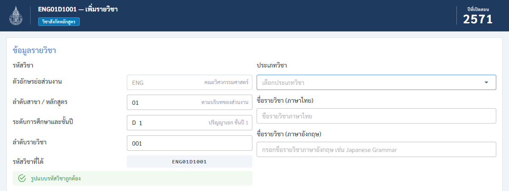<figcaption>
ตัวอย่างหลักสูตรปริญญาเอก ปีหน้าปก 2571: ENG + 01 + D1 + 001 = ENG01D1001
</figcaption></figure>

รหัส 10 หลักประกอบจาก 4 ช่อง (ระบบรวมให้ในช่อง **"รหัสวิชาที่ได้"**)

| ช่อง | กรอกอะไร | ตัวอย่าง |
| --- | --- | --- |
| **ตัวอักษรย่อส่วนงาน** | ระบบเติมให้ตามคณะ (แก้ไม่ได้) | `ENG` = คณะวิศวกรรมศาสตร์ |
| **ลำดับสาขา / หลักสูตร** | ตัวเลข 2 หลัก ตามที่ส่วนงานกำหนด | `01` |
| **ระดับการศึกษาและชั้นปี** | ตัวอักษรระดับการศึกษาระบบเติมให้ตามหลักสูตร (เช่น `B` = ปริญญาตรี, `D` = ปริญญาเอก) **กรอกชั้นปี 1 ตัว** (1–6) | `D` + `1` |
| **ลำดับรายวิชา** | ตัวเลข 3 หลัก | `001` |

เมื่อกรอกครบและถูกต้อง จะขึ้น ✓ **รูปแบบรหัสวิชาถูกต้อง** และหัวฟอร์มเปลี่ยนเป็นรหัสที่ได้ (เช่น "ENG01D1001 — เพิ่มรายวิชา")


**หลักสูตรก่อน 2571 อยากใช้รหัส 10 หลัก:** กดปุ่ม **"รหัสวิชารูปแบบใหม่"** มุมขวาของกล่องข้อมูลรายวิชา ฟอร์มจะเปลี่ยนเป็นช่องกรอก 10 หลัก ถ้าต้องการกลับ กดปุ่ม **"รหัสวิชารูปแบบเดิม"** (ตัวเลขที่เคยกรอกแบบมีขีดจะกลับมา)

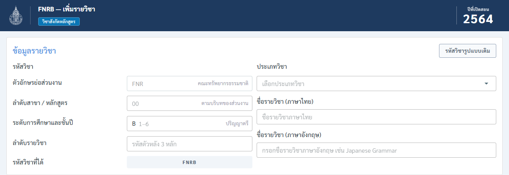


กรอกต่อ: ประเภทวิชา \* · ชื่อไทย \* / อังกฤษ · คำอธิบายรายวิชา · หน่วยกิตและชั่วโมง · ประเภทห้องเรียน · Active Learning · หมายเหตุ


* ระบบเตือนทันทีถ้า **รหัสซ้ำ** กับวิชาอื่นในปีการศึกษาเดียวกัน (พร้อมบอกว่าหลักสูตรไหนใช้อยู่)
* **คำอธิบายภาษาไทย** ต้องมีอักษรไทยอย่างน้อย 1 ตัว และ **ภาษาอังกฤษ** ห้ามมีอักษรไทย




#### แท็บ 2 — รายวิชาที่บังคับเรียนก่อน/ควบ

<figure>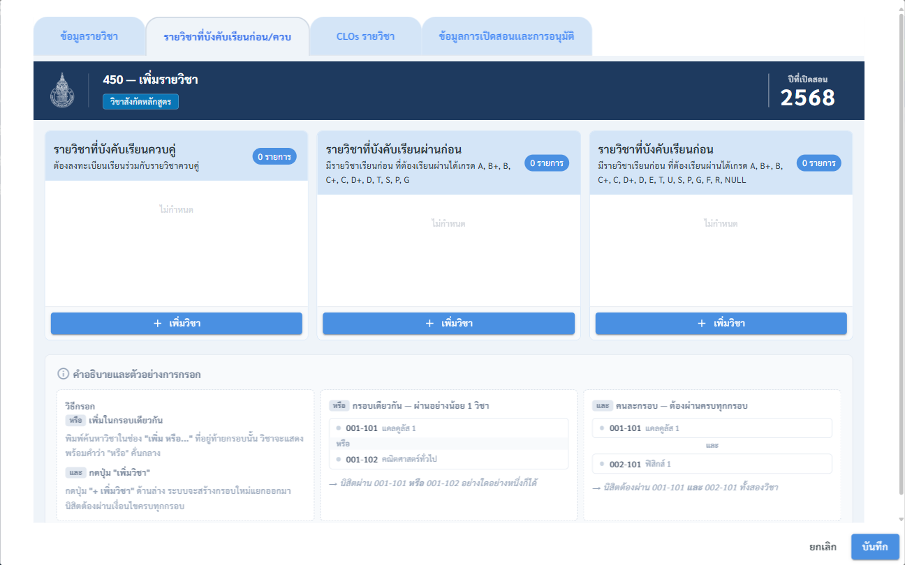<figcaption>
มี 3 กล่อง พร้อมคำอธิบายวิธีกรอก "หรือ" / "และ" ด้านล่าง
</figcaption></figure>

<table><thead><tr><th width="120">ต้องการ</th><th>วิธีกรอก</th><th>ตัวอย่าง</th></tr></thead><tbody><tr><td><strong>หรือ</strong></td><td>พิมพ์ค้นหาในช่อง <strong>"เพิ่ม หรือ..."</strong> ท้ายกรอบเดิม</td><td>ผ่าน 001-101 <strong>หรือ</strong> 001-102 อย่างใดอย่างหนึ่ง</td></tr><tr><td><strong>และ</strong></td><td>กดปุ่ม <strong>"+ เพิ่มวิชา"</strong> เพื่อสร้างกรอบใหม่</td><td>ต้องผ่าน 001-101 <strong>และ</strong> 002-101 ทั้งสองวิชา</td></tr></tbody></table>



#### แท็บ 3 — CLOs รายวิชา

<figure>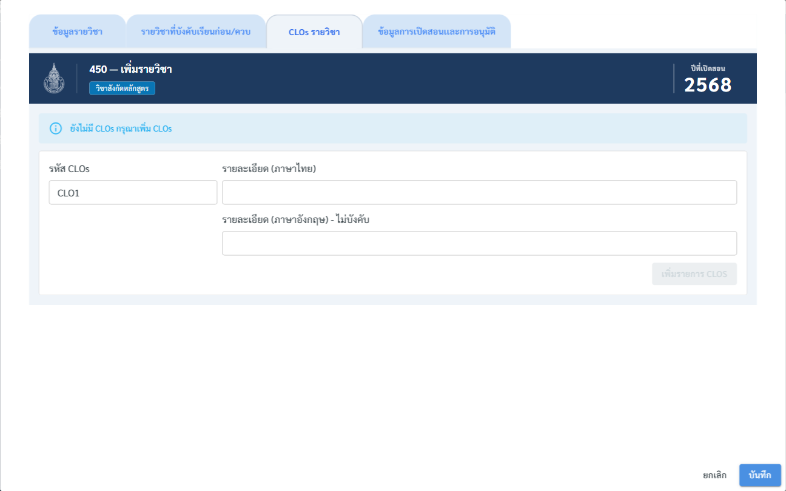<figcaption>
รหัส CLO รันให้อัตโนมัติ
</figcaption></figure>

กรอกรายละเอียดภาษาไทย \* (อังกฤษไม่บังคับ) → กด **"เพิ่มรายการ CLOs"** ทำซ้ำจนครบทุกข้อ



#### แท็บ 4 — ข้อมูลการเปิดสอนและการอนุมัติ

<figure>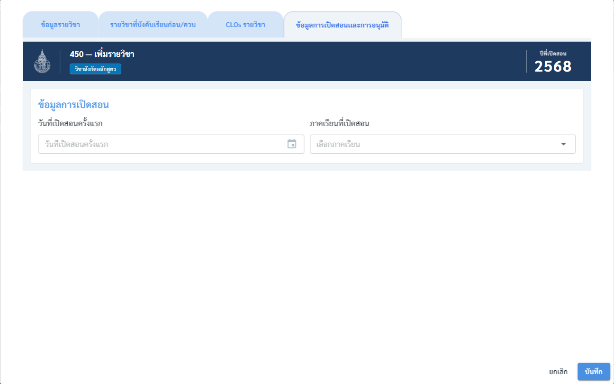<figcaption></figcaption></figure>

วันที่เปิดสอนครั้งแรก · ภาค/ปีที่เปิดสอน · สถานะการใช้งาน (ถ้าปิดใช้งาน ต้องกรอกวันที่ ภาค ปีที่ปิด) · การบังคับใช้กับคณะ (ถ้ามี)



#### กด "บันทึก"

ถ้ายังไม่มี CLOs ระบบจะถาม **"บันทึกโดยไม่มี CLOs?"** บันทึกต่อได้ แต่ **รายวิชาที่ไม่มี CLOs จะอนุมัติเปิดใช้งานไม่ได้**

> กด "ยกเลิก" ระหว่างกรอก ระบบจะถาม **"ออกโดยไม่บันทึก"** — ข้อมูลที่กรอกไว้จะหายทั้งหมด



### 1.2 นำเข้ารายวิชาด้วย Excel



#### ดาวน์โหลด Template

เมนู **"นำเข้าข้อมูล" → "นำเข้ารายวิชา Excel"** → กด **"ดาวน์โหลด Template (.xlsx)"**



#### กรอกไฟล์

คอลัมน์บังคับ: รหัสวิชา · ประเภทวิชา · ชื่อรายวิชา (ไทย) · หน่วยกิตรวม (และหน่วยงาน ถ้าหลักสูตรมีหลายหน่วยงาน)

ช่องรายวิชาบังคับก่อน/ควบ ใช้ **`/` = หรือ** และ **`,` = และ** เช่น `001-101/001-102, 002-101`



#### อัปโหลดและตรวจผล

รับเฉพาะ **.xlsx** สูงสุด **300 แถว** แต่ละแถวจะขึ้น ✅ ถูกต้อง หรือ ❌ ผิดพลาด — แก้รหัส/ประเภทวิชาในหน้านั้นได้ แถวที่ผิดพลาด **จะไม่ถูกนำเข้า**



#### กด "นำเข้า N รายวิชา"

ระบบบันทึกทันที



> **นำเข้า CLOs Excel:** 1 แถว = 1 CLO ถ้าวิชามีหลาย CLO ให้ใส่หลายแถวด้วยรหัสวิชาเดียวกัน (รหัสวิชาต้องมีในหลักสูตรแล้ว)

### 1.3 แชร์ / ลบรายวิชา

🔗 ให้หลักสูตรอื่นใช้รายวิชานี้ร่วม

เปิดสวิตช์ **"ใช้งานร่วม/แชร์"** ที่แถวรายวิชา หลักสูตรอื่นจะค้นเจอและใส่ในโครงสร้างได้ทันที (จะเห็นป้าย "วิชานอกหลักสูตร") ถ้าปิดสวิตช์ขณะมีหลักสูตรอื่นใช้อยู่ ระบบจะถามยืนยันพร้อมบอกจำนวนหลักสูตรที่ใช้

🗑️ ลบรายวิชา

* ถ้ารายวิชายังอยู่ในโครงสร้างหลักสูตรใด ๆ จะลบไม่ได้ ระบบเปิดหน้าต่าง **"ไม่สามารถลบรายวิชาได้"** ซึ่งบอกทุกตำแหน่งที่ใช้อยู่ (หลักสูตร · วิชาเอก · แผน · หมวด · กลุ่ม · กลุ่มย่อย)
* ลบหลายรายการ: **"เลือกรายการ"** → ติ๊ก → **"ลบที่เลือก"** ระบบข้ามวิชาที่ยังใช้อยู่ให้อัตโนมัติ
* แก้ไขรายวิชาที่จัดลงแผนการเรียนแล้ว **จะลดหน่วยกิตไม่ได้** ต้องเอาออกจากแผนการเรียนก่อน

***

## ขั้นตอนที่ 2: สร้างแผนการศึกษา (แท็บ "แผนการศึกษา")

### 2.1 ทำความเข้าใจลำดับชั้นก่อน

<table><thead><tr><th width="60">ชั้น</th><th width="190">ระดับ</th><th>คืออะไร</th><th width="170">มีทุกหลักสูตรไหม</th></tr></thead><tbody><tr><td>1</td><td>🎓 <strong>วิชาเอก</strong></td><td>สาขาย่อยของ<strong>ทั้งหลักสูตร</strong> — แต่ละเอกมีแผนของตัวเอง</td><td>เฉพาะหลักสูตรที่แบ่งเอก</td></tr><tr><td>2</td><td>📘 <strong>แผนการศึกษา</strong></td><td>เช่น แผนปริญญาตรี — มีหน่วยกิตรวม/ระยะเวลาของตัวเอง</td><td>ทุกหลักสูตร อย่างน้อย 1 แผน</td></tr><tr><td>3</td><td>⚙️ <strong>ตัวเลือกโครงสร้างของแผน</strong></td><td>แยกโครงสร้าง<strong>ภายในแผนเดียว</strong> เช่น ปกติ/สหกิจ, เอกเดี่ยว/เอก-โท</td><td>เฉพาะแผนที่ต้องแยก</td></tr><tr><td>4</td><td>🗂️ <strong>หมวดวิชา</strong></td><td>เช่น หมวดวิชาศึกษาทั่วไป, หมวดวิชาเฉพาะ</td><td>ทุกแผน</td></tr><tr><td>5</td><td>📁 <strong>กลุ่ม</strong></td><td>เช่น กลุ่มวิชาแกน, กลุ่มวิชาบังคับ</td><td>ทุกหมวด (อย่างน้อย "ไม่ระบุกลุ่ม")</td></tr><tr><td>6</td><td>📄 <strong>กลุ่มย่อย</strong></td><td>แบ่งในกลุ่มอีกชั้น (รวม Minor และกลุ่มสาระ GE) ซ้อนได้หลายชั้น</td><td>เฉพาะที่ต้องแยกย่อย</td></tr><tr><td>7</td><td>📚 <strong>รายวิชา</strong></td><td>ตัวรายวิชาจริง</td><td>—</td></tr></tbody></table>

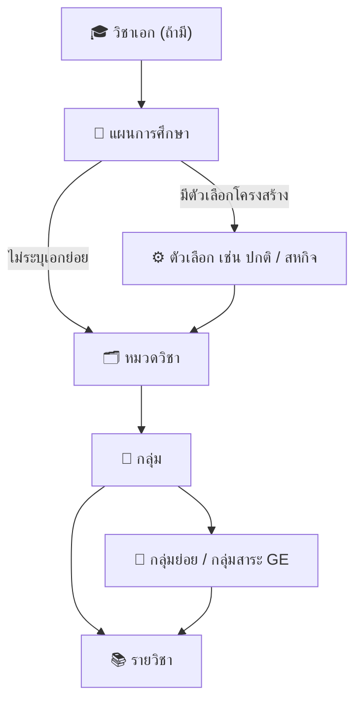


**"วิชาเอก" ≠ "ตัวเลือกโครงสร้างของแผน"** — วิชาเอกแบ่ง**ทั้งหลักสูตร** (ได้หลายแผน) ส่วนตัวเลือกโครงสร้างแยก**ภายในแผนเดียว** ใช้ร่วมกันได้ และไม่บังคับต้องมีทั้งคู่


### 2.2 หน้ารายการแผน

**ตัวอย่างที่ 1 — หลักสูตรที่แบ่งวิชาเอก** (วศ.บ. วิศวกรรมเซมิคอนดักเตอร์ มี 3 วิชาเอก) แต่ละเอกเป็นการ์ดแยก มีปุ่ม **"เพิ่มแผนการศึกษาในวิชาเอกนี้"** และปุ่มคัดลอกทั้งวิชาเอก (ไอคอนที่หัวการ์ด)

<figure>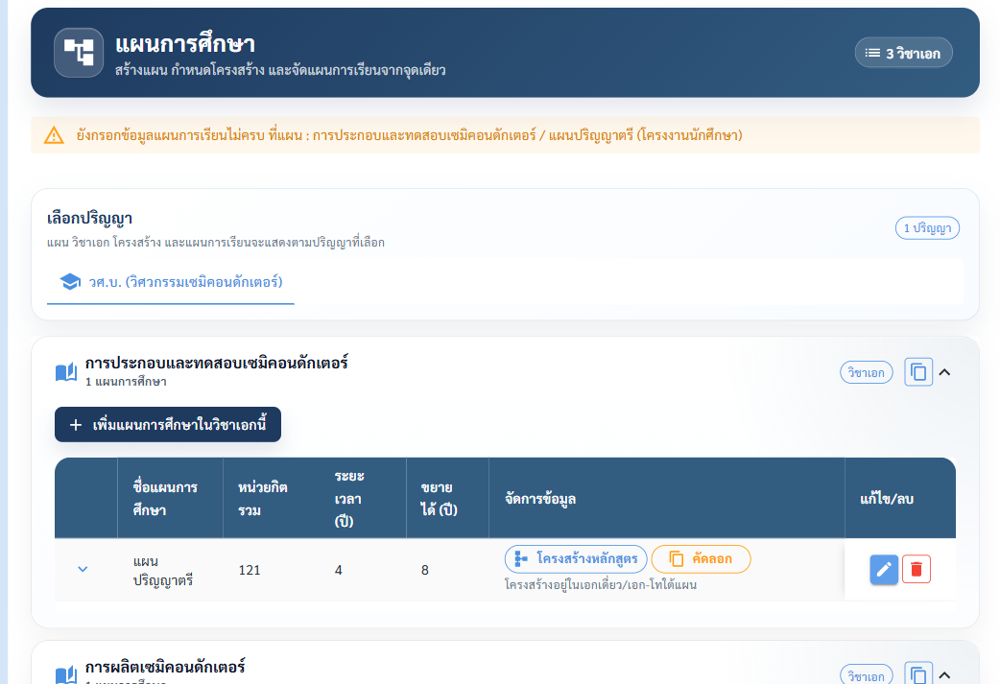<figcaption>
แถบสีส้มเตือนว่าแผนไหนยังกรอกแผนการเรียนไม่ครบ
</figcaption></figure>

**ตัวอย่างที่ 2 — แผนที่มีตัวเลือกโครงสร้าง** (บช.บ. บัญชีบัณฑิต) กดลูกศรหน้าแถวเพื่อขยาย จะเห็นการ์ดตัวเลือก 4 แบบ แต่ละการ์ดมีปุ่ม **โครงสร้าง · แผนการเรียน · คัดลอก** ของตัวเอง

<figure>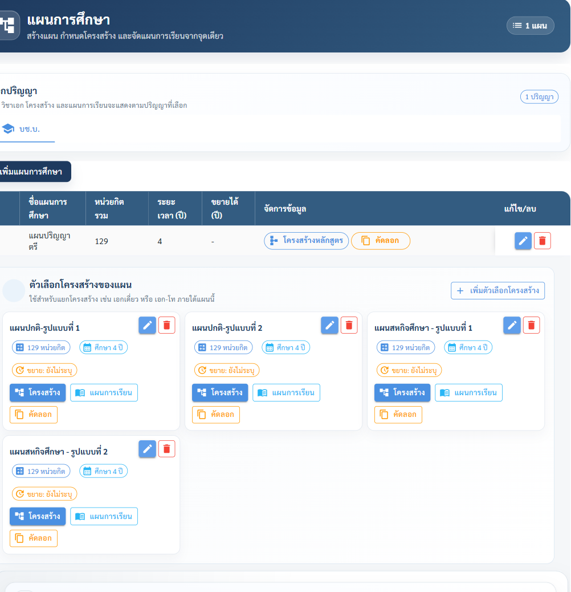<figcaption>
แผนปริญญาตรี แยกเป็น แผนปกติ/สหกิจศึกษา รูปแบบที่ 1–2
</figcaption></figure>


* หลักสูตรที่มีหลายปริญญา จะมีแท็บ **"เลือกปริญญา"** ด้านบน
* แผนที่ยังไม่ได้เลือกชุด PLO จะมีไอคอนเตือน **"กรุณาเลือกชุด PLO"**


### 2.3 เพิ่มแผนการศึกษา



#### กด "เพิ่มแผนการศึกษา"

(หลักสูตรที่แบ่งเอก ให้กด "เพิ่มแผนการศึกษาในวิชาเอกนี้" ในการ์ดของเอกนั้น)



#### กรอกฟอร์ม

<figure>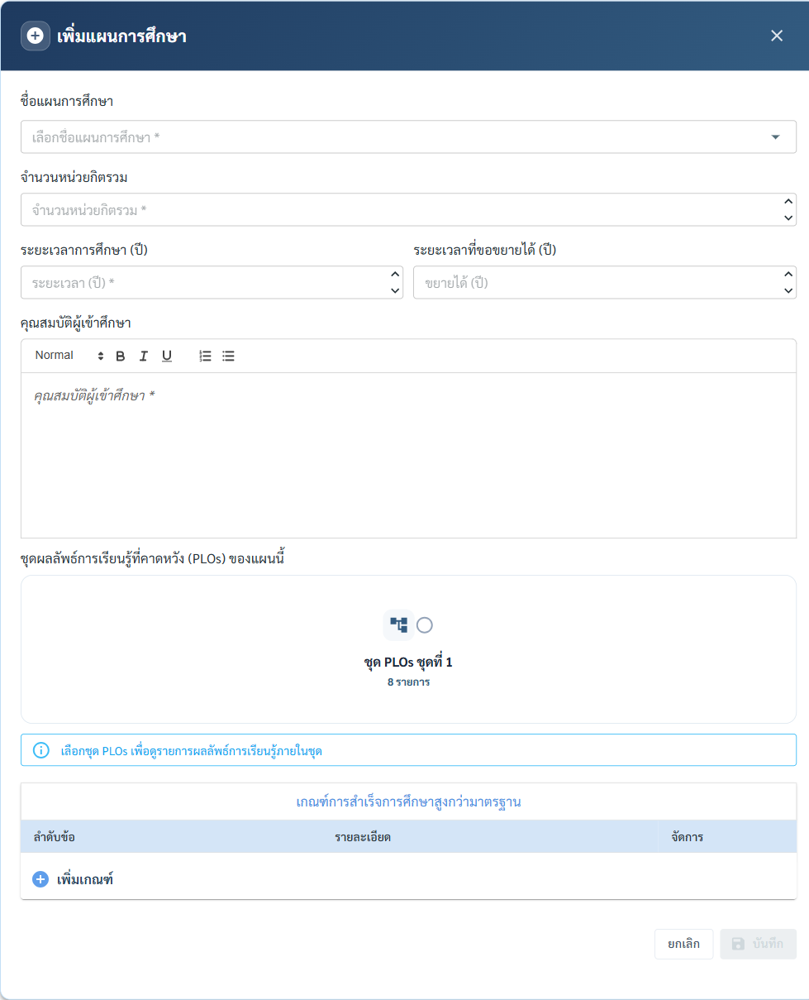<figcaption></figcaption></figure>

<table><thead><tr><th width="260">ฟิลด์</th><th>หมายเหตุ</th></tr></thead><tbody><tr><td>ชื่อแผนการศึกษา *</td><td>เลือกจากรายการตามระดับการศึกษา ชื่อที่ใช้แล้วจะเลือกซ้ำไม่ได้</td></tr><tr><td>จำนวนหน่วยกิตรวม * · ระยะเวลา (ปี) * · ขยายได้ (ปี)</td><td>เช่น 129 หน่วยกิต · 4 ปี</td></tr><tr><td>คุณสมบัติผู้เข้าศึกษา *</td><td></td></tr><tr><td>ชุด PLOs ของแผนนี้</td><td>กดการ์ดชุด PLO ที่ต้องการ (ต้องมีชุด PLO ในหลักสูตรก่อน)</td></tr><tr><td>เกณฑ์การสำเร็จการศึกษาสูงกว่ามาตรฐาน</td><td>กด "เพิ่มเกณฑ์" (ลำดับข้อ + รายละเอียด) ไม่บังคับ</td></tr></tbody></table>



#### กดบันทึก



**ดูข้อมูลแผนที่บันทึกแล้ว:** กดลูกศรหน้าแถวแผน (หรือปุ่ม "โครงสร้างหลักสูตร") จะเห็น ตัวเลือกโครงสร้าง · คุณสมบัติผู้เข้าศึกษา · เกณฑ์การสำเร็จการศึกษา · ชุด PLOs ของแผน

<table><thead><tr><th width="260">เกณฑ์การสำเร็จการศึกษา</th><th>ต้องทำอะไร</th></tr></thead><tbody><tr><td><strong>เกณฑ์มาตรฐาน</strong> (ชิป "มาตรฐาน พ.ศ. 25xx")</td><td>ไม่ต้องทำ — ระบบดึงจากเกณฑ์มาตรฐานที่หลักสูตรใช้ แก้ไขไม่ได้</td></tr><tr><td><strong>เกณฑ์สูงกว่ามาตรฐาน</strong></td><td>กรอกในฟอร์มแผน (ปุ่ม ✏️ แก้ไขแผน) → "เพิ่มเกณฑ์" ระบุลำดับข้อ + รายละเอียด เช่น "ต้องได้รับคะแนนเฉลี่ยไม่ต่ำกว่า 2.00"</td></tr></tbody></table>

✏️ แก้ไข / ลบแผนการศึกษา

* **แก้ไข:** กด ✏️ ที่คอลัมน์ "แก้ไข/ลบ" — ถ้าเอา PLO ที่จับคู่ I/R/M กับรายวิชาแล้วออกจากแผน ระบบจะถามยืนยัน เพราะ I/R/M ของ PLO นั้นจะถูกลบด้วย
* **ลบ:** กด 🗑️ — ต้องกรอก CAPTCHA เพราะโครงสร้างและแผนการเรียนทั้งหมดของแผนนั้นจะถูกลบไปด้วย

### 2.4 (ถ้ามี) เพิ่มตัวเลือกโครงสร้างของแผน

ใช้เมื่อแผนเดียวมีโครงสร้างหลายแบบ เช่น แผนปกติ/สหกิจศึกษา หรือ เอกเดี่ยว/เอก-โท ถ้าไม่มี ข้ามไปขั้นตอนที่ 3 ได้เลย (แผนจะใช้โหมด **"ไม่ระบุเอกย่อย"**)



#### ขยายแถวแผน แล้วกด "เพิ่มตัวเลือกโครงสร้าง"

<figure>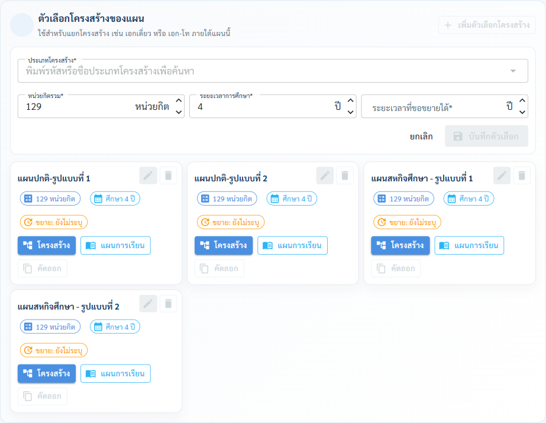<figcaption></figcaption></figure>



#### เลือกประเภทโครงสร้าง แล้วกรอกหน่วยกิต/ระยะเวลา

ค่าหน่วยกิตรวม/ระยะเวลาเริ่มต้นตามแผน แก้ได้ถ้าตัวเลือกนี้ต่างจากแผน (เช่น เอก-โท เรียนหน่วยกิตมากกว่า)



#### กด "บันทึกตัวเลือก" ทำซ้ำจนครบทุกตัวเลือก




* **สลับโหมด** "ไม่ระบุเอกย่อย" ↔ "ตัวเลือกโครงสร้าง" ได้ตลอด แต่ระบบจะ **ลบโครงสร้างเดิมทั้งหมดของแผน** (หมวด กลุ่ม รายวิชา และแผนการเรียน) ต้องกรอก CAPTCHA และย้อนกลับไม่ได้
* ตัวเลือกที่ยังมีหมวด/กลุ่ม/รายวิชาอยู่ **ลบไม่ได้** ต้องลบข้างในให้หมดก่อน


📋 คัดลอกโครงสร้างไปแผน/เอกอื่น

<table><thead><tr><th width="200">ระดับ</th><th>ปุ่มอยู่ที่</th></tr></thead><tbody><tr><td>ทั้งวิชาเอก</td><td>ไอคอนคัดลอกบนการ์ดวิชาเอก</td></tr><tr><td>ทั้งแผน</td><td>"คัดลอก" ที่แถวแผน</td></tr><tr><td>ตัวเลือกโครงสร้าง</td><td>"คัดลอก" บนการ์ดตัวเลือก</td></tr></tbody></table>

เลือกปลายทางได้หลายรายการ ระบบจะ **ล้างข้อมูลปลายทางก่อนแล้วจึงคัดลอก** (เขียนทับ) จึงต้องกรอก CAPTCHA ทุกครั้ง

⚠️ เจอแถบ "พบแผนที่ต้องจัดตำแหน่ง"

เกิดเมื่อแผนผูกกับเอก/แขนงที่ไม่มีแล้ว (เช่น เปลี่ยนการตั้งค่าวิชาเอกในหมวดที่ 1)

* **"จัดตำแหน่งแผน"** → ย้ายไปผูกกับเอก/แขนงที่ถูกต้อง โครงสร้างในแผนยังอยู่ครบ
* **"ลบข้อมูลค้าง"** → ใช้เมื่อไม่มีปลายทางให้ย้ายเท่านั้น

***

## ขั้นตอนที่ 3: ใส่รายวิชาลงโครงสร้าง (ปุ่ม "โครงสร้าง")

กดปุ่ม **"โครงสร้าง"** ของแผน (หรือของตัวเลือกโครงสร้าง) ระบบเปิดพื้นที่ทำงานในหน้าเดิม:

<figure>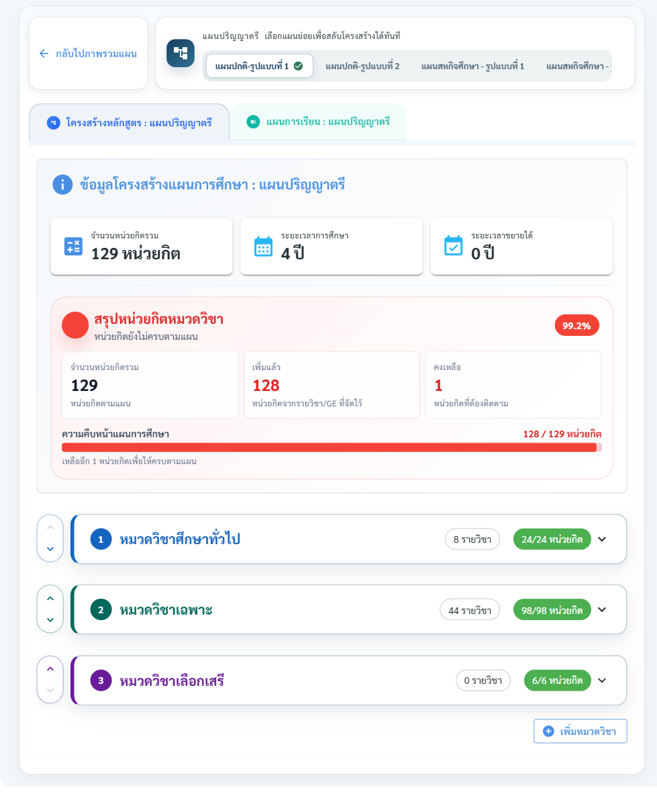<figcaption>
ตัวอย่างบัญชีบัณฑิต แผนปกติ-รูปแบบที่ 1: ผูกหน่วยกิตแล้ว 128 จาก 129 จึงเป็นสีแดง
</figcaption></figure>

<table><thead><tr><th width="240">ส่วน</th><th>ใช้ทำอะไร</th></tr></thead><tbody><tr><td><strong>แถบบนสุด</strong></td><td>"กลับไปภาพรวมแผน" และชิปสลับตัวเลือกโครงสร้างได้ทันที</td></tr><tr><td><strong>2 แท็บ</strong></td><td>"โครงสร้างหลักสูตร" (ขั้นตอนนี้) · "แผนการเรียน" (ขั้นตอนที่ 4)</td></tr><tr><td><strong>สรุปหน่วยกิตหมวดวิชา</strong></td><td>🟢 ครบตามแผน · 🔴 ยังไม่ครบ (บอกว่าเหลืออีกกี่หน่วยกิต) หรือเกินแผน</td></tr><tr><td><strong>การ์ดหมวดวิชา</strong></td><td>กดเพื่อขยาย ลูกศร ↑↓ ด้านซ้ายใช้เลื่อนลำดับหมวด</td></tr></tbody></table>


**ตัวอย่างการอ่านการ์ดสรุป:** บัญชีบัณฑิต แผน 129 หน่วยกิต มี 3 หมวด คือ ศึกษาทั่วไป 24 + วิชาเฉพาะ 98 + เลือกเสรี 6 = **128** จึงขึ้น "เหลืออีก 1 หน่วยกิตเพื่อให้ครบตามแผน" — ต้องเพิ่มหน่วยกิตในหมวดใดหมวดหนึ่งอีก 1 จึงจะเป็นสีเขียว


### 3.1 เพิ่มหมวดวิชา



#### กด "เพิ่มหมวดวิชา" (ท้ายรายการหมวด)



#### เลือกชื่อหมวดวิชา และกรอกจำนวนหน่วยกิต

หมวดที่ใช้แล้วในแผนนี้จะไม่แสดงให้เลือกซ้ำ ใต้ช่องหน่วยกิตจะบอกว่า "กำหนดได้ไม่เกิน X หน่วยกิต" — **ผลรวมทุกหมวดต้องไม่เกินหน่วยกิตรวมของแผน**



#### กด "บันทึกหมวดวิชา"

**ต้องบันทึกก่อน** จึงจะเพิ่มกลุ่ม/รายวิชาในหมวดได้



#### (ไม่บังคับ) ใส่หมายเหตุ

กดไอคอนดินสอในแถบ "ยังไม่มีหมายเหตุ" → พิมพ์ → กด ✓



**ตัวอย่าง — หมวดวิชาเลือกเสรีที่ไม่ต้องระบุรายวิชา:** ติ๊ก **"เลือกเรียนวิชาใดก็ได้"** ระบบนับหน่วยกิตเต็ม (6/6) โดยไม่ต้องใส่รายวิชา

<figure>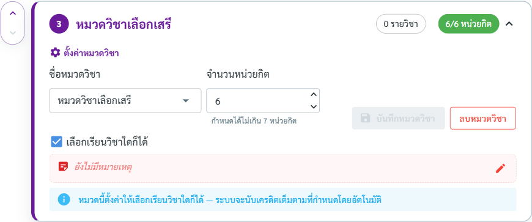<figcaption>
0 รายวิชา แต่นับครบ 6/6 หน่วยกิต
</figcaption></figure>


* ช่อง **"เลือกเรียนวิชาใดก็ได้"** มีเฉพาะหมวดที่ชื่อมีคำว่า "วิชาเลือก" / "เลือกเสรี" (ยกเว้นหมวดวิทยานิพนธ์/สารนิพนธ์)
* ถ้าหมวดมีรายวิชาอยู่แล้วแล้วไปติ๊ก ระบบจะถามยืนยัน — รายวิชาเดิมยังเก็บไว้ แต่จะไม่ถูกนับหน่วยกิต
* หมวดที่ชื่อมีคำว่า **"ศึกษาทั่วไป"** จะเป็นหมวด GE อัตโนมัติ (ปุ่มเพิ่มรายวิชาเปลี่ยนเป็นชุดของ GE)


### 3.2 เพิ่มกลุ่มในหมวด

**ทางลัด:** ถ้าหมวดนั้นไม่แบ่งกลุ่ม ให้กดปุ่มเพิ่มรายวิชาท้ายหมวดได้เลย รายวิชาจะเข้ากลุ่ม **"ไม่ระบุกลุ่ม"** ให้อัตโนมัติ (เช่น หมวดศึกษาทั่วไปของบัญชีบัณฑิตด้านล่าง)

ถ้าต้องแบ่งกลุ่ม:



#### กด "เพิ่มกลุ่ม" แล้วค้นหาชื่อกลุ่ม

พิมพ์รหัสหรือชื่อกลุ่ม (แต่ละกลุ่มใช้ได้ครั้งเดียวต่อหมวด) ถ้าไม่มีชื่อที่ต้องการ กดปุ่ม **"+"** ข้างช่อง เพื่อ **เพิ่มชื่อกลุ่ม** ใหม่

<figure>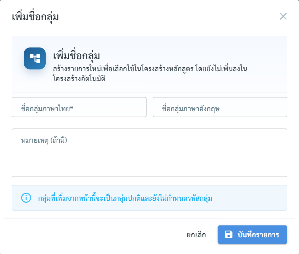<figcaption>
ชื่อไทย * · ชื่ออังกฤษ · หมายเหตุ (ชื่อห้ามซ้ำ)
</figcaption></figure>



#### กรอกหน่วยกิตกลุ่ม

<table><thead><tr><th width="220">กรอก</th><th>ผลลัพธ์</th></tr></thead><tbody><tr><td>ตัวเลขมากกว่า 0</td><td>กลุ่มปกติ</td></tr><tr><td><strong>0</strong></td><td><strong>กลุ่ม Audit</strong> — รายวิชาที่เพิ่มจะไม่นับหน่วยกิตทั้งหมด</td></tr><tr><td>ติ๊ก <strong>"ไม่ระบุรายวิชาในกลุ่มนี้"</strong></td><td>นับหน่วยกิตเต็มอัตโนมัติ ไม่ต้องใส่รายวิชา (ติ๊กได้เฉพาะตอนกลุ่มยังว่าง และไม่ใช่หมวดศึกษาทั่วไป)</td></tr></tbody></table>



#### กด "บันทึกกลุ่ม"

ปุ่มเพิ่มรายวิชาในกลุ่มจะกดไม่ได้จนกว่าจะกรอกหน่วยกิตและบันทึกกลุ่ม



**ตัวอย่าง — กลุ่มที่บันทึกแล้ว** (บัญชีบัณฑิต หมวดวิชาเฉพาะ › กลุ่มวิชาแกน 23 หน่วยกิต)

<figure>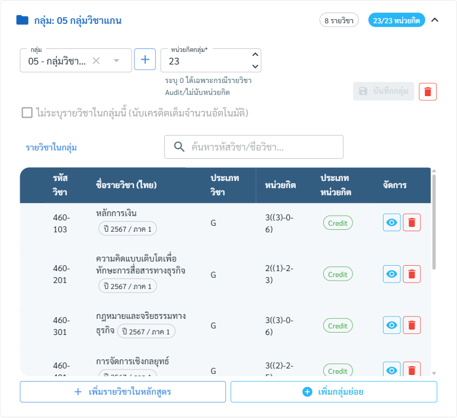<figcaption>
คอลัมน์ "ประเภทหน่วยกิต" บอกว่าวิชานับหน่วยกิต (Credit) หรือไม่นับ (Audit)
</figcaption></figure>

### 3.3 วิธีใส่รายวิชาลงโครงสร้าง (ทุกแบบ)

<table><thead><tr><th width="240">ปุ่ม</th><th width="230">ใช้ได้ที่</th><th>ค้นหาได้จาก</th></tr></thead><tbody><tr><td><strong>เพิ่มรายวิชาในหลักสูตร</strong></td><td>หมวดที่ไม่ใช่ศึกษาทั่วไป</td><td>① วิชาของหลักสูตรนี้ ② วิชาที่หลักสูตรอื่นแชร์ (ป้าย <strong>"วิชานอกหลักสูตร"</strong>) ③ รายวิชากลางคณะ (ป้าย <strong>"วิชากลาง"</strong>)</td></tr><tr><td><strong>เพิ่มวิชาศึกษาทั่วไป</strong></td><td>หมวดศึกษาทั่วไป หรือหมวดที่อนุญาตวิชาประเภท G</td><td>วิชา GE กลางของมหาวิทยาลัย</td></tr><tr><td><strong>เพิ่มกลุ่มสาระ GE</strong></td><td>หมวดศึกษาทั่วไปเท่านั้น</td><td>กลุ่มสาระ GE กลาง (ที่มีในหมวดแล้วจะไม่แสดง)</td></tr><tr><td><strong>เพิ่มกลุ่มย่อย</strong></td><td>ทุกหมวด</td><td>กลุ่มย่อยหลัก + Minor (เลือกได้หลายรายการ)</td></tr><tr><td>ไอคอนในแถวกลุ่มย่อย/GE</td><td>แถวกลุ่มย่อยที่บันทึกแล้ว</td><td>ดูตารางไอคอนด้านล่าง</td></tr></tbody></table>

#### แบบที่ 1: เพิ่มรายวิชาในหลักสูตร



#### กด "เพิ่มรายวิชาในหลักสูตร" ท้ายกลุ่ม แล้วพิมพ์ค้นหาอย่างน้อย 2 ตัวอักษร

<figure>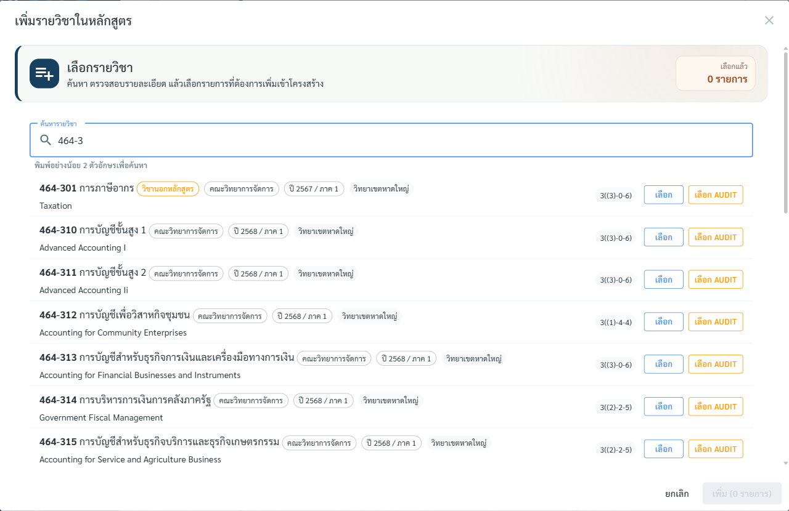<figcaption>
ตัวอย่างค้นหา "464-3" — 464-301 มีป้าย "วิชานอกหลักสูตร" เพราะเป็นวิชาที่หลักสูตรอื่นแชร์มา
</figcaption></figure>

วิชาที่อยู่ในกลุ่มนี้แล้วจะไม่แสดงซ้ำ



#### กด "เลือก" หรือ "เลือก AUDIT" ทีละวิชา

<figure>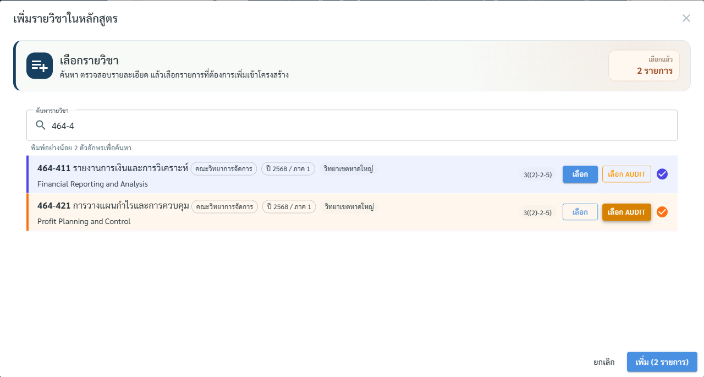<figcaption>
ตัวอย่าง: 464-411 เลือกแบบนับหน่วยกิต (สีน้ำเงิน) · 464-421 เลือกแบบ Audit (สีส้ม)
</figcaption></figure>

<table><thead><tr><th width="160">ปุ่ม</th><th>ผลลัพธ์ในโครงสร้าง</th></tr></thead><tbody><tr><td><strong>เลือก</strong></td><td>นับหน่วยกิต (ป้าย <strong>Credit</strong>)</td></tr><tr><td><strong>เลือก AUDIT</strong></td><td>ไม่นับหน่วยกิตเฉพาะตำแหน่งนี้ (ป้าย <strong>Audit</strong>)</td></tr></tbody></table>



#### กด "เพิ่ม (N รายการ)"

ระบบบันทึกทันที ถ้าวิชาเดียวกันเคยจับคู่ PLO (I/R/M) ไว้ในตำแหน่งเดียวกันของอีกแผนที่ใช้ชุด PLO เดียวกัน ระบบจะ **คัดลอก I/R/M มาให้อัตโนมัติ** (ข้อความแจ้ง "…และคัดลอก IRM X ค่า")




ถ้าเปิดหน้าต่างจาก **กลุ่ม 0 หน่วยกิต** หัวหน้าต่างจะเป็น "เลือกรายวิชาแบบไม่นับหน่วยกิต" และมีแค่ปุ่ม "เลือก AUDIT"


#### แบบที่ 2: เพิ่มกลุ่มย่อย / Minor

<figure>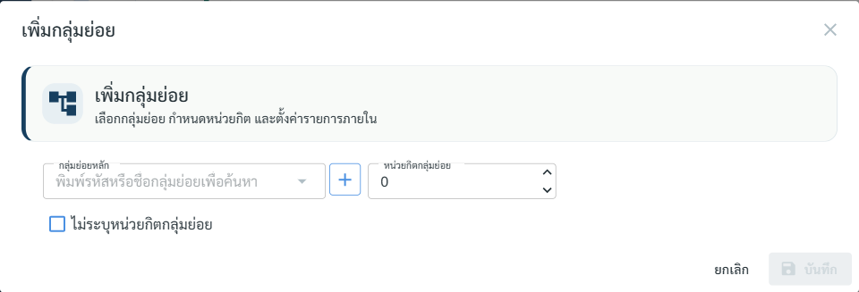<figcaption></figcaption></figure>

1. กด **"เพิ่มกลุ่มย่อย"** → ค้นหา **กลุ่มย่อยหลัก** (หรือกด **"+"** เพื่อเพิ่มชื่อกลุ่มย่อยใหม่)
2. กรอก **หน่วยกิตกลุ่มย่อย** (หรือติ๊ก "ไม่ระบุหน่วยกิตกลุ่มย่อย") → ถ้ามี Minor ให้เลือกได้หลายรายการ พร้อมหน่วยกิตราย Minor
3. กด **"บันทึก"** แล้วใช้ไอคอนในแถวกลุ่มย่อยเพื่อใส่รายวิชา

#### แบบที่ 3: หมวดศึกษาทั่วไป (GE)

**ตัวอย่าง — หมวดวิชาศึกษาทั่วไปของบัญชีบัณฑิต** ใช้กลุ่ม "ไม่ระบุกลุ่ม" และใส่กลุ่มสาระ GE1–GE7 ไว้ รวม 24/24 หน่วยกิต

<figure>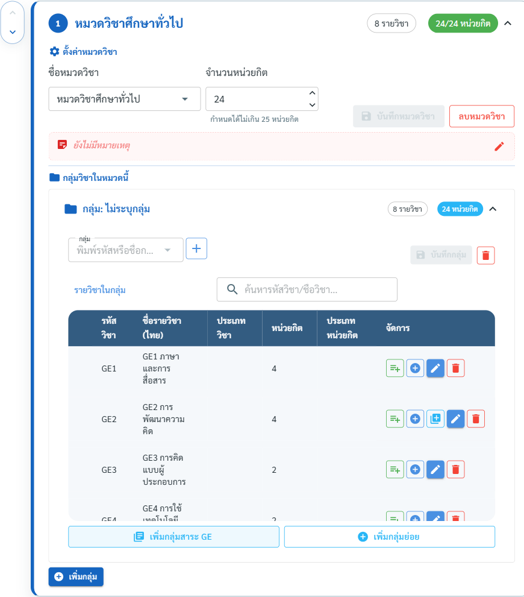<figcaption>
ปุ่มท้ายกลุ่มของหมวด GE คือ "เพิ่มกลุ่มสาระ GE" และ "เพิ่มกลุ่มย่อย"
</figcaption></figure>



#### กด "เพิ่มกลุ่มสาระ GE" แล้วกดสาระที่ต้องการ

<figure>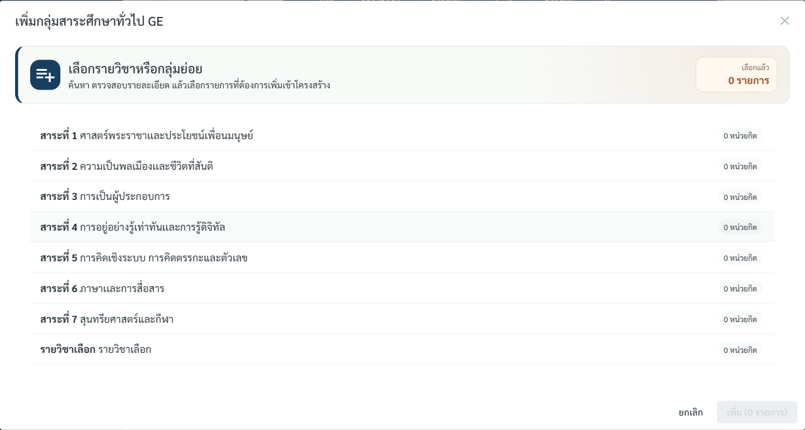<figcaption></figcaption></figure>



#### ระบุหน่วยกิตของสาระนั้น แล้วกด "ยืนยัน"

<figure>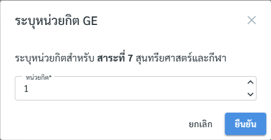<figcaption></figcaption></figure>



#### กด "เพิ่ม (N รายการ)"



**ไอคอนในแถวกลุ่มสาระ GE / กลุ่มย่อย**

<figure><figcaption></figcaption></figure>

<table><thead><tr><th width="230">ไอคอน (ซ้าย → ขวา)</th><th>ใช้ทำอะไร</th></tr></thead><tbody><tr><td>📋 <strong>เพิ่มวิชาในกลุ่ม GE นี้</strong> / <strong>เพิ่มรายวิชาในหลักสูตร</strong></td><td>ใส่รายวิชาเข้ากลุ่มนี้โดยตรง</td></tr><tr><td>⊕ <strong>เพิ่มกลุ่มย่อยภายใน</strong></td><td>ซ้อนกลุ่มย่อยลงไปอีกชั้น (ซ้อนได้ไม่จำกัดชั้น)</td></tr><tr><td>⧉ <strong>เพิ่ม Sub minor</strong></td><td>เฉพาะกลุ่ม GE ที่มี Minor ให้เลือก (ภายในหน่วยกิตคงเหลือของกลุ่มแม่)</td></tr><tr><td>✏️ / 🗑️</td><td>แก้ไข / ลบ</td></tr></tbody></table>

**ตัวอย่าง — เพิ่ม Sub minor ใต้ GE2** ระบบแสดงหน่วยกิตที่เหลือ (4 หน่วยกิต) และ Minor ที่เลือกได้ (GE2A, GE2B)

<figure>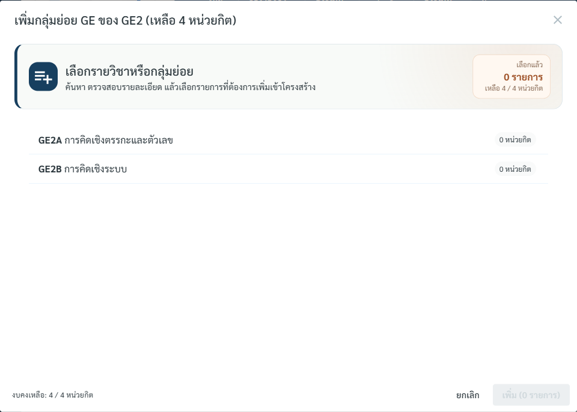<figcaption></figcaption></figure>


ถ้ากลุ่มย่อยมีกลุ่มย่อยลูกอยู่แล้ว จะใส่รายวิชาตรงที่ตัวแม่ไม่ได้ ต้องใส่ที่กลุ่มย่อยลูกแทน (เลือกทางใดทางหนึ่ง)


### 3.4 ตรวจหน่วยกิตให้ครบ

การ์ด **"สรุปหน่วยกิตหมวดวิชา"** ต้องเป็นสีเขียว และชิปหน่วยกิตของทุกหมวด/กลุ่มต้องครบ (เช่น 23/23)

🧮 ระบบคำนวณหน่วยกิตอย่างไร

* **กลุ่ม** = ผลรวมหน่วยกิตของรายวิชา + กลุ่มย่อย/กลุ่มสาระ GE (ไม่รวมวิชา Audit)
* **หมวด** = ผลรวมของทุกกลุ่ม (ถ้าติ๊ก "เลือกเรียนวิชาใดก็ได้" = หน่วยกิตเต็มของหมวด)
* **ทั้งแผน** = ผลรวมของทุกหมวด

✏️ แก้ไข / ลบในโครงสร้าง

* แก้ข้อมูลรายวิชาจากหน้าโครงสร้างไม่ได้ ต้องแก้ที่แท็บ "จัดการรายวิชา"
* ลบหมวด/กลุ่ม/กลุ่มย่อย/รายวิชา: **I/R/M ที่ผูกไว้จะถูกลบด้วย** ถ้ารายการนั้นจัดลงแผนการเรียนแล้ว ต้องกรอก CAPTCHA และระบบจะเอาออกจากทุกปี/ภาคด้วย
* ลดหน่วยกิตกลุ่มย่อย/Minor ที่ใช้ในแผนการเรียนแล้วไม่ได้ ต้องเอาออกจากแผนการเรียนก่อน

***

## ขั้นตอนที่ 4: จัดรายวิชาลงปี/ภาค (แท็บ "แผนการเรียน")

ในพื้นที่ทำงานของแผน กดแท็บ **"แผนการเรียน : {ชื่อแผน}"** (หรือปุ่ม "แผนการเรียน" บนการ์ดตัวเลือกโครงสร้าง)


หารายวิชาไม่เจอ? รายวิชาต้อง **อยู่ในโครงสร้างหลักสูตรก่อน** (ขั้นตอนที่ 3) หน้าต่างจะแสดงเฉพาะรายการที่ **ยังมีหน่วยกิตเหลือให้จัด**


### 4.1 อ่านการ์ด "ความคืบหน้าหน่วยกิตรายหมวด"

**ตัวอย่าง** (วิศวกรรมเซมิคอนดักเตอร์ แผนโครงงานนักศึกษา) — จัดครบ 3 จาก 5 หมวด ยังขาดหมวดศึกษาทั่วไป 6 หน่วยกิต และหมวดวิชาเลือก 9 หน่วยกิต

<figure>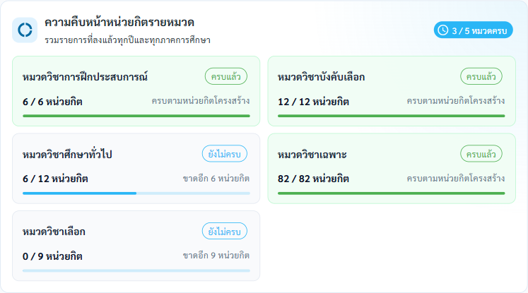<figcaption></figcaption></figure>

> การ์ดนี้นับหน่วยกิตที่ **จัดลงปี/ภาคแล้ว** ต่างจากการ์ด "สรุปหน่วยกิตหมวดวิชา" ในขั้นตอนที่ 3 ที่นับหน่วยกิตที่ **ผูกกับหมวดแล้ว** — ต้องครบทั้งคู่

### 4.2 ตั้งค่าแต่ละปี

แต่ละปี (ปีที่ 1 ถึง N) เลือก **"ประเภทแผนการศึกษา"** ได้อิสระ:

<table><thead><tr><th width="220">ประเภท</th><th>ลักษณะ</th></tr></thead><tbody><tr><td><strong>แผนรายภาคการศึกษา</strong></td><td>แยกการ์ดตามภาค (จำนวนภาคตามหมวดที่ 2 ปกติ 3 ภาค + ภาคฤดูร้อน ถ้าหลักสูตรมี)</td></tr><tr><td><strong>แผนรายปีการศึกษา</strong></td><td>การ์ดเดียว "รายวิชาทั้งปี"</td></tr></tbody></table>

<figure>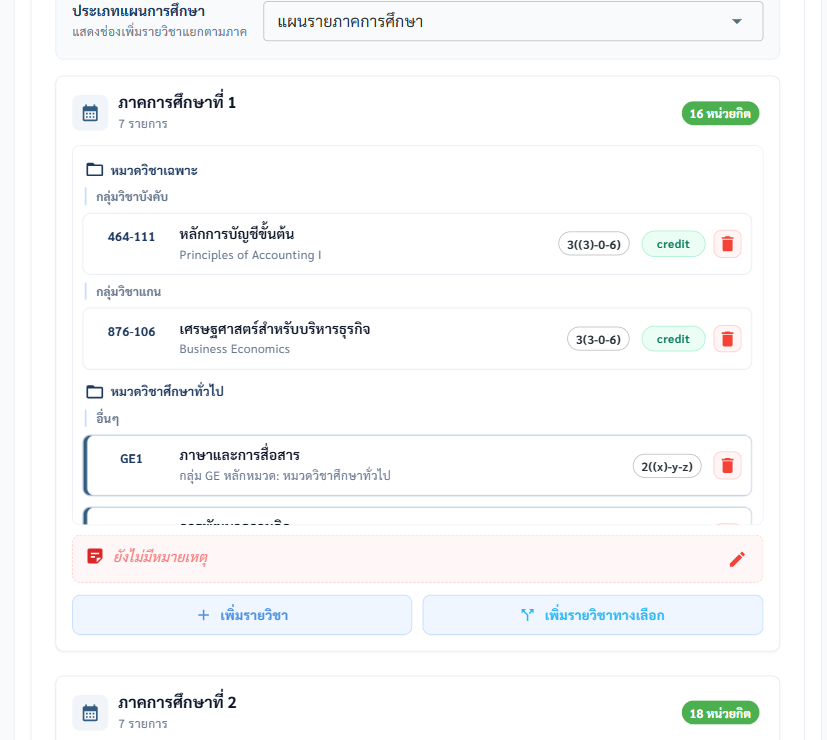<figcaption>
รายวิชาในแต่ละภาคจัดกลุ่มตามหมวด → กลุ่ม แต่ละภาคมีหมายเหตุของตัวเอง
</figcaption></figure>

> เปลี่ยนประเภทตอนที่ปีนั้นมีรายวิชาแล้ว ระบบจะถามยืนยัน แล้วย้ายรายวิชาไปรูปแบบใหม่และบันทึกให้อัตโนมัติ

### 4.3 กด "เพิ่มรายวิชา" — เพิ่มได้ 5 แบบ

หน้าต่างมีปุ่มสลับแท็บอยู่ข้างช่องค้นหา (แท็บจะแสดงเฉพาะแบบที่ยังมีของเหลือให้จัด):

<table><thead><tr><th width="180">แท็บ</th><th>เพิ่มอะไร</th></tr></thead><tbody><tr><td><strong>เพิ่มรายวิชา</strong></td><td>ทีละวิชา</td></tr><tr><td><strong>เพิ่มกลุ่ม</strong></td><td>ทั้งกลุ่มเป็นก้อนเดียว</td></tr><tr><td><strong>เพิ่มกลุ่มย่อย</strong></td><td>ทั้งกลุ่มย่อย / Minor</td></tr><tr><td><strong>เพิ่มกลุ่ม GE</strong></td><td>กลุ่มสาระ GE / Minor GE</td></tr><tr><td><strong>เพิ่มหมวด</strong></td><td>ทั้งหมวดเป็นก้อนเดียว</td></tr></tbody></table>



<figure>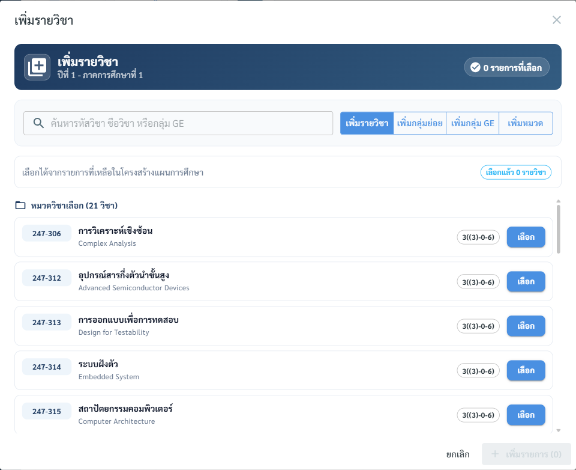<figcaption>
รายวิชาจัดกลุ่มตามหมวด/กลุ่ม กด "เลือก" ทีละวิชา
</figcaption></figure>



<figure>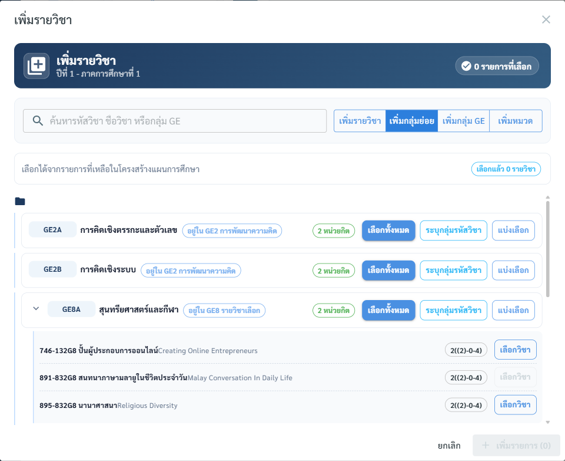<figcaption></figcaption></figure>



<figure>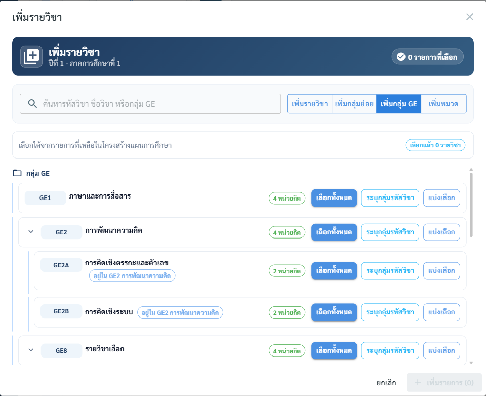<figcaption></figcaption></figure>



<figure>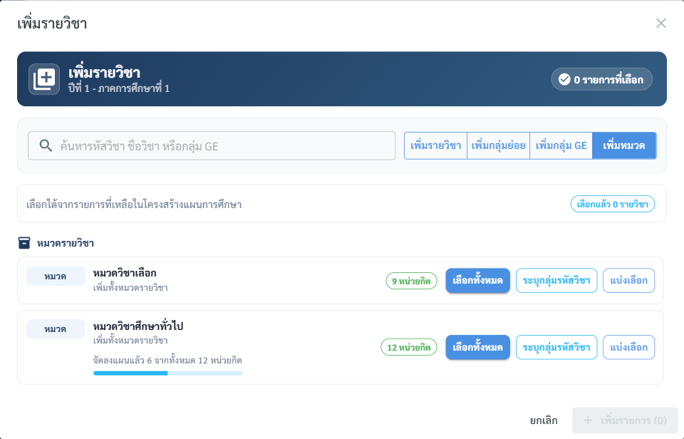<figcaption>
หมวดศึกษาทั่วไปจัดลงแผนแล้ว 6 จาก 12 หน่วยกิต
</figcaption></figure>



**หน่วยกิตที่แสดงในแผนการเรียน**

รายการที่ลงเป็นก้อน (ทั้งหมวด ทั้งกลุ่ม กลุ่มย่อย หรือกลุ่ม GE) ไม่มีชั่วโมงบรรยาย/ปฏิบัติ/ศึกษาด้วยตนเองของตัวเอง ระบบจึงแสดงหน่วยกิตเป็น **`N((x)-y-z)`**

<table><thead><tr><th width="320">ลงแบบไหน</th><th>แสดงในแผนการเรียน</th></tr></thead><tbody><tr><td>รายวิชาเดี่ยว</td><td>หน่วยกิตจริงของวิชา เช่น <code>3((3)-0-6)</code></td></tr><tr><td>ทั้งหมวด เช่น หมวดวิชาเลือก 9 หน่วยกิต</td><td><code>9((x)-y-z)</code></td></tr><tr><td>กลุ่ม / กลุ่มย่อย / กลุ่ม GE เช่น GE1 2 หน่วยกิต</td><td><code>2((x)-y-z)</code></td></tr><tr><td>แบ่งเลือกแบบช่วง เช่น 2–4</td><td><code>2-4 หน่วยกิต</code></td></tr><tr><td>Audit / ไม่นับหน่วยกิต</td><td><code>0 หน่วยกิต</code></td></tr></tbody></table>

> ตัวอย่างในภาพการ์ดภาคการศึกษาที่ 1 ด้านบน: GE1 ภาษาและการสื่อสาร แสดงเป็น `2((x)-y-z)` เพราะลงทั้งกลุ่ม GE

**ปุ่มของแต่ละรายการ**

<table><thead><tr><th width="200">ปุ่ม</th><th>ใช้ทำอะไร</th></tr></thead><tbody><tr><td><strong>เลือก / เลือกทั้งหมด</strong></td><td>ใส่หน่วยกิตเต็ม (หรือเต็มเท่าที่เหลือ)</td></tr><tr><td><strong>แบ่งเลือก</strong></td><td>ระบุหน่วยกิตเอง เพื่อกระจายลงหลายภาค (เช่น โครงงาน) ระบุเป็นช่วงได้</td></tr><tr><td><strong>ระบุกลุ่มรหัสวิชา</strong></td><td>แสดงเป็นรหัสรวม เช่น <strong>276-6XX</strong> หรือ <strong>xxx-xxx</strong> นับหน่วยกิตตามที่ระบุ แต่ไม่ถือเป็นรายวิชาจริง</td></tr></tbody></table>

**ตัวอย่าง A — "แบ่งเลือก" แบบช่วงหน่วยกิต:** GE1 ภาษาและการสื่อสาร เหลือ 4 หน่วยกิต ติ๊ก "ระบุหน่วยกิตเป็นช่วง" แล้วใส่ 2–4 แผนการเรียนจะแสดงเป็น "2-4 หน่วยกิต"

<figure>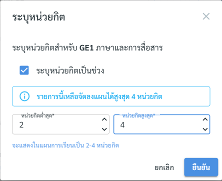<figcaption></figcaption></figure>

**ตัวอย่าง B — "ระบุกลุ่มรหัสวิชา":** หมวดวิชาเลือก ให้แสดงในภาคนี้เป็น `xxx-xxx` จำนวน 3 หน่วยกิต (นักศึกษาเลือกวิชาเอง)

<figure>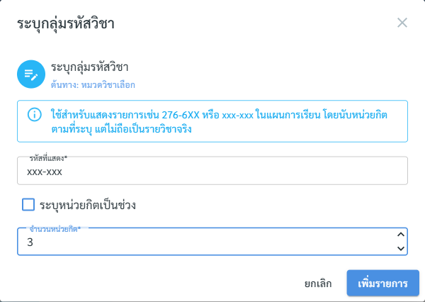<figcaption></figcaption></figure>

> ติ๊ก **"แสดงรายวิชาภายในกลุ่ม"** แล้วกด "ถัดไป" เพื่อเลือกวิชาที่จะแสดงใต้รหัสนั้นได้ วิชาเหล่านี้จะมีป้าย "รายวิชาอ้างอิงภายในกลุ่ม ไม่นับหน่วยกิตซ้ำ"

📏 กฎการลงซ้ำ

* วิชาที่แบ่งหน่วยกิตได้ → ลงได้หลายภาคจนครบหน่วยกิต
* วิชา Audit → ลงซ้ำได้หลายภาค
* วิชาที่แบ่งไม่ได้ → ลงได้ครั้งเดียวทั้งแผน
* เลือกรายการที่อยู่ใต้กลุ่มหลัก ระบบอาจเพิ่มกลุ่มหลักให้อัตโนมัติ
* กดเพิ่มแล้ว **บันทึกทันที**

### 4.4 กด "เพิ่มรายวิชาทางเลือก" (หรือ / และ)

ใช้เมื่อนักศึกษาเลือกเรียนทางใดทางหนึ่ง

**ตัวอย่าง:** ชุด "วิชาเลือกด้านการออกแบบวงจร" — เรียน 247-319 **หรือ** 247-320 อย่างใดอย่างหนึ่ง (3 หน่วยกิต)

<figure>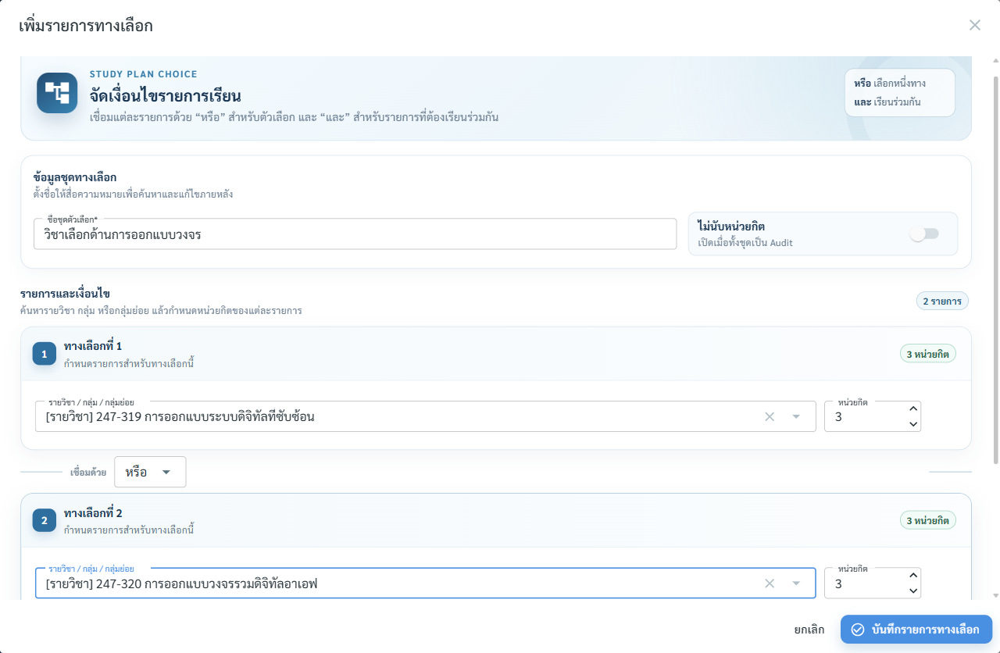<figcaption></figcaption></figure>



#### ตั้งชื่อชุดตัวเลือก

(เปิด **"ไม่นับหน่วยกิต"** ถ้าทั้งชุดเป็น Audit)



#### ใส่รายการในแต่ละทางเลือก

พิมพ์ค้นหารายวิชา/กลุ่ม/กลุ่มย่อย แล้วกำหนดหน่วยกิต



#### เลือกตัวเชื่อม "หรือ" / "และ"

**หรือ** = เลือกหนึ่งทาง · **และ** = เรียนร่วมกัน กด "เพิ่มรายการทางเลือก" ถ้าต้องการทางเลือกที่ 3 ขึ้นไป



#### กด "บันทึกรายการทางเลือก"




ระบบจะไม่ให้บันทึกถ้า: มีน้อยกว่า 2 ทางเลือก · มีรายการซ้ำ · รายการต่างประเภทกัน (ต้องเป็นรายวิชาทั้งหมด หรือกลุ่มทั้งหมด หรือกลุ่มย่อยทั้งหมด) · รายการอยู่คนละหมวด


หลังบันทึก ชุดทางเลือกจะแสดงในภาค/ปีนั้นเป็นการ์ด **"เลือกเรียน 1 ทางเลือก"** กดแก้ไขหรือลบทั้งชุดได้จากการ์ด (ลบมีกล่องยืนยัน "ยืนยันการลบชุดตัวเลือก")

**ตัวอย่างการใช้ "และ":** ทางเลือกที่ 1 = 247-319 **และ** 247-320 (เรียนคู่กัน 6 หน่วยกิต) **หรือ** ทางเลือกที่ 2 = 247-312 (3 หน่วยกิต) + 247-313 (3 หน่วยกิต) — ให้เลือกตัวเชื่อม "และ" ระหว่างรายการในทางเลือกเดียวกัน และ "หรือ" ระหว่างทางเลือก

### 4.5 ลบออกจากปี/ภาค

กดไอคอนถังขยะที่แถว (ไม่ได้ลบออกจากโครงสร้าง) ถ้าลบกลุ่มย่อย วิชาภายในจะถูกลบไปด้วย วิชาใน Minor GE ลบทีละวิชาไม่ได้ ต้องลบที่ตัว Minor

***

## ขั้นตอนที่ 5: กรอกแผนการรับนักศึกษา (แท็บ "แผนการรับนักศึกษา")

กรอกจำนวนนักศึกษาที่คาดว่าจะรับในแต่ละปีการศึกษา แยกตามแผนการศึกษา

**ตัวอย่าง** (บัญชีบัณฑิต แผนปริญญาตรี) — รับนักศึกษาไทย โครงการปกติ ปีละ 150 คน 5 ปี รวม 750 คน

<figure>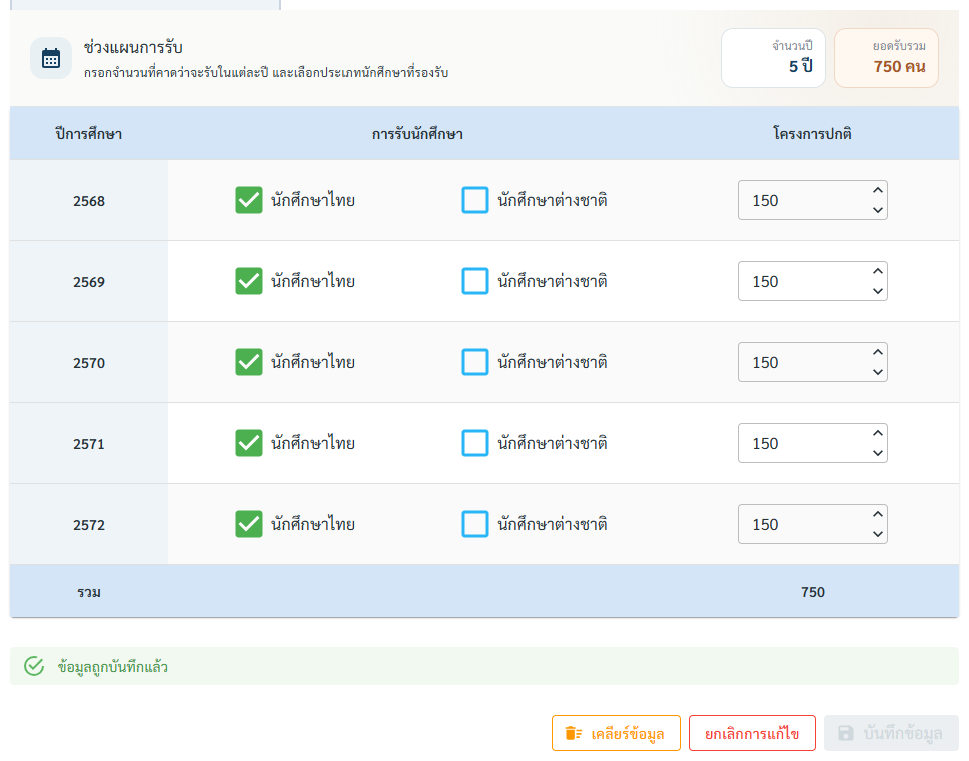<figcaption>
การ์ดมุมขวาบนสรุป "จำนวนปี" และ "ยอดรับรวม" ให้อัตโนมัติ
</figcaption></figure>



#### เลือกแผนจากแท็บด้านบน

แต่ละแผนการศึกษามีแท็บของตัวเอง (หลักสูตรที่แบ่งเอกจะแสดงเป็น "เอก … • ชื่อแผน")



#### ติ๊กประเภทนักศึกษาที่รับในแต่ละปี

ติ๊ก **นักศึกษาไทย** และ/หรือ **นักศึกษาต่างชาติ** ทีละแถว (หนึ่งแถว = หนึ่งปีการศึกษา)

> ปีการศึกษาเริ่มตามปีหน้าปกของหลักสูตร ถ้าเปลี่ยนปีหน้าปกภายหลัง ระบบจะ **ปรับปีให้อัตโนมัติ** โดยคงจำนวนรับเดิมไว้



#### กรอกจำนวนรับ

<table><thead><tr><th width="230">คอลัมน์ที่เห็น</th><th>ขึ้นกับ</th></tr></thead><tbody><tr><td><strong>โครงการปกติ</strong> / <strong>โครงการพิเศษ</strong></td><td>แสดงเฉพาะโครงการที่หลักสูตรเลือกไว้ในหมวดที่ 1 (ตัวอย่างนี้มีแค่โครงการปกติ)</td></tr><tr><td><strong>จำนวนรวม</strong></td><td>แสดงเมื่อหลักสูตรไม่ได้แยกโครงการ</td></tr></tbody></table>

แถว **"รวม"** ท้ายตารางคำนวณให้อัตโนมัติ



#### กด "บันทึกข้อมูล"

ระบบถามยืนยัน แล้วแถบสถานะจะเปลี่ยนจาก "มีการเปลี่ยนแปลงที่ยังไม่ได้บันทึก" เป็น **"ข้อมูลถูกบันทึกแล้ว"**



<table><thead><tr><th width="200">ปุ่มอื่น</th><th>ใช้ทำอะไร</th></tr></thead><tbody><tr><td><strong>ยกเลิกการแก้ไข</strong></td><td>คืนค่าที่บันทึกล่าสุด (มีกล่องยืนยัน)</td></tr><tr><td><strong>เคลียร์ข้อมูล</strong></td><td>ลบจำนวนรับทั้งหมดของแผนนี้ และรีเซ็ตทุกปีเป็น 0 (มีกล่องยืนยัน)</td></tr></tbody></table>


* ถ้ายอดรับรวมน้อยกว่า **จำนวนขั้นต่ำของระดับการศึกษา** ระบบจะเตือน "จำนวนรับนักศึกษารวม (X คน) ยังไม่ถึงจำนวนขั้นต่ำ (Y คน) ขาดอีก Z คน" (ยกเว้นหลักสูตร Sandbox)
* ถ้าไม่มีคอลัมน์ให้กรอกเลย ให้กลับไประบุ **โครงการปกติ/โครงการพิเศษ** ในข้อมูลหลักสูตร (หมวดที่ 1) ก่อน



* ถ้าตั้ง "การบริหารจัดการวิชาเอก" ในหมวดที่ 1 เป็น **"ไม่แยก"** → แท็บจะเป็น "ชื่อแผน" กรอกครั้งเดียวใช้ร่วมกันทุกเอกที่ใช้ชื่อแผนเดียวกัน ถ้า **"แยก"** → แต่ละเอกกรอกของตัวเอง
* หลักสูตรหลายปริญญา: ปริญญาที่เพิ่มเข้ามา **ใช้แผนการรับของปริญญาหลัก** ไม่ต้องกรอกซ้ำ


***

## ขั้นตอนที่ 6: จับคู่รายวิชากับ PLO (แท็บ "PLOs & รายวิชา")

ระบุว่าแต่ละรายวิชาส่งเสริม PLO ข้อใด ในระดับ **I / R / M**


**ต้องกรอกเมื่อไร:** หลักสูตรปีหน้าปก **2568 ขึ้นไป** — หลักสูตรปีหน้าปก 2567 หรือต่ำกว่า และหลักสูตรสถานะ "หลักสูตรเดิม" ไม่ต้องกรอก (ระบบแสดงข้อความแจ้งไว้บนสุดของแท็บ)


<figure>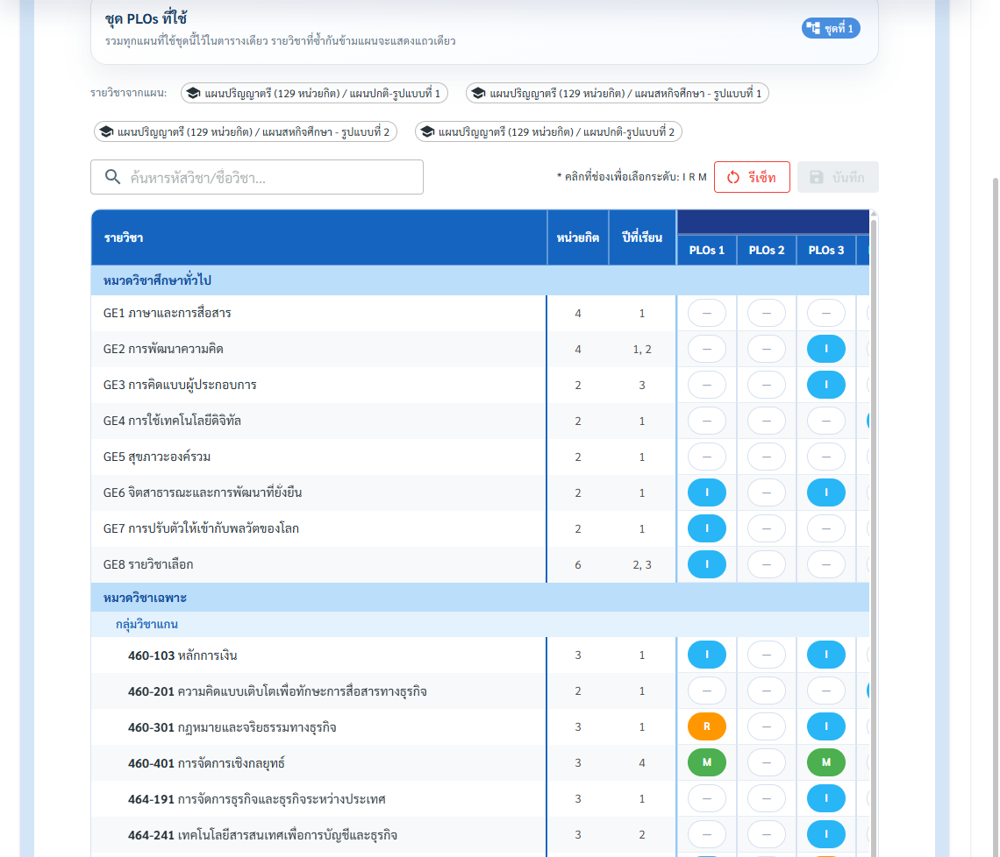<figcaption>
ตัวอย่างบัญชีบัณฑิต: ชุด PLOs ชุดที่ 1 ใช้ร่วมกัน 4 แผน จึงแสดงรวมในตารางเดียว
</figcaption></figure>

**ส่วนประกอบของหน้าจอ**

<table><thead><tr><th width="230">ส่วน</th><th>ความหมาย</th></tr></thead><tbody><tr><td><strong>ชุด PLOs ที่ใช้ / เลือกชุด PLOs</strong></td><td>ตารางแยกตามชุด PLO (ไม่ได้แยกตามแผน) — ทุกแผนที่ใช้ชุดเดียวกันอยู่ในตารางเดียว รายวิชาที่ซ้ำข้ามแผนแสดงแถวเดียว ถ้ามีหลายชุด ให้กดแท็บเลือกชุด</td></tr><tr><td><strong>รายวิชาจากแผน:</strong> (ชิป)</td><td>บอกว่าตารางนี้รวมแผนไหนบ้าง ชิปมีป้ายสถานะต่อท้าย เช่น "(IRM ยังไม่ครบ)" "(ยังไม่มี IRM)" — เอาเมาส์ชี้เพื่อดูว่าบันทึกแล้วกี่รายการ</td></tr><tr><td><strong>แถว</strong></td><td>รายวิชา/กลุ่มจากโครงสร้าง เรียงตาม หมวด → กลุ่ม → กลุ่มย่อย พร้อมคอลัมน์ หน่วยกิต และ <strong>ปีที่เรียน</strong> (ดึงจากแผนการเรียน)</td></tr><tr><td><strong>คอลัมน์</strong></td><td>PLO ทุกข้อของชุด (รวม sub-PLO และ PLO เฉพาะวิชาเอก)</td></tr></tbody></table>



#### เลือกระดับจากแถบ "เลือกระดับ" มุมขวาล่าง

<figure><figcaption></figcaption></figure>

<table><thead><tr><th width="100">ระดับ</th><th width="140">สี</th><th>ความหมาย</th></tr></thead><tbody><tr><td><strong>I</strong></td><td>🔵 ฟ้า</td><td>Introduce — เริ่มสอน</td></tr><tr><td><strong>R</strong></td><td>🟠 ส้ม</td><td>Reinforce — เน้นย้ำ</td></tr><tr><td><strong>M</strong></td><td>🟢 เขียว</td><td>Master — เชี่ยวชาญ</td></tr></tbody></table>

ระดับที่เลือกจะค้างไว้ จนกว่าจะกดระดับอื่น



#### คลิกช่องที่ต้องการ (เหมือนใช้พู่กันแต้ม)

* คลิกช่องว่าง (—) → ใส่ระดับที่เลือกไว้
* คลิกช่องที่มีค่าเดียวกับระดับที่เลือก → ล้างค่า
* คลิกช่องที่มีค่าอื่น → เปลี่ยนเป็นระดับที่เลือก

**ตัวอย่าง:** ต้องการให้ 460-301 เป็น R ใน PLO1 → กด **R** ที่แถบเลือกระดับ → คลิกช่อง 460-301 × PLOs 1



#### กด "บันทึก"

ปุ่มกดได้เมื่อมีการเปลี่ยนแปลงที่ยังไม่บันทึก หลังบันทึก ระบบ **คัดลอก I/R/M ที่ตรงกันไปยังแผนอื่นที่ใช้ชุด PLO เดียวกันให้อัตโนมัติ**




* ต้องกรอก I/R/M **ครบทุกรายวิชา** แท็บโครงสร้างหลักสูตรจึงจะสมบูรณ์ (ครบแล้วจะขึ้น "ข้อมูล I R M กรอกครบถ้วนแล้ว")
* ปุ่ม **"รีเซ็ท"** ล้างค่าทั้งหมดของชุด PLO ที่เลือก และ **บันทึกทันที** (มีกล่องยืนยัน "ล้างและบันทึก")
* ถ้าขึ้น "ไม่พบรายวิชาในโครงสร้างหลักสูตร" ให้เพิ่มรายวิชาในโครงสร้างก่อน (ขั้นตอนที่ 3) ถ้าขึ้น "ยังไม่มีชุด PLO ที่เลือกไว้ในแผนการศึกษา" ให้แก้ไขแผนแล้วเลือกชุด PLO (2.3)
* กลุ่ม GE ที่มี Minor ซึ่งระบุรายวิชาแล้ว จะแสดงเป็นหัวข้อ ไม่มีช่องให้กรอก (กรอกที่ Minor แทน)


***

## ขั้นตอนที่ 7: กรอกกลยุทธ์และวิธีการสอน (แท็บ "กลยุทธ์และวิธีการสอน")


**ต้องกรอกเมื่อไร:** หลักสูตรปีหน้าปก **2564 ขึ้นไป** (ก่อน 2564 ไม่ต้องกรอก)


<figure>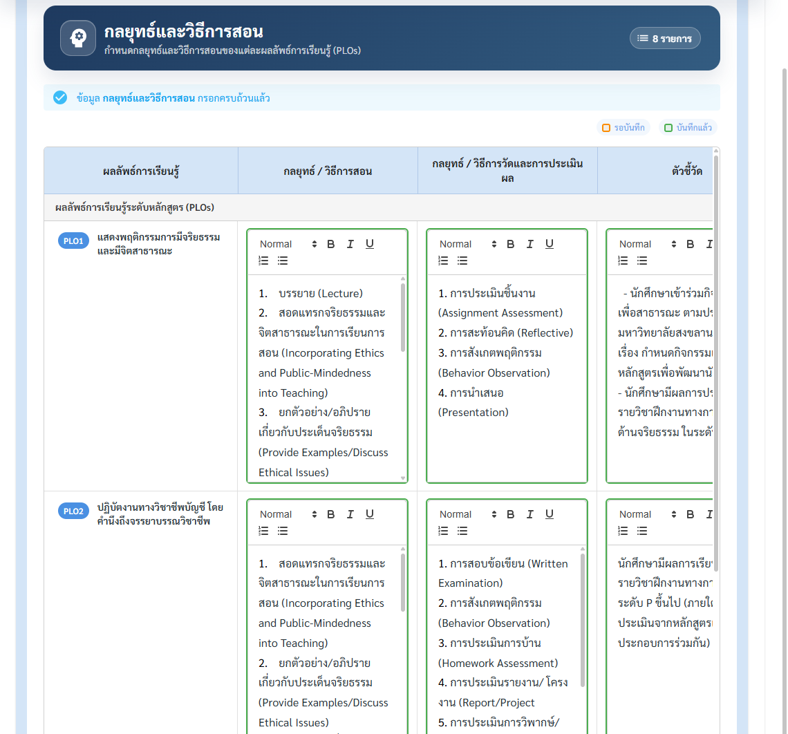<figcaption>
ตัวอย่างบัญชีบัณฑิต PLO1–PLO2 กรอกครบทั้ง 3 ช่อง (ขอบเขียว = บันทึกแล้ว)
</figcaption></figure>

ตารางมี 1 แถวต่อ 1 PLO และ 3 คอลัมน์ให้กรอก:

<table><thead><tr><th width="270">คอลัมน์</th><th>กรอกอะไร</th><th>ตัวอย่าง (PLO1 จริยธรรม)</th></tr></thead><tbody><tr><td><strong>กลยุทธ์ / วิธีการสอน</strong></td><td>สอนอย่างไรให้เกิด PLO นี้</td><td>1. บรรยาย 2. สอดแทรกจริยธรรมในการเรียนการสอน 3. ยกตัวอย่าง/อภิปราย</td></tr><tr><td><strong>กลยุทธ์ / วิธีการวัดและประเมินผล</strong></td><td>วัดผลอย่างไร</td><td>1. การประเมินชิ้นงาน 2. การสะท้อนคิด 3. การสังเกตพฤติกรรม</td></tr><tr><td><strong>ตัวชี้วัด</strong></td><td>เกณฑ์ที่ถือว่าบรรลุ</td><td>นักศึกษาเข้าร่วมกิจกรรมเพื่อสาธารณะตามที่หลักสูตรกำหนด</td></tr></tbody></table>



#### พิมพ์ข้อความในแต่ละช่อง

ช่องเป็นตัวแก้ไขข้อความ จัดตัวหนา/ตัวเอียง/ขีดเส้นใต้ และลิสต์ลำดับเลข/จุดได้ (แถบเครื่องมือ "Normal B I U")



#### ดูสีขอบช่อง

<table><thead><tr><th width="160">สีขอบ</th><th>ความหมาย</th></tr></thead><tbody><tr><td>🟠 ส้ม</td><td>รอบันทึก (แก้แล้วยังไม่บันทึก)</td></tr><tr><td>🟢 เขียว</td><td>บันทึกแล้ว</td></tr><tr><td>🔴 แดง</td><td>กรอกไม่ครบ 3 ช่องในแถวนั้น</td></tr></tbody></table>



#### กด "บันทึกข้อมูล" แล้วยืนยัน




* แต่ละแถว **ต้องกรอกครบทั้ง 3 ช่อง หรือเว้นว่างทั้งแถว** — กรอกบางช่องระบบจะเตือนใต้แถวนั้น
* แถว PLO แบ่งเป็น **PLOs ระดับหลักสูตร** (ใช้ทุกแผน อยู่บนสุด) และ **PLOs เฉพาะแผน/วิชาเอก** (แยกหัวข้อตามแผน)
* **"ยกเลิกการแก้ไข"** คืนค่าที่บันทึกล่าสุดทุกช่อง (มีกล่องยืนยัน)


***

## ขั้นตอนที่ 8: จับคู่ PLO กับ K A S (แท็บ "PLOs & K A S")

K A S = **K**nowledge (ความรู้) / **A**ttitude (ทัศนคติ) / **S**kill (ทักษะ) — ต้องกรอกเฉพาะหลักสูตรปีหน้าปก **2564 ขึ้นไป**

มี 2 โหมด สลับด้วยปุ่มด้านบน: **"จัดการคลัง K/A/S"** (สร้างรายการ) และ **"PLOs K/A/S"** (จับคู่) — ต้องสร้างคลังก่อนจึงจะจับคู่ได้

### 8.1 สร้างคลัง (โหมด "จัดการคลัง K/A/S")

<figure>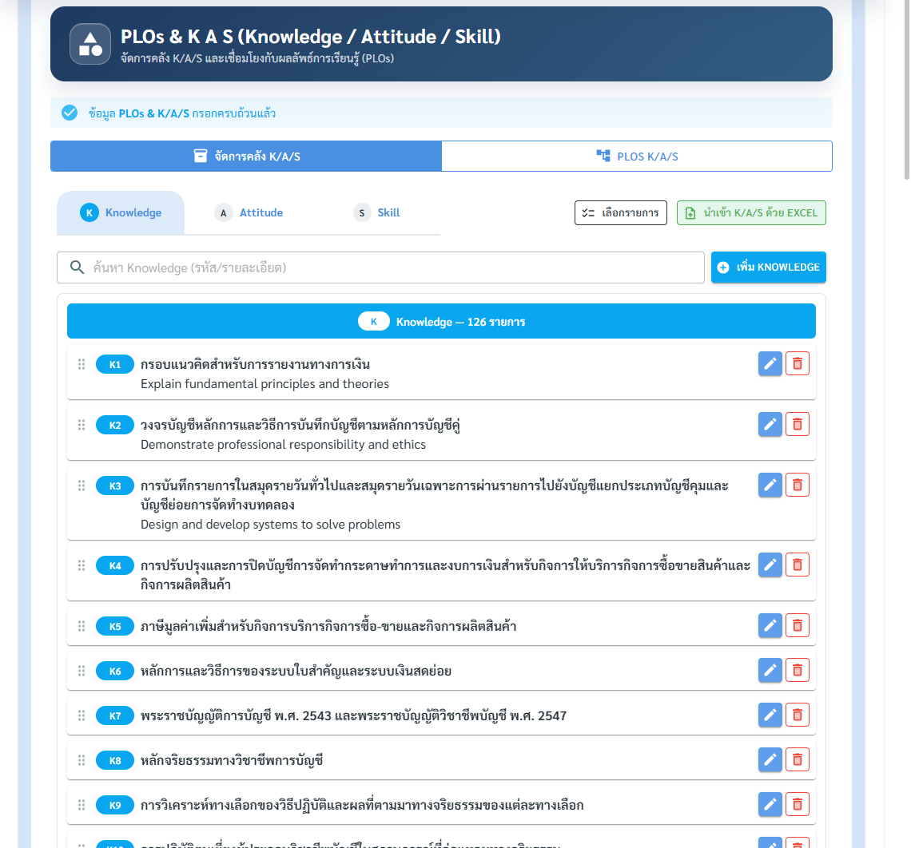<figcaption>
ตัวอย่างบัญชีบัณฑิต: คลัง Knowledge 126 รายการ
</figcaption></figure>



#### เลือกแท็บ Knowledge / Attitude / Skill



#### เพิ่มรายการ

* ทีละรายการ: กด **"เพิ่ม KNOWLEDGE"** (หรือ ATTITUDE / SKILL) → กรอกรายละเอียด (ไทย/อังกฤษ) → บันทึก ระบบรันรหัส K1, K2, … ให้
* หลายรายการ: กด **"นำเข้า K/A/S ด้วย EXCEL"**



#### จัดการรายการ

* **ลาก** ไอคอน ⋮⋮ ด้านซ้ายเพื่อเรียงลำดับ
* ✏️ แก้ไข / 🗑️ ลบ ทีละรายการ
* ลบหลายรายการ: **"เลือกรายการ"** → ติ๊ก (หรือ "เลือกทั้งหมด") → **"ลบรายการที่เลือก"**
* ค้นหาด้วยรหัสหรือรายละเอียดได้



### 8.2 จับคู่กับ PLO (โหมด "PLOs K/A/S")

<figure>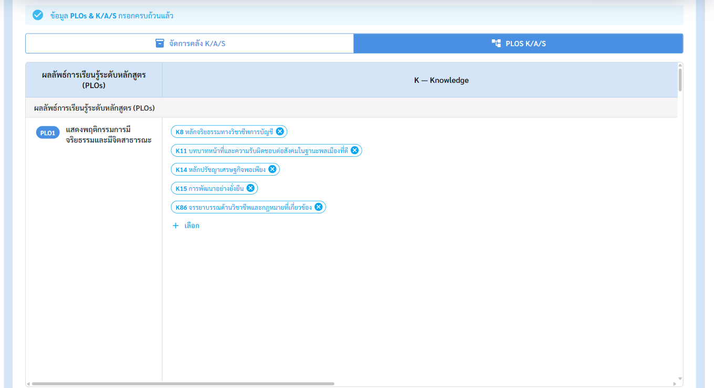<figcaption>
ตัวอย่าง: PLO1 จับคู่กับ K8, K11, K14, K15, K86
</figcaption></figure>



#### กด "+ เลือก" ในช่องของ PLO × ประเภท (K / A / S)



#### ติ๊กรายการจากคลัง แล้วกด "บันทึก (N)"

<figure>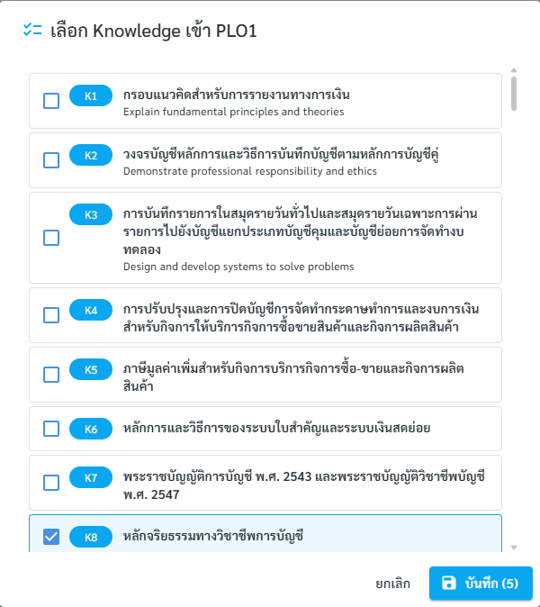<figcaption>
รายการที่จับคู่ไว้แล้วจะถูกติ๊กไว้ก่อน
</figcaption></figure>



#### นำออก (ถ้าต้องการ)

กด **✕** บนชิป → ยืนยัน "นำออก"




* การเพิ่ม/นำออกในโหมดนี้ **บันทึกทันที** ไม่ต้องกดบันทึกรวม
* ถ้าคลังประเภทนั้นยังว่าง ปุ่ม "เลือก" ในคอลัมน์นั้นจะกดไม่ได้ — กลับไปเพิ่มในโหมด "จัดการคลัง K/A/S" ก่อน
* ทุก PLO ต้องมี K/A/S ครบ แท็บจึงจะขึ้น "ข้อมูล PLOs & K/A/S กรอกครบถ้วนแล้ว"


***

## สรุป: ปัญหาที่พบบ่อยและวิธีแก้

<table><thead><tr><th width="300">อาการ</th><th>วิธีแก้</th></tr></thead><tbody><tr><td>รายวิชามีป้าย "ยังไม่มี CLOs" / อนุมัติไม่ได้</td><td>แก้ไขรายวิชา → แท็บ "CLOs รายวิชา" (ขั้นตอนที่ 1)</td></tr><tr><td>ลบรายวิชาไม่ได้</td><td>ดูหน้าต่าง "ไม่สามารถลบรายวิชาได้" ว่าใช้อยู่ที่ไหน แล้วเอาออกจากโครงสร้างก่อน</td></tr><tr><td>เพิ่มกลุ่ม/รายวิชาในหมวดไม่ได้</td><td>ยังไม่ได้กด "บันทึกหมวดวิชา" (3.1)</td></tr><tr><td>ปุ่มเพิ่มรายวิชาในกลุ่มกดไม่ได้</td><td>ยังไม่กรอกหน่วยกิตกลุ่ม หรือยังไม่บันทึกกลุ่ม (3.2)</td></tr><tr><td>บันทึกหมวดไม่ได้ เพราะหน่วยกิตเกิน</td><td>ผลรวมหน่วยกิตทุกหมวดเกินหน่วยกิตรวมของแผน ลดหมวดอื่นก่อน (3.1)</td></tr><tr><td>ไม่เห็นช่อง "เลือกเรียนวิชาใดก็ได้"</td><td>มีเฉพาะหมวดวิชาเลือก/เลือกเสรี (3.1)</td></tr><tr><td>การ์ดสรุปหน่วยกิตเป็นสีแดง</td><td>หน่วยกิตที่ผูกยังขาด/เกินจากแผน ดูตัวเลข "คงเหลือ" (3.4)</td></tr><tr><td>หารายวิชาไม่เจอในแผนการเรียน / ตาราง PLO</td><td>เพิ่มรายวิชานั้นในโครงสร้างก่อน (ขั้นตอนที่ 3) หรือรายการนั้นจัดครบหน่วยกิตแล้ว</td></tr><tr><td>ลดหน่วยกิตรายวิชา/กลุ่มย่อยไม่ได้</td><td>เอาออกจากแผนการเรียนก่อน</td></tr><tr><td>ระบบขอให้กรอก CAPTCHA</td><td>ปกติเมื่อ: ลบสิ่งที่อยู่ในแผนการเรียนแล้ว · ลบตัวเลือกโครงสร้าง · สลับโหมดไม่ระบุเอกย่อย/ตัวเลือกโครงสร้าง · คัดลอกโครงสร้าง · ลบแผน</td></tr><tr><td>หน้าโครงสร้างแก้ไขไม่ได้ ขึ้น "อ่านอย่างเดียว"</td><td>หลักสูตรส่งอนุมัติแล้ว</td></tr></tbody></table>
