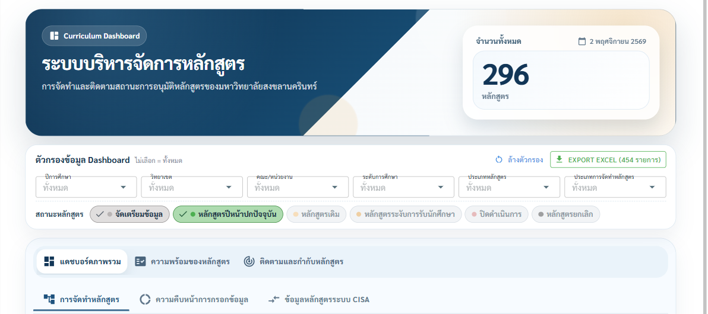
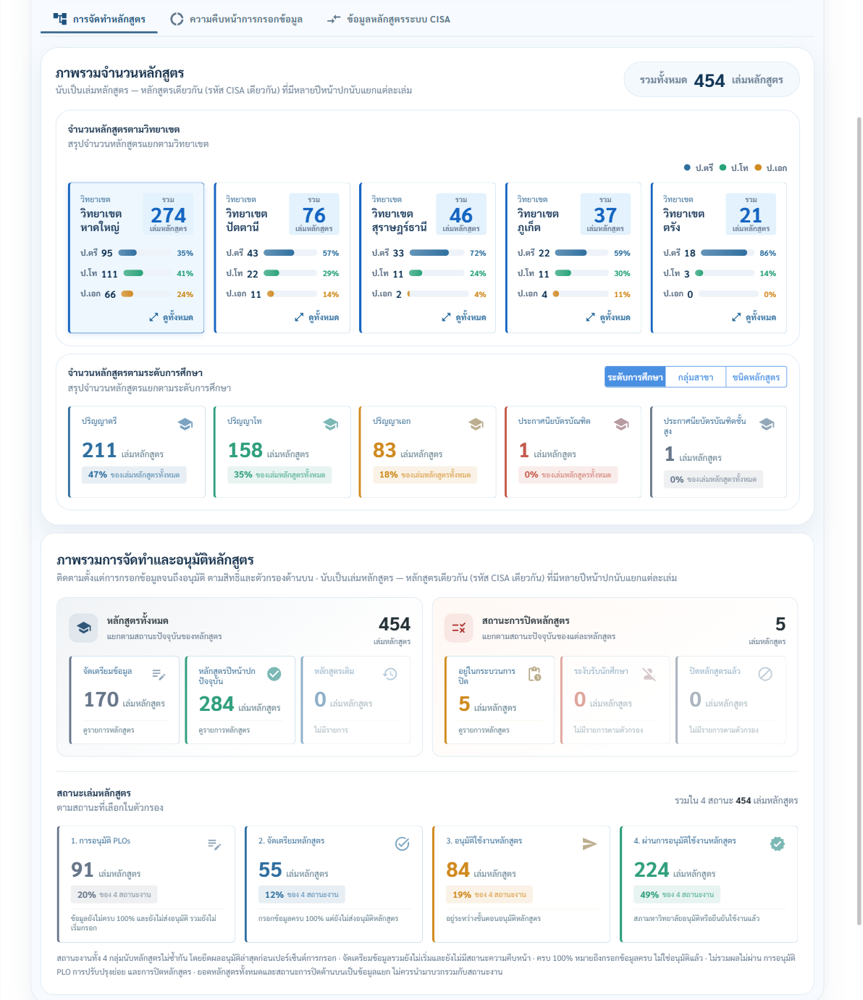
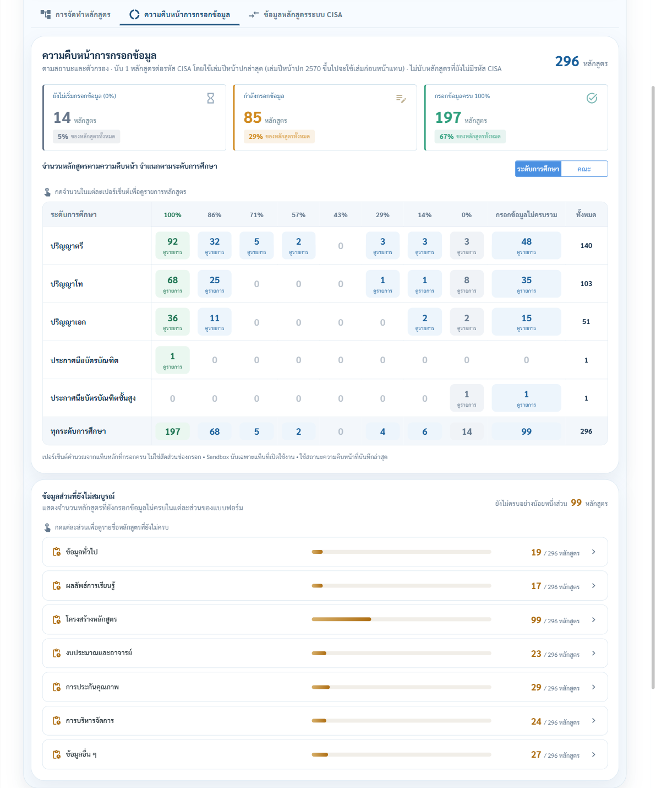
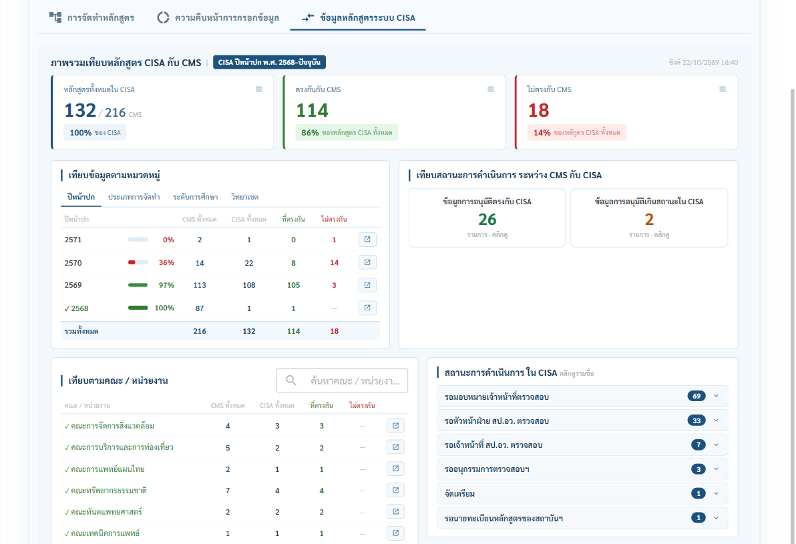
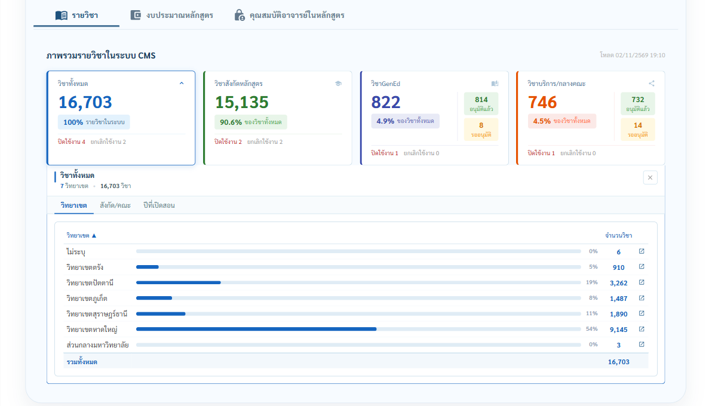
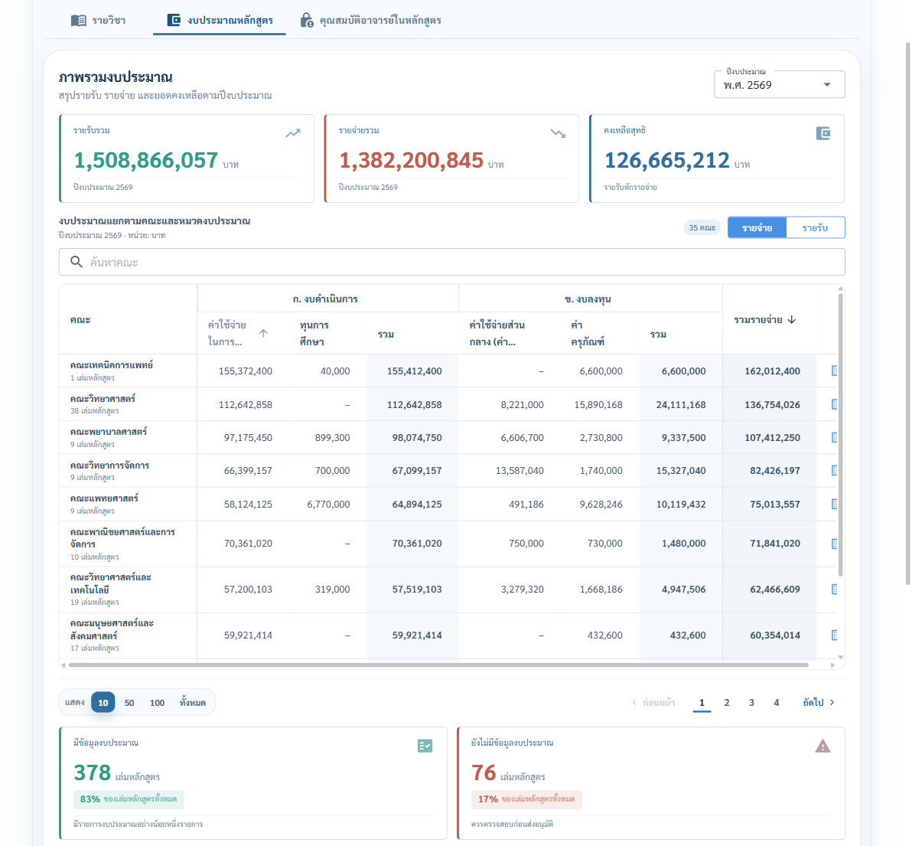
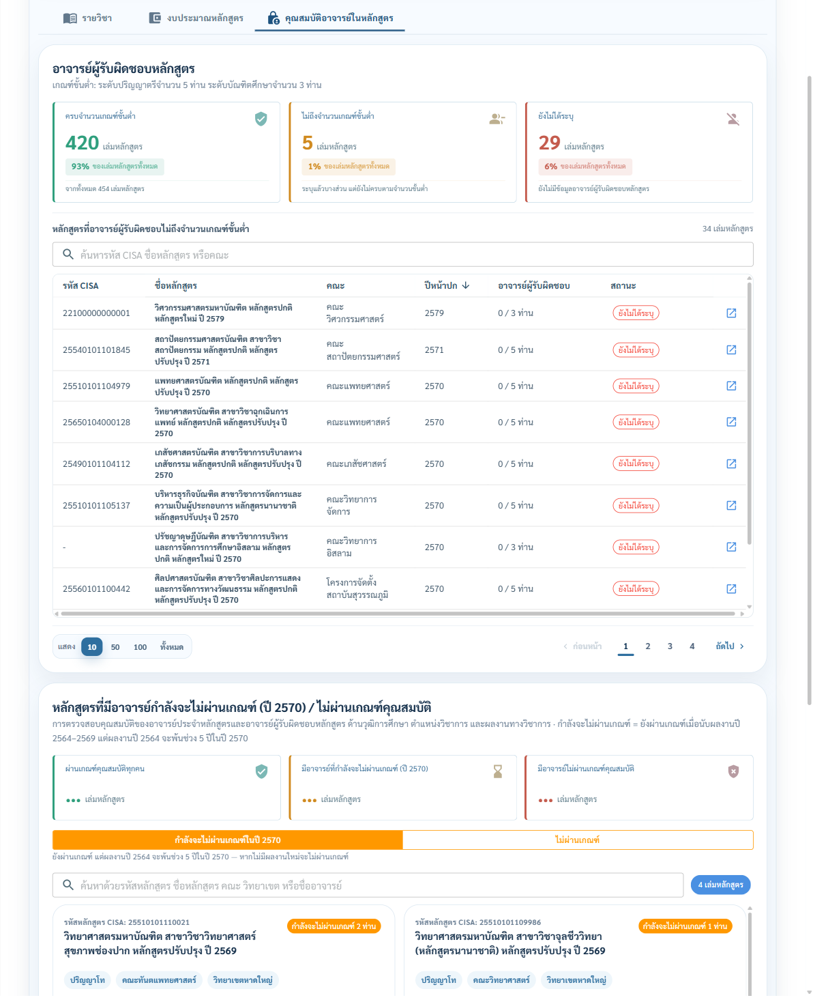
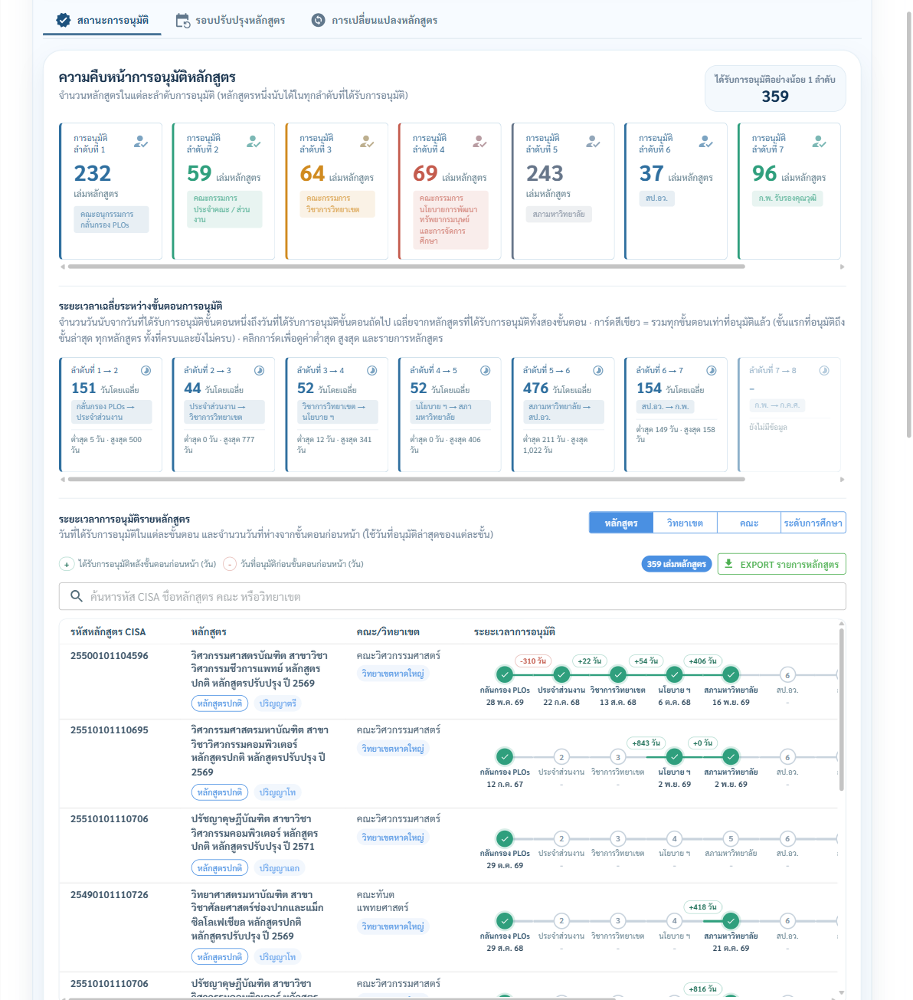
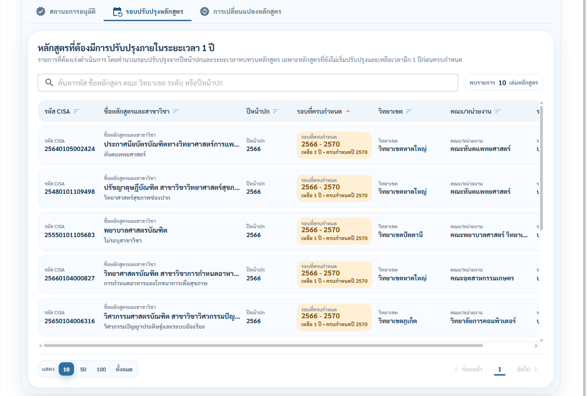
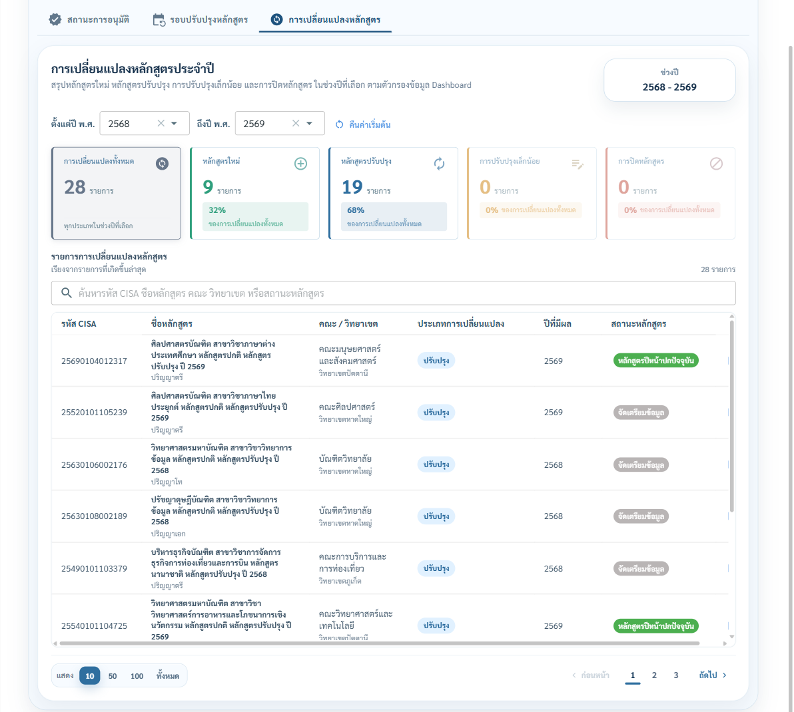

# 3. หน้า Dashboard (Homepage)

หน้าแรกหลังเข้าสู่ระบบ ใช้ดูภาพรวมหลักสูตรทั้งหมดที่ตนเองมีสิทธิ์เห็น ว่ามีกี่หลักสูตร อยู่ขั้นไหน กรอกข้อมูลครบหรือยัง และมีเรื่องอะไรที่ต้องติดตาม ก่อนเข้าไปทำงานในแต่ละหลักสูตร


ผู้ใช้เห็นข้อมูลเฉพาะคณะ/หน่วยงานที่ตนเองสังกัดหรือได้รับสิทธิ์เท่านั้น ถ้าดูแลหลายคณะ ให้ใช้ตัวกรอง "คณะ/หน่วยงาน" เลือกดูทีละคณะได้


## ส่วนประกอบของหน้า

หน้า Dashboard แบ่งเป็น 3 ส่วน เรียงจากบนลงล่าง

<table><thead><tr><th width="60">#</th><th width="200">ส่วน</th><th>ใช้ทำอะไร</th></tr></thead><tbody><tr><td>1</td><td>แถบหัว (Hero)</td><td>แสดง <strong>จำนวนหลักสูตรทั้งหมด</strong> ในระบบ (นับ 1 หลักสูตรต่อรหัส CISA) และวันที่ปัจจุบัน</td></tr><tr><td>2</td><td>ตัวกรองข้อมูล Dashboard</td><td>เลือกขอบเขตข้อมูล ทุกแท็บด้านล่างจะคำนวณใหม่ตามตัวกรอง และส่งออกรายชื่อหลักสูตรเป็น Excel ได้</td></tr><tr><td>3</td><td>แท็บข้อมูล</td><td>3 กลุ่มใหญ่ กลุ่มละ 3 แท็บย่อย รวม 9 มุมมอง</td></tr></tbody></table>

<figure><figcaption>
แถบหัว (จำนวนหลักสูตรทั้งหมด) และกล่อง "ตัวกรองข้อมูล Dashboard"
</figcaption></figure>

## วิธีใช้ตัวกรอง



### เลือกขอบเขตจากช่องตัวกรอง

มี 6 ช่อง แต่ละช่องเลือกได้หลายค่า ถ้า **ไม่เลือก = ทั้งหมด**

| ช่อง | ตัวอย่างค่า |
| --- | --- |
| ปีการศึกษา | 2568, 2569, 2570 (ปีหน้าปกหลักสูตร) |
| วิทยาเขต | วิทยาเขตหาดใหญ่, ปัตตานี, ภูเก็ต, สุราษฎร์ธานี, ตรัง |
| คณะ/หน่วยงาน | คณะวิทยาศาสตร์, คณะวิศวกรรมศาสตร์ ฯลฯ |
| ระดับการศึกษา | ปริญญาตรี, ปริญญาโท, ปริญญาเอก, ประกาศนียบัตรบัณฑิต |
| ประเภทหลักสูตร | หลักสูตรปกติ, หลักสูตรนานาชาติ ฯลฯ |
| ประเภทการจัดทำหลักสูตร | หลักสูตรใหม่, หลักสูตรปรับปรุง |



### เลือกสถานะหลักสูตร (ชิปด้านล่างตัวกรอง)

คลิกชิปเพื่อเปิด/ปิดสถานะนั้น ชิปที่เลือกอยู่จะมีเครื่องหมาย ✓ และสีเข้ม ค่าเริ่มต้นคือ **จัดเตรียมข้อมูล** และ **หลักสูตรปีหน้าปกปัจจุบัน**

ชิปที่มีให้เลือก: จัดเตรียมข้อมูล · หลักสูตรปีหน้าปกปัจจุบัน · หลักสูตรเดิม · หลักสูตรระงับการรับนักศึกษา · ปิดดำเนินการ · หลักสูตรยกเลิก


เมื่อเลื่อนหน้าลงมา จะมีแถบ **"สถานะหลักสูตร"** ติดอยู่ด้านบนจอ บอกว่ากำลังกรองสถานะอะไรอยู่ กด **"ไปที่ตัวกรอง"** เพื่อเลื่อนกลับขึ้นไปแก้ตัวกรองได้ทันที




### ล้างตัวกรอง หรือส่งออก Excel

* **ล้างตัวกรอง**: คืนค่าทุกช่องเป็นค่าเริ่มต้น
* **EXPORT EXCEL (N รายการ)**: ดาวน์โหลดรายชื่อหลักสูตรตามตัวกรองปัจจุบันเป็นไฟล์ Excel ตัวเลขในวงเล็บคือจำนวนเล่มหลักสูตรที่จะได้




**ตัวอย่าง:** อยากดูเฉพาะหลักสูตรปริญญาโทของคณะวิทยาศาสตร์ ที่ปีหน้าปก 2569 ให้เลือก ปีการศึกษา = 2569, คณะ/หน่วยงาน = คณะวิทยาศาสตร์, ระดับการศึกษา = ปริญญาโท ทุกแท็บจะแสดงเฉพาะหลักสูตรกลุ่มนี้ แล้วกด EXPORT EXCEL เพื่อได้รายชื่อไปใช้ต่อ



**"หลักสูตร" กับ "เล่มหลักสูตร" ต่างกันอย่างไร**: 1 หลักสูตร (รหัส CISA เดียวกัน) อาจมีหลายเล่มตามปีหน้าปก เช่น ฉบับปรับปรุง 2565 และ 2570 แท็บส่วนใหญ่นับเป็น **เล่มหลักสูตร** ส่วนตัวเลขที่แถบหัวนับเป็น **หลักสูตร**


## แท็บข้อมูลทั้งหมด

| กลุ่มแท็บ | แท็บย่อย | ใช้ดูอะไร |
| --- | --- | --- |
| **แดชบอร์ดภาพรวม** | การจัดทำหลักสูตร | จำนวนหลักสูตรแยกวิทยาเขต/ระดับ และสถานะงานของแต่ละเล่ม |
| | ความคืบหน้าการกรอกข้อมูล | หลักสูตรไหนกรอกครบ/ยังไม่ครบ และขาดส่วนไหน |
| | ข้อมูลหลักสูตรระบบ CISA | เทียบข้อมูลใน CMS กับระบบ CISA |
| **ความพร้อมของหลักสูตร** | รายวิชา | จำนวนรายวิชาในระบบ แยกประเภท/วิทยาเขต/คณะ |
| | งบประมาณหลักสูตร | รายรับ รายจ่าย และหลักสูตรที่ยังไม่กรอกงบประมาณ |
| | คุณสมบัติอาจารย์ในหลักสูตร | อาจารย์ผู้รับผิดชอบครบเกณฑ์หรือไม่ และอาจารย์ที่กำลังจะไม่ผ่านเกณฑ์ |
| **ติดตามและกำกับหลักสูตร** | สถานะการอนุมัติ | หลักสูตรอยู่ขั้นอนุมัติไหน และใช้เวลาแต่ละขั้นนานเท่าไร |
| | รอบปรับปรุงหลักสูตร | หลักสูตรที่ต้องปรับปรุงภายใน 1 ปี |
| | การเปลี่ยนแปลงหลักสูตร | สรุปหลักสูตรใหม่/ปรับปรุง/ปิด ในช่วงปีที่เลือก |


แทบทุกตารางและการ์ดในแท็บเหล่านี้ **คลิกได้** ตัวเลขที่คลิกได้จะแสดงรายชื่อหลักสูตรเบื้องหลัง และไอคอน ↗ ท้ายแถวจะพาไปเปิดหน้าหลักสูตรนั้นโดยตรง


## กลุ่มที่ 1: แดชบอร์ดภาพรวม

### 1.1 การจัดทำหลักสูตร

<figure><figcaption>
แท็บ "การจัดทำหลักสูตร"
</figcaption></figure>

| ส่วน | อ่านอย่างไร |
| --- | --- |
| **ภาพรวมจำนวนหลักสูตร** | การ์ดละ 1 วิทยาเขต แสดงจำนวนเล่มหลักสูตร แยก ป.ตรี/ป.โท/ป.เอก พร้อมแถบสัดส่วน กด **"ดูทั้งหมด"** เพื่อดูรายชื่อ |
| **จำนวนหลักสูตรตามระดับการศึกษา** | สลับมุมมองได้ 3 แบบด้วยปุ่มขวาบน: **ระดับการศึกษา / กลุ่มสาขา / ชนิดหลักสูตร** |
| **ภาพรวมการจัดทำและอนุมัติหลักสูตร** | ฝั่งซ้าย: หลักสูตรทั้งหมดแยกตามสถานะหลักสูตร (จัดเตรียมข้อมูล, หลักสูตรปีหน้าปกปัจจุบัน, หลักสูตรเดิม) ฝั่งขวา: สถานะการปิดหลักสูตร (อยู่ในกระบวนการปิด, ระงับรับนักศึกษา, ปิดหลักสูตรแล้ว) |
| **สถานะเล่มหลักสูตร** | 4 สถานะงาน: **1. การอนุมัติ PLOs** (ข้อมูลยังไม่ครบ 100% และยังไม่ส่งอนุมัติ) · **2. จัดเตรียมหลักสูตร** (กรอกครบ 100% แต่ยังไม่ส่งอนุมัติ) · **3. อนุมัติใช้งานหลักสูตร** (อยู่ระหว่างขั้นตอนอนุมัติ) · **4. ผ่านการอนุมัติใช้งานหลักสูตร** (สภามหาวิทยาลัยอนุมัติแล้ว) |

### 1.2 ความคืบหน้าการกรอกข้อมูล

ใช้ดูว่าหลักสูตรไหนกรอกข้อมูลยังไม่ครบ และขาดส่วนไหน (นับ 1 หลักสูตรต่อรหัส CISA โดยใช้เล่มปีหน้าปกล่าสุด)

<figure><figcaption>
การ์ด 3 ระดับ ตารางเปอร์เซ็นต์ความคืบหน้า และรายการ "ข้อมูลส่วนที่ยังไม่สมบูรณ์"
</figcaption></figure>



### ดูการ์ดสรุป 3 ใบ

**ยังไม่เริ่มกรอกข้อมูล (0%)** · **กำลังกรอกข้อมูล** · **กรอกข้อมูลครบ 100%**



### ดูตารางความคืบหน้า

แถว = ระดับการศึกษา (กดปุ่ม **"คณะ"** ขวาบนเพื่อเปลี่ยนเป็นแยกตามคณะ) คอลัมน์ = เปอร์เซ็นต์ที่กรอกแล้ว (100%, 86%, 71% … 0%) **กดตัวเลขในช่อง** เพื่อดูรายชื่อหลักสูตรกลุ่มนั้น



### ดู "ข้อมูลส่วนที่ยังไม่สมบูรณ์"

แสดงจำนวนหลักสูตรที่ยังกรอกไม่ครบในแต่ละส่วนของแบบฟอร์ม (ข้อมูลทั่วไป, ผลลัพธ์การเรียนรู้, โครงสร้างหลักสูตร, งบประมาณและอาจารย์, การประกันคุณภาพ, การบริหารจัดการ, ข้อมูลอื่น ๆ) **กดแต่ละแถว** เพื่อดูรายชื่อหลักสูตรที่ยังขาดส่วนนั้น




**ตัวอย่าง:** ในภาพ แถว "ปริญญาโท" คอลัมน์ 100% มี 68 หลักสูตร แปลว่ามีหลักสูตร ป.โท 68 หลักสูตรที่กรอกครบแล้ว ส่วนรายการ "โครงสร้างหลักสูตร 99 / 296" แปลว่ามี 99 หลักสูตรที่โครงสร้างหลักสูตรยังไม่ครบ กดแถวนี้เพื่อดูว่าเป็นหลักสูตรใดบ้าง



เปอร์เซ็นต์คำนวณจากแท็บหลักที่กรอกครบ ไม่ใช่สัดส่วนช่องกรอก และนับเฉพาะแท็บที่เปิดใช้งาน


### 1.3 ข้อมูลหลักสูตรระบบ CISA

ใช้ตรวจว่าหลักสูตรใน CMS ตรงกับระบบ CISA (ระบบของ สป.อว.) หรือไม่

<figure><figcaption>
การ์ดเปรียบเทียบ CMS กับ CISA และตารางแยกตามปีหน้าปก / คณะ
</figcaption></figure>

| ส่วน | อ่านอย่างไร |
| --- | --- |
| การ์ด 3 ใบด้านบน | **หลักสูตรทั้งหมดใน CISA** · **ตรงกันกับ CMS** · **ไม่ตรงกับ CMS** |
| เทียบข้อมูลตามหมวดหมู่ | สลับแท็บ ปีหน้าปก / ประเภทการจัดทำ / ระดับการศึกษา / วิทยาเขต ดูจำนวน CMS, CISA, ที่ตรงกัน, ไม่ตรงกัน ปุ่ม ↗ ท้ายแถวเปิดรายชื่อ |
| เทียบสถานะการดำเนินการ ระหว่าง CMS กับ CISA | จำนวนหลักสูตรที่ข้อมูลการอนุมัติตรงกับ CISA และที่อนุมัติเกินสถานะใน CISA (คลิกดูรายชื่อได้) |
| เทียบตามคณะ / หน่วยงาน | ค้นหาคณะได้ คณะที่มี ✓ คือข้อมูลตรงกันทั้งหมด |
| สถานะการดำเนินการ ใน CISA | จำนวนหลักสูตรตามสถานะใน CISA เช่น รอมอบหมายเจ้าหน้าที่ตรวจสอบ, รอหัวหน้าฝ่าย สป.อว. ตรวจสอบ กดลูกศรเพื่อดูรายชื่อ |


ข้อมูล CISA ซิงก์เข้ามาเป็นรอบ ดูเวลาซิงก์ล่าสุดได้ที่มุมขวาบนของแท็บ (เช่น "ซิงค์ 22/10/2569 16:40") ถ้าเพิ่งแก้ข้อมูลใน CISA อาจยังไม่แสดงทันที


## กลุ่มที่ 2: ความพร้อมของหลักสูตร

### 2.1 รายวิชา

<figure><figcaption>
การ์ดรายวิชา 4 ประเภท และตารางรายละเอียดเมื่อกดการ์ด
</figcaption></figure>

* การ์ด 4 ใบ: **วิชาทั้งหมด** · **วิชาสังกัดหลักสูตร** · **วิชา GenEd** · **วิชาบริการ/กลางคณะ** (สองการ์ดหลังแสดงจำนวน "อนุมัติแล้ว" และ "รออนุมัติ" ด้วย) ใต้การ์ดมีจำนวนวิชาที่ปิดใช้งานและยกเลิกใช้งาน
* **กดการ์ด** เพื่อเปิดตารางรายละเอียด สลับดูแยกตาม **วิทยาเขต / สังกัด/คณะ / ปีที่เปิดสอน** และกด ↗ เพื่อดูรายชื่อวิชา

### 2.2 งบประมาณหลักสูตร

<figure><figcaption>
เลือกปีงบประมาณที่มุมขวาบน
</figcaption></figure>

1. เลือก **ปีงบประมาณ** ที่มุมขวาบน
2. การ์ด 3 ใบ: **รายรับรวม** · **รายจ่ายรวม** · **คงเหลือสุทธิ** (รายรับหักรายจ่าย)
3. ตาราง **งบประมาณแยกตามคณะและหมวดงบประมาณ** กดปุ่ม **รายจ่าย / รายรับ** เพื่อสลับ ค้นหาคณะได้ และกดหัวคอลัมน์เพื่อเรียงลำดับ
4. การ์ด **มีข้อมูลงบประมาณ / ยังไม่มีข้อมูลงบประมาณ** และตาราง **"หลักสูตรที่ยังไม่มีข้อมูลงบประมาณ"** ใช้ติดตามหลักสูตรที่ต้องกลับไปกรอกงบประมาณก่อนส่งอนุมัติ

### 2.3 คุณสมบัติอาจารย์ในหลักสูตร

<figure><figcaption>
ส่วนบน: จำนวนอาจารย์ผู้รับผิดชอบ ส่วนล่าง: อาจารย์ที่กำลังจะไม่ผ่านเกณฑ์
</figcaption></figure>

**ส่วนที่ 1: อาจารย์ผู้รับผิดชอบหลักสูตร** (เกณฑ์ขั้นต่ำ: ป.ตรี 5 ท่าน, บัณฑิตศึกษา 3 ท่าน)

* การ์ด **ครบจำนวนเกณฑ์ขั้นต่ำ** · **ไม่ถึงจำนวนเกณฑ์ขั้นต่ำ** (ระบุแล้วบางส่วน) · **ยังไม่ได้ระบุ**
* ตาราง **"หลักสูตรที่อาจารย์ผู้รับผิดชอบไม่ถึงจำนวนเกณฑ์ขั้นต่ำ"** แสดงจำนวนที่มี/ที่ต้องมี เช่น "0 / 5 ท่าน" กด ↗ เพื่อไปเพิ่มอาจารย์ในหลักสูตรนั้น

**ส่วนที่ 2: หลักสูตรที่มีอาจารย์กำลังจะไม่ผ่านเกณฑ์ / ไม่ผ่านเกณฑ์คุณสมบัติ**

ตรวจคุณสมบัติด้านวุฒิการศึกษา ตำแหน่งวิชาการ และผลงานทางวิชาการ ของอาจารย์ประจำหลักสูตรและอาจารย์ผู้รับผิดชอบหลักสูตร

* การ์ด **ผ่านเกณฑ์คุณสมบัติทุกคน** · **มีอาจารย์ที่กำลังจะไม่ผ่านเกณฑ์** · **มีอาจารย์ไม่ผ่านเกณฑ์คุณสมบัติ**
* ปุ่มสลับ **กำลังจะไม่ผ่านเกณฑ์ในปี…** / **ไม่ผ่านเกณฑ์** แล้วค้นหาด้วยรหัสหลักสูตร ชื่อหลักสูตร คณะ วิทยาเขต หรือชื่ออาจารย์ได้


**"กำลังจะไม่ผ่านเกณฑ์"** หมายถึงตอนนี้ยังผ่าน แต่ผลงานที่ใช้นับจะหลุดช่วง 5 ปีในปีถัดไป ถ้าไม่มีผลงานใหม่จะไม่ผ่านเกณฑ์ ควรแจ้งอาจารย์ให้อัปเดตผลงานล่วงหน้า


## กลุ่มที่ 3: ติดตามและกำกับหลักสูตร

### 3.1 สถานะการอนุมัติ

<figure><figcaption>
จำนวนหลักสูตรในแต่ละลำดับการอนุมัติ ระยะเวลาเฉลี่ย และไทม์ไลน์รายหลักสูตร
</figcaption></figure>

| ส่วน | อ่านอย่างไร |
| --- | --- |
| **ความคืบหน้าการอนุมัติหลักสูตร** | การ์ดละ 1 ลำดับการอนุมัติ (ลำดับที่ 1–8) บอกจำนวนเล่มหลักสูตรที่ผ่านลำดับนั้นแล้ว และชื่อผู้อนุมัติ เช่น ลำดับที่ 1 = คณะอนุกรรมการกลั่นกรอง PLOs, ลำดับที่ 5 = สภามหาวิทยาลัย, ลำดับที่ 6 = สป.อว. |
| **ระยะเวลาเฉลี่ยระหว่างขั้นตอนการอนุมัติ** | จำนวนวันเฉลี่ยจากขั้นหนึ่งถึงขั้นถัดไป พร้อมค่าต่ำสุด/สูงสุด คลิกการ์ดเพื่อดูรายชื่อหลักสูตร |
| **ระยะเวลาการอนุมัติรายหลักสูตร** | ไทม์ไลน์ของแต่ละหลักสูตร วงกลมสีเขียว = อนุมัติแล้ว พร้อมวันที่ ป้ายด้านบนคือจำนวนวันห่างจากขั้นก่อนหน้า (ป้ายแดงติดลบ = อนุมัติก่อนขั้นก่อนหน้า) สลับมุมมองเป็น **หลักสูตร / วิทยาเขต / คณะ / ระดับการศึกษา** ได้ และกด **EXPORT รายการหลักสูตร** เพื่อดาวน์โหลด |
| **จำนวนหลักสูตรที่ยังไม่ได้รับการอนุมัติจากสภามหาวิทยาลัย** | แยกตามคณะ (เลื่อนลงด้านล่างของแท็บ) |

### 3.2 รอบปรับปรุงหลักสูตร

<figure><figcaption>
หลักสูตรที่เหลือเวลาอีก 1 ปีก่อนครบรอบปรับปรุง
</figcaption></figure>

แสดงหลักสูตรที่ **ยังไม่เริ่มปรับปรุง** และเหลือเวลาไม่เกิน 1 ปีก่อนครบรอบ (คำนวณจากปีหน้าปกและระยะเวลาทบทวนหลักสูตร) คอลัมน์ **"รอบที่ครบกำหนด"** บอกช่วงปี และปีที่ครบกำหนด เช่น "2566 – 2570 · เหลือ 1 ปี · ครบกำหนดปี 2570"


**ใช้อย่างไร:** หลักสูตรที่อยู่ในรายการนี้ควรเริ่ม [ปรับปรุงหลักสูตร](revise-curriculum.md) ได้แล้ว เมื่อสร้างฉบับปรับปรุงในระบบ หลักสูตรนั้นจะหายจากรายการ


### 3.3 การเปลี่ยนแปลงหลักสูตร

<figure><figcaption>
เลือกช่วงปี แล้วดูสรุปและรายการการเปลี่ยนแปลง
</figcaption></figure>

1. เลือก **ตั้งแต่ปี พ.ศ.** และ **ถึงปี พ.ศ.** (กด **คืนค่าเริ่มต้น** เพื่อกลับไปช่วงปีปัจจุบัน)
2. การ์ดสรุป: **การเปลี่ยนแปลงทั้งหมด** · **หลักสูตรใหม่** · **หลักสูตรปรับปรุง** · **การปรับปรุงเล็กน้อย** · **การปิดหลักสูตร** พร้อมสัดส่วน
3. ตาราง **รายการการเปลี่ยนแปลงหลักสูตร** เรียงจากล่าสุด แสดงประเภทการเปลี่ยนแปลง ปีที่มีผล และสถานะหลักสูตร ค้นหาได้

## คำถามที่พบบ่อย

| คำถาม | คำตอบ |
| --- | --- |
| ตัวเลขที่แถบหัวไม่เท่ากับในแท็บ | แถบหัวนับเป็น **หลักสูตร** (รหัส CISA) แต่แท็บส่วนใหญ่นับเป็น **เล่มหลักสูตร** และขึ้นกับตัวกรองสถานะด้วย |
| ไม่เห็นหลักสูตรของคณะอื่น | Dashboard แสดงเฉพาะคณะที่มีสิทธิ์ ติดต่อผู้ดูแลระบบหากต้องการสิทธิ์เพิ่ม |
| แท็บขึ้น "กำลังโหลดข้อมูล…" นาน | บางแท็บ (เช่น รายวิชา) มีข้อมูลมาก รอสักครู่ หรือกรองให้แคบลงก่อน |
| อยากได้รายชื่อหลักสูตรเป็นไฟล์ | ใช้ปุ่ม **EXPORT EXCEL** ในกล่องตัวกรอง หรือ **EXPORT รายการหลักสูตร** ในแท็บสถานะการอนุมัติ |
