# การตรวจสอบข้อมูลหลักสูตร (ก่อนและหลังอนุมัติ)

ก่อนและหลังการอนุมัติหลักสูตร ระบบมีขั้น **ตรวจสอบข้อมูล** เพื่อยืนยันว่าข้อมูลที่คณะกรอกถูกต้องครบถ้วน แบ่งเป็น 2 ระยะ:

<table><thead><tr><th width="170"></th><th>ระยะ 1 · ตรวจสอบก่อนอนุมัติ</th><th>ระยะ 2 · ตรวจสอบหลังอนุมัติ</th></tr></thead><tbody><tr><td><strong>ผู้ตรวจ</strong></td><td>ผู้มีสิทธิ์ตรวจระยะ 1 (กรรมการ)</td><td>เจ้าหน้าที่ฝ่ายทะเบียนและประมวลผล</td></tr><tr><td><strong>ตรวจได้เมื่อ</strong></td><td>อนุมัติขั้นที่ 4 (นโยบาย ฯ) แล้ว</td><td>อนุมัติขั้นที่ 5 (สภามหาวิทยาลัย) และกด "ส่งข้อมูลการอนุมัติ" แล้ว</td></tr><tr><td><strong>ตรวจอะไร</strong></td><td>ทุกหมวด (7 แท็บใหญ่)</td><td>เฉพาะ <strong>โครงสร้างหลักสูตร</strong> (จัดการรายวิชา + แผนการศึกษา)</td></tr><tr><td><strong>ผลต่อการอนุมัติ</strong></td><td>ต้องตรวจผ่านครบก่อน จึงกรอกอนุมัติขั้นที่ 5–8 ได้</td><td>ไม่กระทบการอนุมัติ (หลักสูตรอนุมัติแล้ว)</td></tr><tr><td><strong>ถ้าพบข้อผิด</strong></td><td>"ส่งคืนให้แก้ไข" → หลักสูตรกลับเป็น "จัดเตรียมหลักสูตร" คณะแก้แล้ว <strong>ส่งอนุมัติใหม่</strong></td><td>"เสร็จสิ้นการตรวจสอบ (พบข้อมูลที่ต้องแก้ไข)" → คณะแก้แล้วกด <strong>"ส่งตรวจซ้ำ"</strong></td></tr></tbody></table>

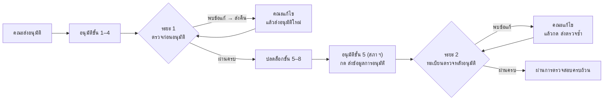


**คำศัพท์ในหน้านี้**

* **แท็บใหญ่** = หมวดของฟอร์มหลักสูตร เช่น ข้อมูลทั่วไป, โครงสร้างหลักสูตร
* **แท็บย่อย** = แท็บข้างในแต่ละหมวด เช่น รหัสและชื่อหลักสูตร, จัดการรายวิชา — **หน่วยที่ผู้ตรวจติ๊กผล**
* **รอบ** = การตรวจหนึ่งครั้ง ทุกครั้งที่ส่งคืน/ปิดรอบแบบพบข้อแก้ ระบบจะเปิดรอบใหม่ ผลรอบเก่าดูได้ที่ "ประวัติการตรวจสอบข้อมูล"


***

## ระยะ 1: ตรวจสอบข้อมูลก่อนอนุมัติ

### 1.1 เริ่มตรวจได้เมื่อไร

ในหน้า **การอนุมัติหลักสูตร** ด้านบนมีการ์ด **"ตรวจสอบข้อมูลก่อนอนุมัติ"**

<figure>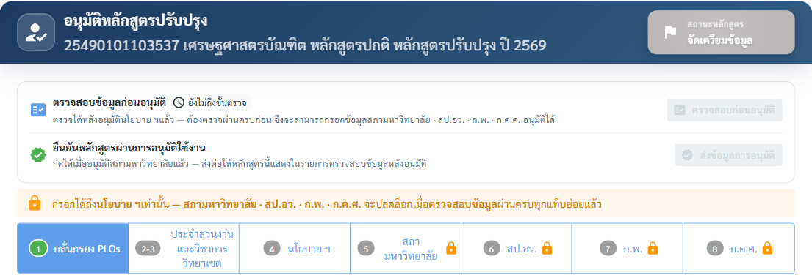<figcaption>
ตัวอย่าง: ยังไม่ถึงขั้นตรวจ — ขั้น 5–8 มีรูปกุญแจ (ล็อก)
</figcaption></figure>

<table><thead><tr><th width="220">ป้ายสถานะบนการ์ด</th><th>ความหมาย</th></tr></thead><tbody><tr><td>🕓 <strong>ยังไม่ถึงขั้นตรวจ</strong></td><td>ยังไม่ได้อนุมัติขั้นที่ 4 (นโยบาย ฯ) — ปุ่มตรวจกดไม่ได้</td></tr><tr><td>🔒 <strong>ยังตรวจไม่ครบ</strong></td><td>ตรวจได้แล้ว แต่ยังไม่ผ่านครบทุกแท็บย่อย — ขั้น 5–8 ยังล็อก</td></tr><tr><td>✅ <strong>ตรวจผ่านครบแล้ว</strong></td><td>ขั้น 5–8 ปลดล็อก กรอกการอนุมัติต่อได้</td></tr></tbody></table>


แถบสีส้ม "กรอกได้ถึงนโยบาย ฯ เท่านั้น — สภามหาวิทยาลัย · สป.อว. · ก.พ. · ก.ค.ศ. จะปลดล็อกเมื่อตรวจสอบข้อมูลผ่านครบทุกแท็บย่อยแล้ว" จะแสดงจนกว่าจะตรวจผ่านครบ ผู้ที่มีสิทธิ์อนุมัติแต่ไม่มีสิทธิ์ตรวจ จะเห็นแค่สถานะ ไม่เห็นปุ่มตรวจ


### 1.2 เข้าหน้าตรวจ

กดปุ่ม **"ตรวจสอบก่อนอนุมัติ"** บนการ์ด — หน้าตรวจเปิดในแท็บใหม่ของเบราว์เซอร์ (ถ้าตรวจผ่านครบแล้ว ปุ่มจะเปลี่ยนเป็น "ดูผลการตรวจสอบ")

<figure>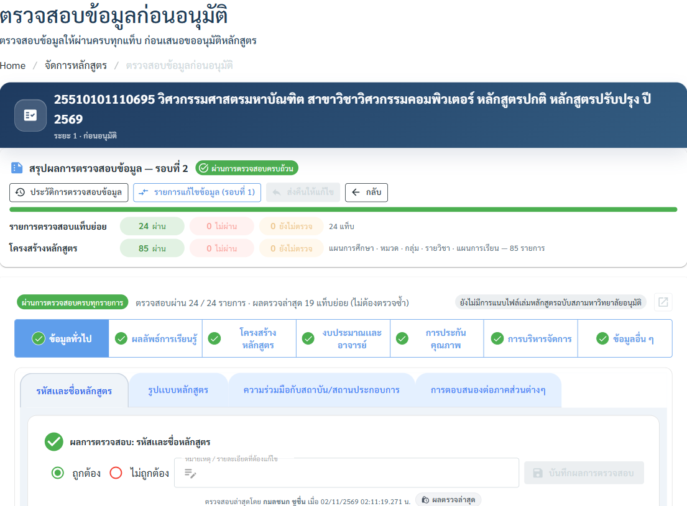<figcaption>
ตัวอย่างหลักสูตรที่ตรวจผ่านครบ 24/24 แท็บย่อย ในรอบที่ 2
</figcaption></figure>

**ส่วนประกอบของหน้าตรวจ**

<table><thead><tr><th width="250">ส่วน</th><th>ใช้ทำอะไร</th></tr></thead><tbody><tr><td><strong>สรุปผลการตรวจสอบข้อมูล — รอบที่ N</strong></td><td>นับ ผ่าน / ไม่ผ่าน / ยังไม่ตรวจ แยก 2 แถว: <strong>รายการตรวจสอบแท็บย่อย</strong> และ <strong>โครงสร้างหลักสูตร</strong> (ชิ้นย่อยในแผน: แผน · หมวด · กลุ่ม · รายวิชา · แผนการเรียน)</td></tr><tr><td><strong>ประวัติการตรวจสอบข้อมูล</strong></td><td>ดูผลทุกรอบ รวมรอบปัจจุบัน (ดูหัวข้อ "เครื่องมือ")</td></tr><tr><td><strong>รายการแก้ไขข้อมูล (รอบที่ N)</strong></td><td>มีเมื่อรอบก่อนถูกส่งคืน — ดูว่าคณะแก้อะไรไปบ้าง</td></tr><tr><td><strong>ส่งคืนให้แก้ไข</strong></td><td>ส่งกลับให้คณะแก้ (ดู 1.5)</td></tr><tr><td><strong>แถบแท็บใหญ่</strong></td><td>วงกลมหน้าชื่อแท็บ: ✅ ผ่านครบ · ❌ มีแท็บย่อยไม่ผ่าน · ⚪ ยังตรวจไม่ครบ</td></tr><tr><td><strong>เล่มหลักสูตร (PDF)</strong></td><td>มุมขวาบน — เปิดเล่มฉบับสภามหาวิทยาลัยอนุมัติประกอบการตรวจ (ถ้ามีการแนบแล้ว)</td></tr></tbody></table>

### 1.3 ตรวจทีละแท็บย่อย



#### เลือกแท็บใหญ่ แล้วเลือกแท็บย่อย

ข้อมูลของหลักสูตรจะแสดงแบบอ่านอย่างเดียว (แก้ไม่ได้จากหน้านี้)



#### อ่านข้อมูล แล้วเลือกผลในกล่อง "ผลการตรวจสอบ" ด้านบน

* **ถูกต้อง** — ข้อมูลครบและตรง
* **ไม่ถูกต้อง** — ต้อง **พิมพ์หมายเหตุ / รายละเอียดที่ต้องแก้ไข** ด้วย (บังคับ) ข้อความนี้คณะจะเห็น

**ตัวอย่างหมายเหตุที่ดี:** "รายวิชา 240-589 ต้องเป็น Active Learning และรูปแบบหน่วยกิตต้องเป็น 3((3)-0-6)" — ระบุรายการและสิ่งที่ต้องแก้ให้ชัด

<figure>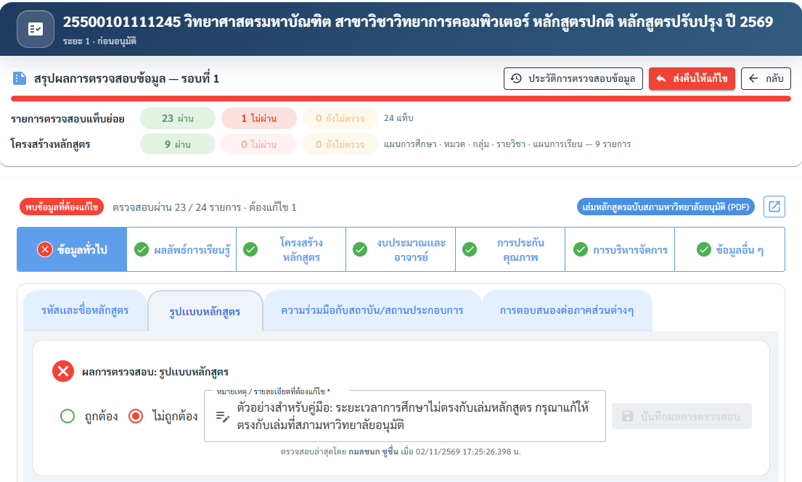<figcaption>
ตัวอย่าง: แท็บย่อย "รูปแบบหลักสูตร" ไม่ถูกต้อง — แท็บใหญ่ "ข้อมูลทั่วไป" ขึ้น ❌ และสรุปเป็น ผ่าน 23 · ไม่ผ่าน 1 · ยังไม่ตรวจ 0 ปุ่ม "ส่งคืนให้แก้ไข" จึงกดได้
</figcaption></figure>



#### กด "บันทึกผลการตรวจสอบ"

ใต้กล่องจะแสดง "ตรวจสอบล่าสุดโดย … เมื่อ …" ผู้ตรวจหลายคนตรวจได้ — **ผลล่าสุดจะทับผลเดิม**



#### ทำซ้ำจนครบทุกแท็บย่อย

ดูความคืบหน้าที่แถบสรุปด้านบน ("ตรวจสอบผ่าน x / y รายการ")




**ป้าย "ผลตรวจล่าสุด"** = ผลที่ยกมาจากรอบก่อน (แท็บที่เคยผ่านแล้วและคณะไม่ได้แก้) ไม่ต้องตรวจซ้ำ เช่น "ผลตรวจล่าสุด 19 แท็บย่อย (ไม่ต้องตรวจซ้ำ)"


#### แท็บย่อยพิเศษ 2 แท็บ — ผลคำนวณให้อัตโนมัติ

<table><thead><tr><th width="230">แท็บย่อย</th><th>ตรวจอย่างไร</th></tr></thead><tbody><tr><td><strong>แผนการศึกษา</strong> (โครงสร้างหลักสูตร)</td><td>ตรวจ <strong>รายชิ้น</strong> (แผน · หมวด · กลุ่ม · รายวิชา · แผนการเรียน) ในหน้าต่าง "ตรวจสอบโครงสร้างและแผนการเรียน" — ผลของแท็บย่อยรวมจากทุกชิ้นให้เอง</td></tr><tr><td><strong>อาจารย์ประจำหลักสูตร</strong> (งบประมาณและอาจารย์)</td><td>ตรวจ <strong>รายคน</strong> ในตาราง — ผลของแท็บย่อยรวมจากทุกคนให้เอง</td></tr></tbody></table>

**ตรวจอาจารย์ประจำหลักสูตรรายคน** — เลือก ถูกต้อง / ไม่ถูกต้อง ที่คอลัมน์ "ผลการตรวจสอบ" ของแต่ละคน (กดไอคอน 📄 เพื่อดูรายละเอียดอาจารย์)

<figure>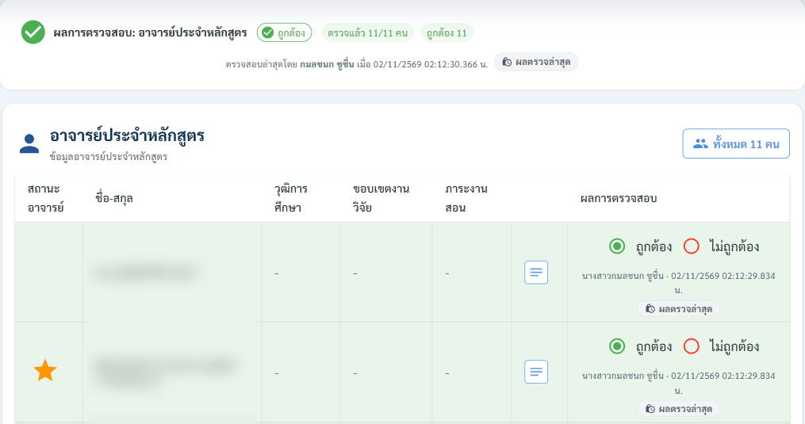<figcaption>
ตัวอย่าง: ตรวจแล้ว 11/11 คน ถูกต้อง 11 (ชื่ออาจารย์เบลอไว้)
</figcaption></figure>

**ตรวจแผนการศึกษารายชิ้น** — ดูวิธีละเอียดที่หัวข้อ 2.3 ด้านล่าง (ใช้หน้าต่างเดียวกันทั้ง 2 ระยะ)

### 1.4 ถ้าตรวจผ่านครบ

เมื่อทุกแท็บย่อยเป็น **ถูกต้อง** การ์ดในหน้าอนุมัติจะเป็น "ตรวจผ่านครบแล้ว" และ **ขั้น 5–8 ปลดล็อกทันที** — ระยะ 1 ไม่มีปุ่ม "เสร็จสิ้นการตรวจสอบ" (ยังกลับมาแก้ผลที่ติ๊กผิดได้)

### 1.5 ถ้าพบข้อที่ต้องแก้ — "ส่งคืนให้แก้ไข"


ปุ่ม **"ส่งคืนให้แก้ไข"** กดได้เมื่อครบ 2 เงื่อนไข: ① ตรวจครบทุกรายการแล้ว (ไม่เหลือ "ยังไม่ตรวจ") และ ② มีรายการที่ **ไม่ถูกต้อง** อย่างน้อย 1 รายการ — เอาเมาส์ชี้ปุ่มเพื่อดูว่าติดเงื่อนไขไหน




#### กด "ส่งคืนให้แก้ไข"



#### ตรวจสอบแท็บย่อยที่คณะจะแก้ไขได้

<figure>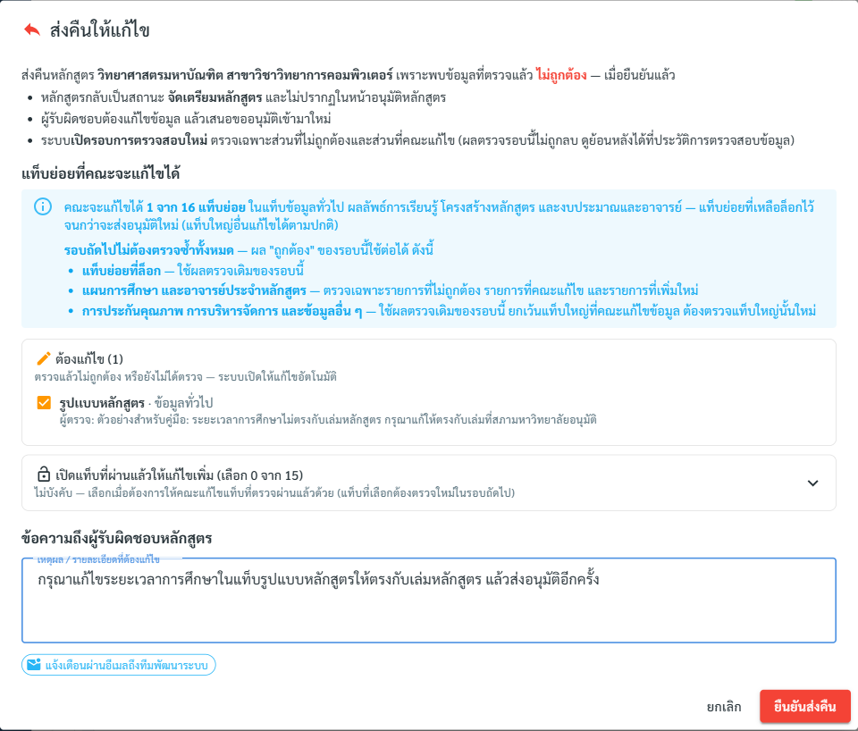<figcaption>
ตัวอย่าง: คณะจะแก้ไขได้ 1 จาก 16 แท็บย่อย (รูปแบบหลักสูตร) พร้อมหมายเหตุของผู้ตรวจ
</figcaption></figure>

ระบบเปิดให้แก้อัตโนมัติ: แท็บที่ **ไม่ถูกต้อง** และแท็บที่ **ยังไม่ได้ตรวจ** — ติ๊กเพิ่มได้ถ้าต้องการเปิดแท็บที่ผ่านแล้วให้แก้ด้วย (ต้องระบุ **เหตุผลที่เปิดให้แก้ไขเพิ่ม** ซึ่งคณะจะเห็น)



#### พิมพ์ "เหตุผล / รายละเอียดที่ต้องแก้ไข" ถึงผู้รับผิดชอบหลักสูตร



#### กด "ยืนยันส่งคืน"

ใช้เวลาหลายวินาที (เก็บผลรอบนี้ เปิดรอบใหม่ และส่งอีเมล) อย่ากดซ้ำ



**ผลหลังส่งคืน**

* หลักสูตรกลับเป็นสถานะ **"จัดเตรียมหลักสูตร"** และไม่แสดงในหน้าอนุมัติหลักสูตร จนกว่าคณะจะส่งอนุมัติใหม่
* ระบบเปิด **รอบใหม่** — รอบถัดไป **ไม่ต้องตรวจซ้ำทั้งหมด**:

<table><thead><tr><th width="300">แท็บ</th><th>รอบถัดไป</th></tr></thead><tbody><tr><td>แท็บย่อยที่ผ่านแล้ว (ล็อก)</td><td>ใช้ผลตรวจเดิม — คณะแก้ไม่ได้</td></tr><tr><td>แผนการศึกษา และอาจารย์ประจำหลักสูตร</td><td>ตรวจเฉพาะรายการที่ไม่ถูกต้อง รายการที่คณะแก้ไข และรายการที่เพิ่มใหม่</td></tr><tr><td>การประกันคุณภาพ การบริหารจัดการ และข้อมูลอื่น ๆ</td><td>ใช้ผลเดิม ยกเว้นแท็บใหญ่ที่คณะแก้ข้อมูล ต้องตรวจแท็บนั้นใหม่</td></tr></tbody></table>

### 1.6 ฝั่งคณะ: แก้ไขหลังถูกส่งคืน (ระยะ 1)



#### เปิดหน้ารายละเอียดหลักสูตร

ด้านบนจะมีแถบสีแดง **"ผู้ตรวจสอบข้อมูลพบ N จุดที่ต้องแก้ไข ใน M แท็บ"**



#### กด "ดูรายการที่ต้องแก้ไข"

หน้าต่างแสดงทุกจุดที่ไม่ถูกต้อง พร้อมหมายเหตุของผู้ตรวจ แบ่งกลุ่มเป็น:

* **ตรวจแล้วไม่ถูกต้อง** — แก้ตามหมายเหตุ
* **แท็บที่เกี่ยวข้อง** — ข้อมูลเชื่อมกับแท็บที่ต้องแก้ ควรตรวจทานด้วย
* **ยังไม่ได้ตรวจ** — แก้ไขได้
* **ผู้ตรวจสอบเปิดให้แก้ไขเพิ่มเติม** — แท็บที่ผ่านแล้วแต่ผู้ตรวจเปิดให้แก้ พร้อมเหตุผล



#### แก้ไขข้อมูล

สัญลักษณ์ดินสอบนหัวแท็บย่อย: 🔴 เปิดให้แก้ไข · 🔵 แก้ไขแล้ว · 🔒 ผ่านการตรวจสอบแล้ว แก้ไขไม่ได้



#### ส่งอนุมัติอีกครั้ง

ใช้ปุ่ม "ส่งอนุมัติ" เดิมในหน้าจัดการหลักสูตร (ดู [การส่งอนุมัติหลักสูตร](curriculum-sent-approval.md))



***

## ระยะ 2: ตรวจสอบข้อมูลหลังอนุมัติ (ฝ่ายทะเบียน)

### 2.1 หลักสูตรเข้ารายการตรวจเมื่อไร

หลังอนุมัติขั้นที่ 5 (สภามหาวิทยาลัย) ผู้ดูแลการอนุมัติกดปุ่ม **"ส่งข้อมูลการอนุมัติ"** ในการ์ด **"ยืนยันหลักสูตรผ่านการอนุมัติใช้งาน"** (หน้าการอนุมัติหลักสูตร — ภาพในหัวข้อ 1.1) หลักสูตรจะเข้ารายการตรวจของทะเบียนทันที ไม่ต้องรออนุมัติขั้น 6–8


"ส่งข้อมูลการอนุมัติ" เป็นการกระทำทางเดียว — ย้อนกลับไม่ได้


### 2.2 หน้ารายการตรวจ

เมนู **หลักสูตร → จัดการหลักสูตร** → แท็บ **"ตรวจสอบข้อมูล (หลังอนุมัติ)"**

<figure>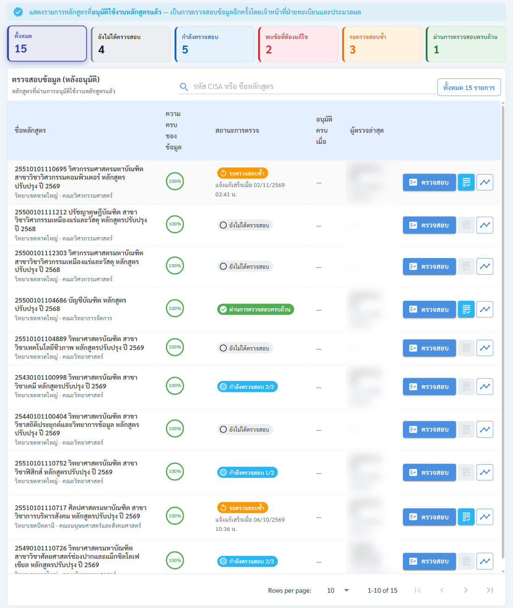<figcaption>
การ์ดด้านบนใช้กรองตามสถานะ — กดการ์ดเพื่อแสดงเฉพาะสถานะนั้น
</figcaption></figure>

<table><thead><tr><th width="230">สถานะการตรวจ</th><th>ความหมาย</th><th width="200">ใครต้องทำอะไรต่อ</th></tr></thead><tbody><tr><td>⚪ <strong>ยังไม่ได้ตรวจสอบ</strong></td><td>ยังไม่มีการติ๊กผล</td><td>ทะเบียน: เริ่มตรวจ</td></tr><tr><td>🔵 <strong>กำลังตรวจสอบ x/y</strong></td><td>ตรวจไปแล้ว x จาก y แท็บย่อย</td><td>ทะเบียน: ตรวจต่อให้ครบ</td></tr><tr><td>🔴 <strong>พบข้อที่ต้องแก้ไข</strong></td><td>ปิดรอบแบบพบข้อแก้ — รอเจ้าหน้าที่หลักสูตรแก้ไข</td><td>คณะ: แก้แล้วกด "ส่งตรวจซ้ำ"</td></tr><tr><td>🟠 <strong>รอตรวจสอบซ้ำ</strong></td><td>คณะแจ้งแก้เสร็จแล้ว (มีวันเวลาที่แจ้ง)</td><td>ทะเบียน: ตรวจรอบใหม่</td></tr><tr><td>🟢 <strong>ผ่านการตรวจสอบครบถ้วน</strong></td><td>ปิดรอบแบบผ่านครบ — จบงาน</td><td>—</td></tr></tbody></table>

<table><thead><tr><th width="200">ปุ่มท้ายแถว</th><th>ใช้ทำอะไร</th></tr></thead><tbody><tr><td><strong>ตรวจสอบ</strong></td><td>เข้าหน้าตรวจ</td></tr><tr><td>📋 (ดูผลตรวจ)</td><td>ดูผลการตรวจทุกรอบ — กดได้เมื่อผู้ตรวจกด "เสร็จสิ้นการตรวจสอบ" ไปแล้วอย่างน้อย 1 รอบ</td></tr><tr><td>📈 (ไทม์ไลน์)</td><td>ไทม์ไลน์การอนุมัติและการตรวจของหลักสูตร</td></tr></tbody></table>

### 2.3 ตรวจโครงสร้างหลักสูตร

ระยะ 2 ตรวจเฉพาะแท็บใหญ่ **โครงสร้างหลักสูตร** มี 2 แท็บย่อย

<figure>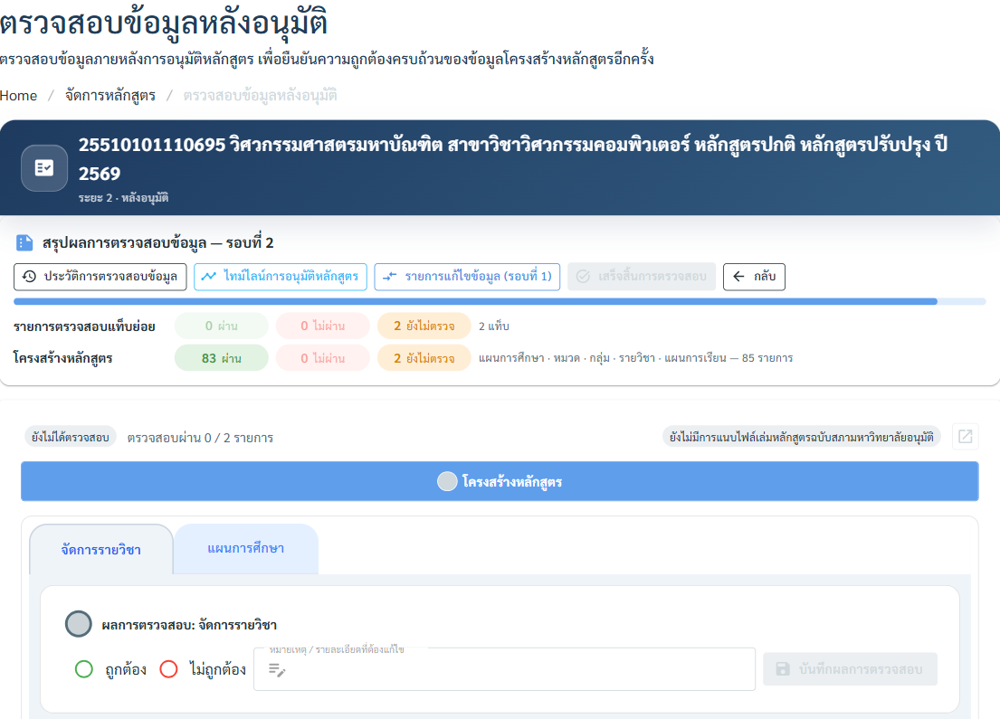<figcaption>
ตัวอย่างรอบที่ 2 (รอตรวจซ้ำ): โครงสร้าง 83 ชิ้นยกผลผ่านมาจากรอบก่อน เหลือตรวจ 2 ชิ้น
</figcaption></figure>

**แท็บย่อย "จัดการรายวิชา"** — ตรวจรายการรายวิชาของหลักสูตร (กด 📄 ท้ายแถวเพื่อดูรายละเอียดวิชา) แล้วติ๊ก ถูกต้อง / ไม่ถูกต้อง + บันทึก เหมือนระยะ 1

#### แท็บย่อย "แผนการศึกษา" — ตรวจรายชิ้น

<figure>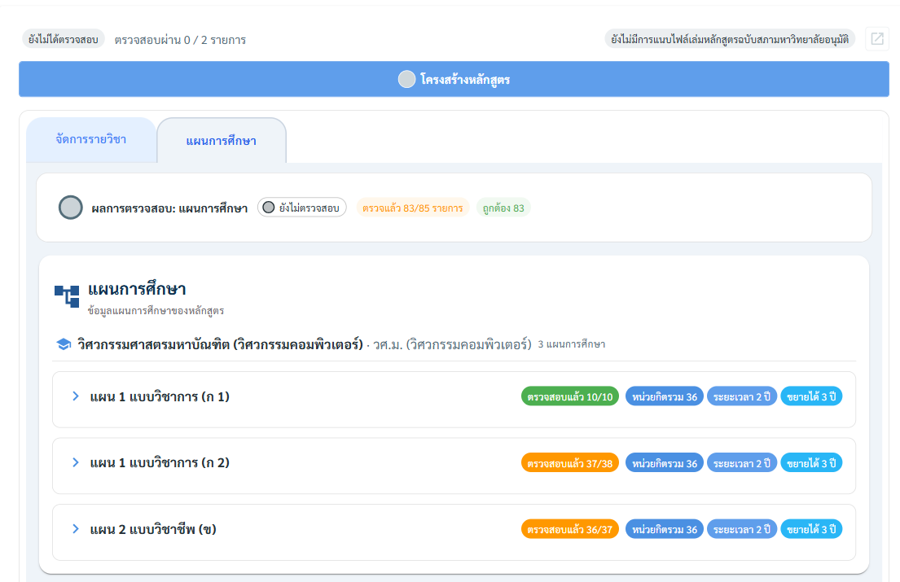<figcaption>
แต่ละแผนแสดงความคืบหน้า เช่น "ตรวจสอบแล้ว 37/38" (ส้ม = ยังไม่ครบ, เขียว = ครบ)
</figcaption></figure>



#### กดที่แผน (หรือตัวเลือกโครงสร้าง) เพื่อขยาย แล้วกด "ตรวจสอบโครงสร้างและแผนการเรียน"



#### ติ๊กผลทีละชิ้น

<figure>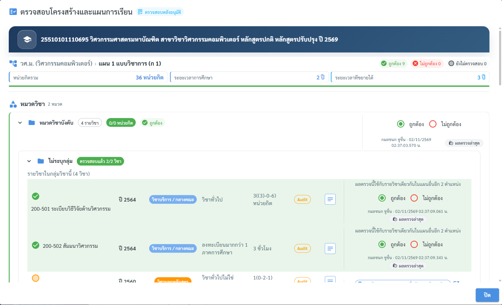<figcaption>
ติ๊กได้ที่ระดับหมวด กลุ่ม และรายวิชา — แถบสรุปมุมขวาบนนับ ถูกต้อง / ไม่ถูกต้อง / ยังไม่ตรวจสอบ
</figcaption></figure>

* **หมวด / กลุ่ม** — เลือกผล แล้วกด **"บันทึกผลการตรวจสอบ"** ข้างช่องนั้น
* **รายวิชาในกลุ่ม** — ติ๊กได้หลายวิชาก่อน ระบบจะขึ้นแถบ **"N รายวิชา ที่รอบันทึก"** ใต้กลุ่ม แล้วกด **"บันทึกผลการตรวจสอบ N รายวิชา"** ทีเดียว (กด "ล้างการเลือก" ถ้าติ๊กผิด)
* **ไม่ถูกต้อง** → ต้องพิมพ์หมายเหตุทุกชิ้น ไม่งั้นปุ่มบันทึกกดไม่ได้

<figure>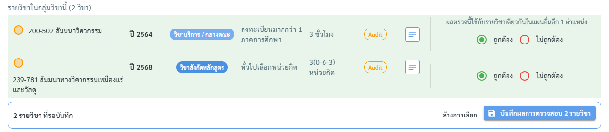<figcaption>
ติ๊กแล้วยังไม่ถูกบันทึกจนกว่าจะกดปุ่มบันทึกของกลุ่ม
</figcaption></figure>


ปิดหน้าต่างโดยไม่กดบันทึก ผลที่ติ๊กไว้จะหาย




#### ติ๊กผลของตัวแผนเอง

นอกจากชิ้นในหน้าต่าง แต่ละแผน (หรือตัวเลือกโครงสร้าง) มีช่อง **ถูกต้อง / ไม่ถูกต้อง** ของตัวแผนอยู่ด้านบนเมื่อกางแผนในแท็บ — ตรวจข้อมูลแผน (หน่วยกิตรวม ระยะเวลา คุณสมบัติผู้เข้าศึกษา เกณฑ์การสำเร็จการศึกษา ชุด PLOs) แล้วกด "บันทึกผลการตรวจสอบ" ตัวเลข "ตรวจสอบแล้ว x/y" บนแถวแผนจึงจะครบ



#### ตรวจแผนการเรียน (รายปี × ภาคการศึกษา) ด้านล่างของหน้าต่าง แล้วกด "ปิด"

ผลของแท็บย่อย "แผนการศึกษา" รวมจากทุกชิ้นให้อัตโนมัติ




* **"ผลตรวจนี้ใช้กับรายวิชาเดียวกันในแผนอื่นอีก N ตำแหน่ง"** — ติ๊กครั้งเดียว ผลไปทุกแผนที่ใช้วิชานั้น
* วิชาของหลักสูตรอื่น (ป้าย "วิชานอกหลักสูตร") ขึ้น **"ยกเว้นการตรวจ — ตรวจที่หลักสูตรเจ้าของวิชา"** ไม่ต้องติ๊ก กดไอคอนเพื่อเปิดหลักสูตรเจ้าของวิชาได้


### 2.4 จบการตรวจ — "เสร็จสิ้นการตรวจสอบ"

ปุ่มกดได้เมื่อตรวจครบทุกรายการ (ไม่เหลือ "ยังไม่ตรวจ") ปุ่มจะเปลี่ยนตามผล:

<figure>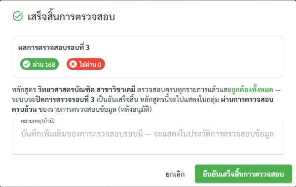<figcaption>
ตัวอย่างแบบผ่านครบ: รอบที่ 3 ผ่าน 168 ไม่ผ่าน 0 — กด "ยืนยันเสร็จสิ้นการตรวจสอบ" เพื่อปิดรอบ
</figcaption></figure>

<figure>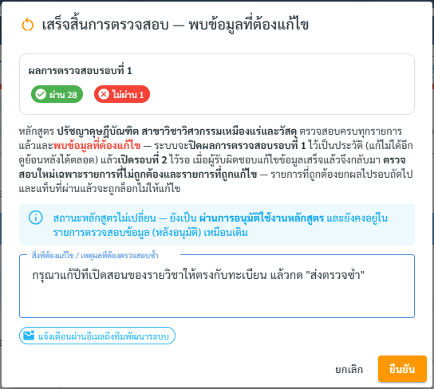<figcaption>
ตัวอย่างแบบพบข้อแก้: ผ่าน 28 ไม่ผ่าน 1 — ต้องพิมพ์ "สิ่งที่ต้องแก้ไข / เหตุผลที่ต้องตรวจสอบซ้ำ" แล้วกด "ยืนยัน"
</figcaption></figure>

<table><thead><tr><th width="320">ปุ่ม</th><th>เมื่อกดแล้ว</th></tr></thead><tbody><tr><td>🟢 <strong>เสร็จสิ้นการตรวจสอบ</strong> (ผ่านครบ)</td><td>ใส่หมายเหตุได้ (ถ้ามี) → ปิดรอบ หลักสูตรเป็น <strong>"ผ่านการตรวจสอบครบถ้วน"</strong> จบงาน</td></tr><tr><td>🟠 <strong>เสร็จสิ้นการตรวจสอบ (พบข้อมูลที่ต้องแก้ไข)</strong></td><td>ต้องระบุ <strong>"สิ่งที่ต้องแก้ไข / เหตุผลที่ต้องตรวจสอบซ้ำ"</strong> → ปิดรอบเป็นประวัติ เปิดรอบใหม่ หลักสูตรเป็น <strong>"พบข้อที่ต้องแก้ไข"</strong> และส่งอีเมลแจ้งคณะ</td></tr></tbody></table>


ต่างจากระยะ 1: ระยะ 2 **ไม่ถอยสถานะหลักสูตร** (หลักสูตรยังอนุมัติใช้งานอยู่) รอบถัดไปตรวจเฉพาะรายการที่ไม่ถูกต้องและรายการที่ถูกแก้ไข — รายการที่ถูกต้องยกผลไปรอบถัดไป


### 2.5 ฝั่งคณะ: แก้ไขแล้ว "ส่งตรวจซ้ำ"

เมื่อทะเบียนปิดรอบแบบพบข้อแก้ หน้ารายละเอียดหลักสูตรจะมีแถบสีส้ม:

<figure>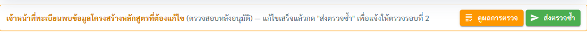<figcaption></figcaption></figure>



#### กด "ดูผลการตรวจ" เพื่อดูรายการที่ไม่ถูกต้องและหมายเหตุ



#### แก้ไขข้อมูลในแท็บที่เปิดให้แก้

แท็บย่อยที่ทะเบียนตรวจผ่านแล้วจะล็อก (🔒) แก้ไม่ได้



#### กด "ส่งตรวจซ้ำ" แล้วยืนยัน

แถบเปลี่ยนเป็นสีเขียว "ส่งตรวจซ้ำแล้ว เมื่อ … — รอเจ้าหน้าที่ทะเบียนตรวจรอบที่ N" ระบบแจ้งทะเบียนให้อัตโนมัติ และสถานะในรายการเป็น **"รอตรวจสอบซ้ำ"**



### 2.6 ตรวจซ้ำ

ทะเบียนกด **"ตรวจสอบ"** ที่หลักสูตรสถานะ "รอตรวจสอบซ้ำ" → กด **"รายการแก้ไขข้อมูล (รอบที่ N)"** เพื่อดูว่าคณะแก้อะไรไปบ้าง แล้วตรวจเฉพาะชิ้นที่เหลือ

***

## เครื่องมือที่ใช้ได้ในหน้าตรวจ

### ประวัติการตรวจสอบข้อมูล

ดูผลทุกรอบ (เรียงจากรอบล่าสุด) กดที่รอบเพื่อกาง — แต่ละรอบบอกเหตุผลที่ส่งคืน จำนวน ผ่าน/ไม่ผ่าน และรายการที่ไม่ผ่านพร้อมตำแหน่ง (แผน › หมวด › กลุ่ม) หมายเหตุ ผู้ตรวจ และเวลา

<figure>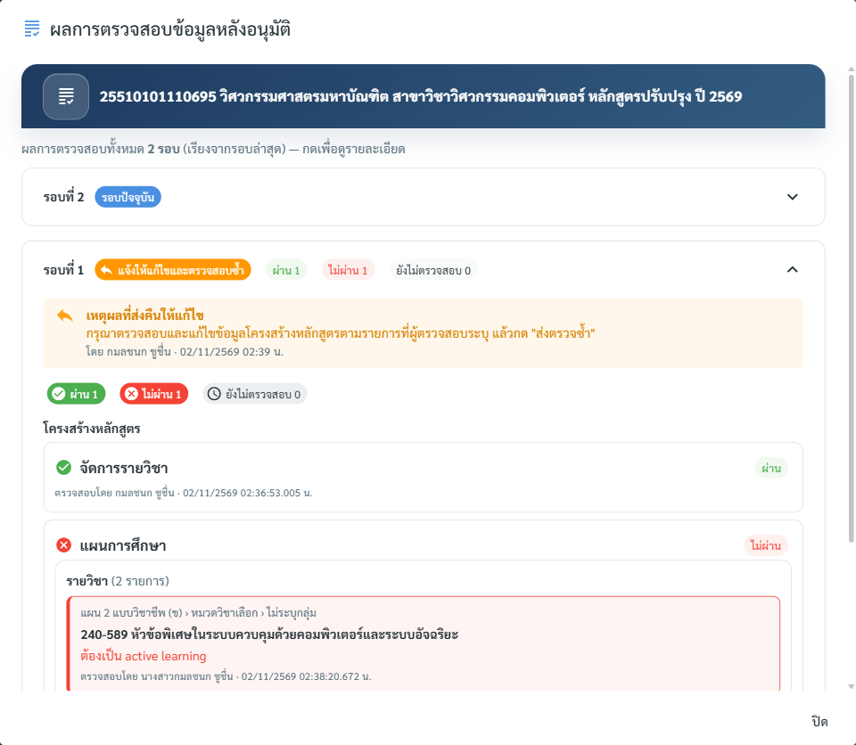<figcaption>
ตัวอย่างรอบที่ 1: วิชา 240-589 ไม่ผ่าน หมายเหตุ "ต้องเป็น active learning"
</figcaption></figure>

### รายการแก้ไขข้อมูล (รอบที่ N)

เปรียบเทียบข้อมูล **เดิม → ใหม่** ที่คณะแก้หลังรอบที่ N ถูกส่งคืน พร้อมบอกว่าแต่ละแท็บถูกเปิดให้แก้ด้วยเหตุผลอะไร (ไม่ถูกต้อง / เกี่ยวข้องกับแท็บที่ไม่ถูกต้อง)

<figure>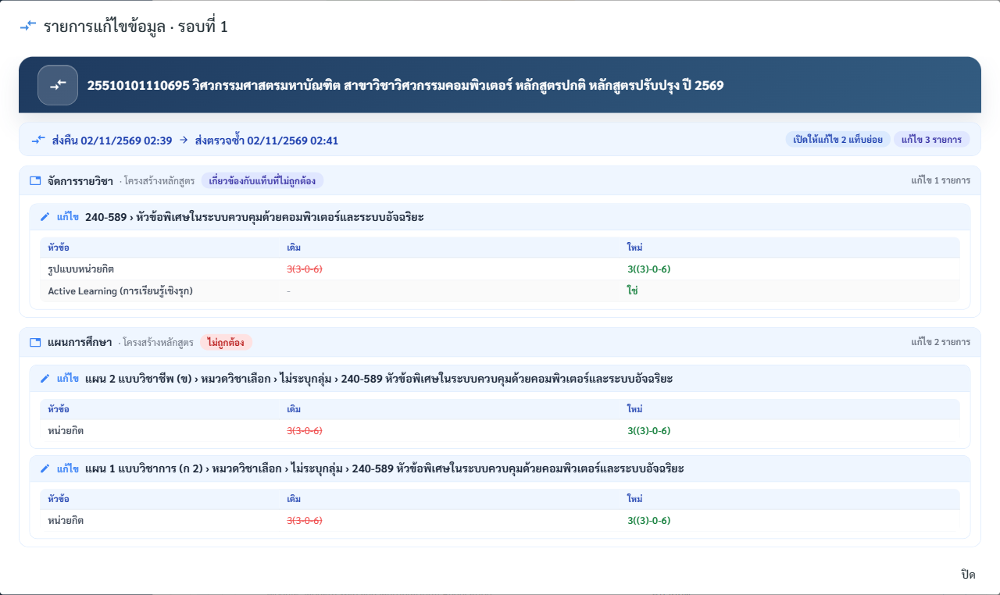<figcaption>
ตัวอย่าง: คณะแก้ 240-589 จาก 3(3-0-6) เป็น 3((3)-0-6) และเปิด Active Learning
</figcaption></figure>

### ไทม์ไลน์การอนุมัติหลักสูตร (เฉพาะหน้าตรวจระยะ 2 และหน้ารายการ)

ลำดับเหตุการณ์ทั้งหมด: วันที่อนุมัติแต่ละขั้น, เริ่มตรวจแต่ละรอบ, ส่งคืน, ส่งขออนุมัติใหม่ — กรองได้ด้วยชิป "ลำดับขั้นการอนุมัติ / ตรวจสอบก่อนอนุมัติ / ตรวจสอบหลังอนุมัติ"

<figure>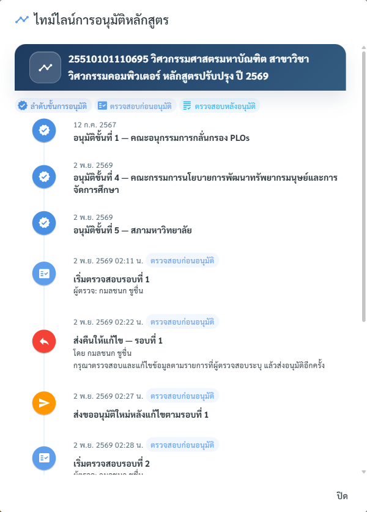<figcaption></figcaption></figure>

***

## คำถามที่พบบ่อย

<table><thead><tr><th width="320">คำถาม</th><th>คำตอบ</th></tr></thead><tbody><tr><td>ไม่เห็นปุ่ม "ตรวจสอบก่อนอนุมัติ"</td><td>บัญชีไม่มีสิทธิ์ตรวจระยะ 1 — จะเห็นแค่สถานะบนการ์ด</td></tr><tr><td>ปุ่มตรวจกดไม่ได้ ขึ้น "ยังไม่ถึงขั้นตรวจ"</td><td>ต้องอนุมัติขั้นที่ 4 (นโยบาย ฯ) ก่อน</td></tr><tr><td>กรอกอนุมัติขั้น 5–8 ไม่ได้ (มีกุญแจ)</td><td>รอให้ตรวจระยะ 1 ผ่านครบทุกแท็บย่อย</td></tr><tr><td>บันทึกผล "ไม่ถูกต้อง" ไม่ได้</td><td>ต้องพิมพ์หมายเหตุ / รายละเอียดที่ต้องแก้ไขก่อน</td></tr><tr><td>ปุ่ม "ส่งคืนให้แก้ไข" / "เสร็จสิ้นการตรวจสอบ" กดไม่ได้</td><td>ยังตรวจไม่ครบทุกรายการ (ชี้เมาส์ที่ปุ่มเพื่อดูจำนวนที่เหลือ) — "ส่งคืน" ต้องมีรายการไม่ถูกต้องด้วย</td></tr><tr><td>หลักสูตรไม่อยู่ในรายการตรวจของทะเบียน</td><td>ยังไม่ได้กด "ส่งข้อมูลการอนุมัติ" ในหน้าการอนุมัติหลักสูตร (ต้องอนุมัติขั้น 5 ก่อน)</td></tr><tr><td>ปุ่ม 📋 ดูผลตรวจ ในรายการกดไม่ได้</td><td>ยังไม่มีรอบที่กด "เสร็จสิ้นการตรวจสอบ"</td></tr><tr><td>คณะแก้แท็บที่ผ่านแล้วไม่ได้</td><td>แท็บที่ตรวจผ่านถูกล็อก — ถ้าจำเป็นต้องแก้ ให้ผู้ตรวจเปิดให้แก้ไขเพิ่มตอนส่งคืน (ระยะ 1)</td></tr><tr><td>วิชาบางตัวขึ้น "ยกเว้นการตรวจ"</td><td>เป็นวิชาของหลักสูตรอื่น ตรวจที่หลักสูตรเจ้าของวิชา</td></tr></tbody></table>
