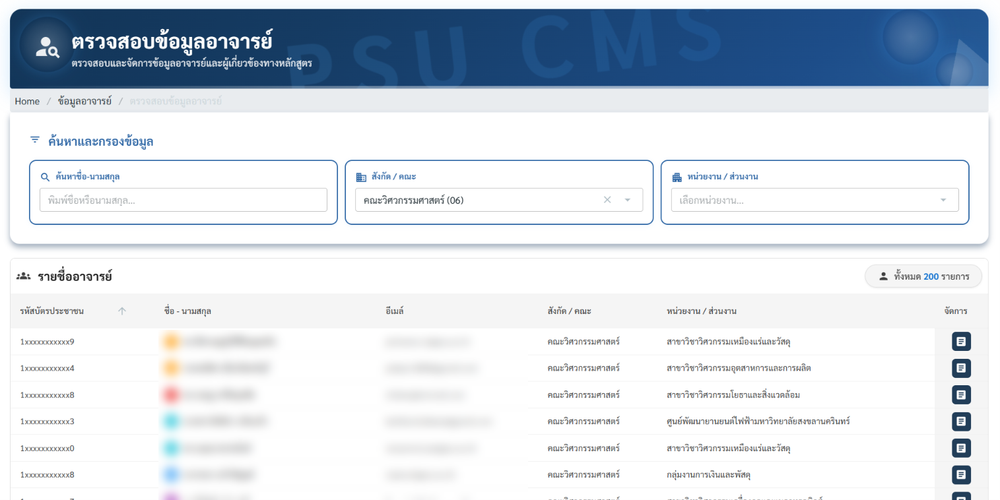
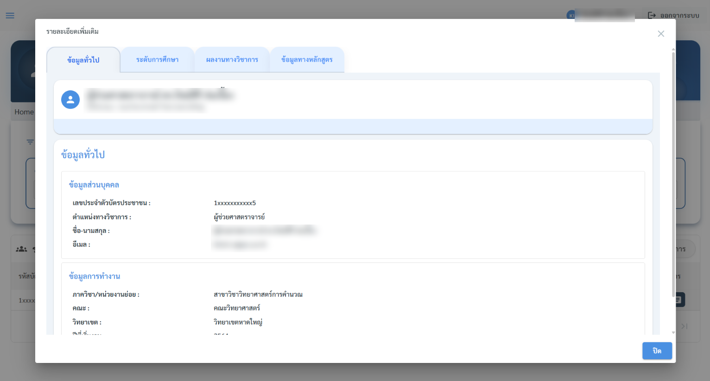
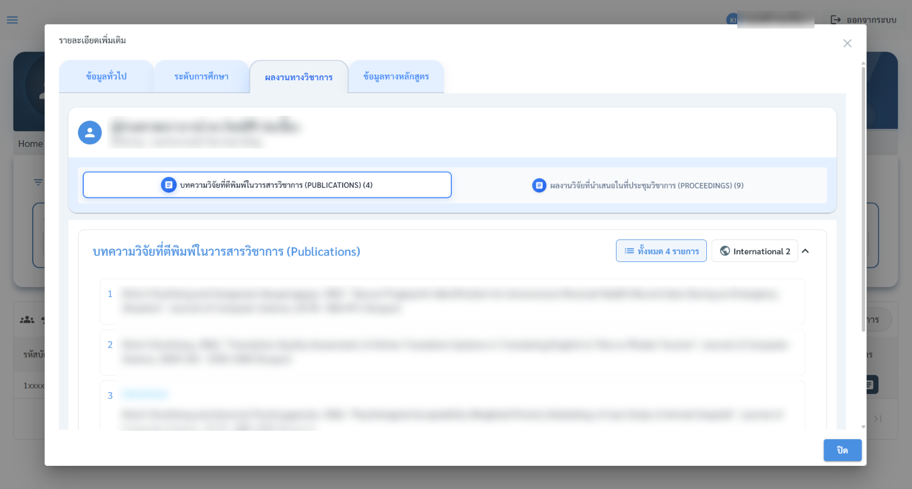

# 10. การตรวจสอบข้อมูลอาจารย์

1. คลิกเมนู ตรวจสอบข้อมูลอาจารย์
2. ระบบซิงค์และนำข้อมูลอาจารย์มาแสดงจากระบบ **HRMIS**

**ข้อมูลที่ดูได้**

| หัวข้อ            | รายละเอียด                                                  |
| ----------------- | ----------------------------------------------------------- |
| ข้อมูลทั่วไป      | ชื่อ-สกุล ตำแหน่ง คณะ/ภาควิชา วิทยาเขต                      |
| คุณวุฒิการศึกษา   | ระดับการศึกษาสูงสุด สาขาวิชา สถาบัน ปีที่จบ                 |
| ตำแหน่งทางวิชาการ | อาจารย์ / ผู้ช่วยศาสตราจารย์ / รองศาสตราจารย์ / ศาสตราจารย์ |
| ภาระการสอน        | รายวิชาที่รับผิดชอบในแต่ละภาคการศึกษา                       |
| ผลงานทางวิชาการ   | งานวิจัย บทความ ตำรา (ซิงค์มาจากระบบ HRMIS)                 |


สามารถใช้**ช่องค้นหา**เพื่อหาข้อมูลอาจารย์รายบุคคลได้


<figure><figcaption>
ค้นหาด้วยชื่อ-นามสกุล หรือกรองตามสังกัด/คณะ และหน่วยงาน/ส่วนงาน แล้วกดปุ่ม 📄 ท้ายแถวเพื่อดูรายละเอียด (ภาพนี้เบลอชื่อและอีเมล)
</figcaption></figure>

หน้าต่าง **"รายละเอียดเพิ่มเติม"** มี 4 แท็บ

| แท็บ | แสดงอะไร |
| --- | --- |
| **ข้อมูลทั่วไป** | ข้อมูลส่วนบุคคล (เลขบัตรประชาชนแบบปิดบางส่วน, ตำแหน่งทางวิชาการ, ชื่อ-นามสกุล, อีเมล) และข้อมูลการทำงาน (ภาควิชา, คณะ, วิทยาเขต, ปีที่เริ่มงาน) |
| **ระดับการศึกษา** | วุฒิการศึกษาแต่ละระดับ สาขา สถาบัน และปีที่จบ |
| **ผลงานทางวิชาการ** | บทความในวารสาร (Publications) และผลงานที่นำเสนอในที่ประชุมวิชาการ (Proceedings) พร้อมจำนวนและป้าย International |
| **ข้อมูลทางหลักสูตร** | หลักสูตรที่อาจารย์คนนี้มีชื่ออยู่ (รหัส CISA, หลักสูตร, สถานะทางหลักสูตร, ช่วงรับผิดชอบ) กดดูขอบเขตงานวิจัยและภาระงานสอน (รายวิชาที่สอน) ได้ |

<figure><figcaption>
แท็บ "ข้อมูลทั่วไป" (ภาพนี้เบลอชื่อและอีเมล)
</figcaption></figure>

## การตรวจคุณสมบัติ 🟢อาจารย์ประจำหลักสูตร

ระบบใช้**ข้อมูลคุณวุฒิและตำแหน่งทางวิชาการ**นี้ในการ ตรวจคุณสมบัติอาจารย์ประจำหลักสูตร ตามเกณฑ์มาตรฐาน เมื่อมีอาจารย์ที่คุณวุฒิไม่ผ่านเกณฑ์ในหลักสูตรใด ระบบจะแสดงในแท็บอาจารย์ของ Dashboard พร้อมข้อมูลสังกัด (วิทยาเขต/คณะ/ภาควิชา) เพื่อให้ติดตามแก้ไขได้ตรงคน

ข้อมูลอาจารย์ (ชื่อ-สกุล คุณวุฒิ ตำแหน่งทางวิชาการ และผลงานทางวิชาการ) มาจากระบบ **HRMIS** หากพบว่าข้อมูลไม่ถูกต้อง ส่วนใหญ่ต้องแก้ที่ **HRMIS ต้นทาง** แล้วข้อมูลจะซิงค์กลับมาที่ CMS ไม่ใช่แก้ที่ CMS โดยตรง

<figure><figcaption>
แท็บ "ผลงานทางวิชาการ" แยก Publications / Proceedings (ภาพนี้เบลอชื่อผู้แต่ง)
</figcaption></figure>


หลังแก้ข้อมูลที่ HRMIS แล้ว ข้อมูลจะซิงค์กลับมาที่ระบบ CMS ภายใน 1 วัน

