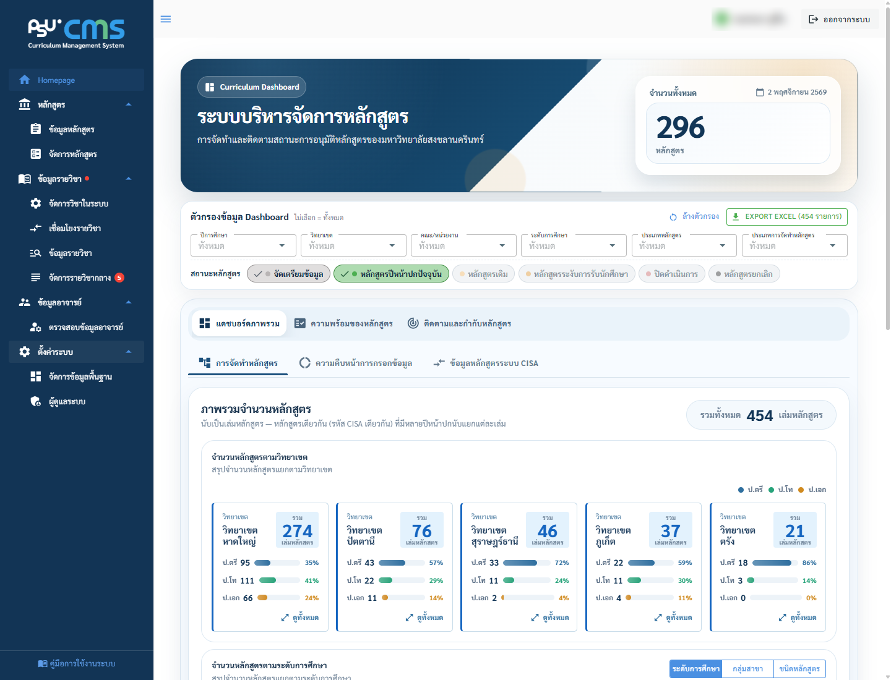
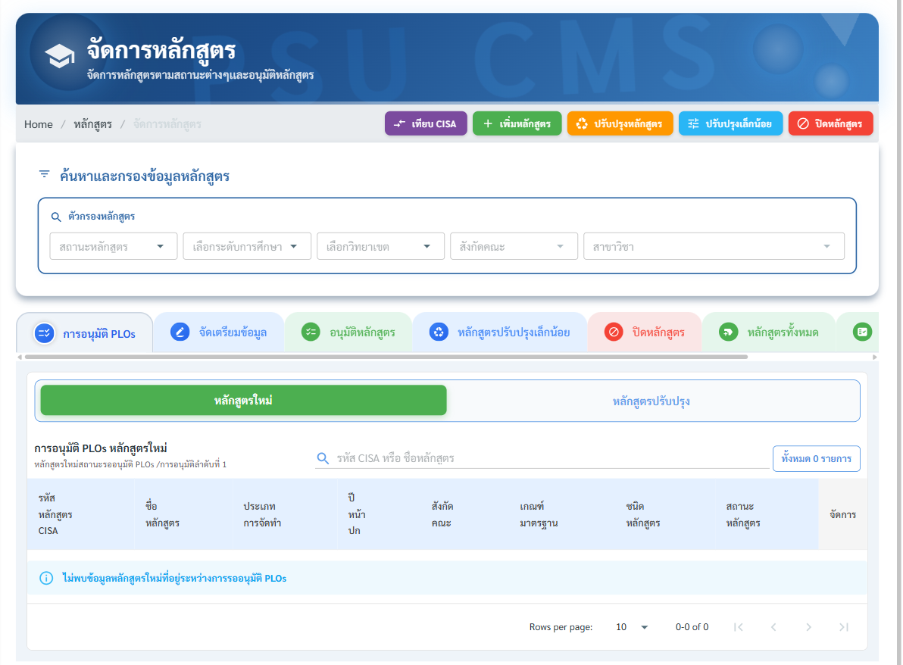

# 2. เมนูและหน้าจอหลัก


เมนูที่เห็นขึ้นกับ **สิทธิ์การใช้งาน** ของแต่ละคน ถ้าไม่เห็นเมนูหรือแท็บที่คู่มือกล่าวถึง แปลว่ายังไม่ได้รับสิทธิ์นั้น ติดต่อผู้ดูแลระบบ (ดู [Contact Us](contact-us.md))


## โครงสร้างหน้าจอ

<figure><figcaption>
เมนูซ้าย (กางทุกกลุ่ม) แถบบน และพื้นที่ทำงาน
</figcaption></figure>

| ส่วน | รายละเอียด |
| --- | --- |
| **แถบเมนูซ้าย (Sidebar)** | เมนูทั้งหมดของระบบ คลิกชื่อกลุ่มเพื่อกาง/หุบเมนูย่อย ด้านล่างสุดมีลิงก์ **"คู่มือการใช้งานระบบ"** (เปิดคู่มือนี้) |
| **ปุ่ม ☰** (มุมซ้ายบน) | ย่อ/ขยายแถบเมนูซ้าย บนจอมือถือแถบเมนูจะซ่อนไว้ ใช้ปุ่มนี้เปิด |
| **แถบบน** | ชื่อผู้ใช้ที่เข้าสู่ระบบ และปุ่ม **ออกจากระบบ** |
| **พื้นที่ทำงาน** | เนื้อหาของหน้าที่เลือก ด้านบนของแต่ละหน้ามีแถบหัวและ breadcrumb (เช่น Home / หลักสูตร / จัดการหลักสูตร) คลิกเพื่อย้อนกลับได้ |
| **ส่วนท้าย (Footer)** | ช่องทางติดต่อ อีเมล โทรศัพท์ LINE และนโยบายต่าง ๆ |

## รายการเมนูทั้งหมด

| กลุ่มเมนู | เมนูย่อย | ใช้ทำอะไร | ดูวิธีใช้ |
| --- | --- | --- | --- |
| **Homepage** | – | หน้า Dashboard ภาพรวมหลักสูตร | [3. หน้า Dashboard](dashboard.md) |
| **หลักสูตร** | ข้อมูลหลักสูตร | ค้นหาและเปิดดูหลักสูตร (อ่านอย่างเดียว) และส่งออก Excel | [4. การดูข้อมูลหลักสูตร](view-curriculum.md) |
| | จัดการหลักสูตร | เพิ่ม/ปรับปรุง/ปรับปรุงเล็กน้อย/ปิดหลักสูตร กรอกข้อมูล ส่งอนุมัติ และตรวจสอบข้อมูล | ด้านล่าง |
| **ข้อมูลรายวิชา** | จัดการวิชาในระบบ | ดูรายวิชาทั้งหมดในระบบ (รวมจากทุกแหล่ง) | [9. การจัดการรายวิชา](subjects.md) |
| | เชื่อมโยงรายวิชา | จับคู่รายวิชาใน CMS กับรายวิชาในระบบทะเบียน | [9. การจัดการรายวิชา](subjects.md) |
| | ข้อมูลรายวิชา | ค้นหาและดูรายละเอียดรายวิชา | [9. การจัดการรายวิชา](subjects.md) |
| | จัดการรายวิชากลาง | เพิ่ม/แก้ไขรายวิชากลางที่ใช้ร่วมกันหลายหลักสูตร | [9. การจัดการรายวิชา](subjects.md) |
| **ข้อมูลอาจารย์** | ตรวจสอบข้อมูลอาจารย์ | ดูข้อมูลอาจารย์ คุณวุฒิ ตำแหน่ง และผลงาน | [10. การตรวจสอบข้อมูลอาจารย์](lecturers.md) |
| **ตั้งค่าระบบ** | จัดการข้อมูลพื้นฐาน / ผู้ดูแลระบบ | สำหรับผู้ดูแลระบบเท่านั้น (ไม่กล่าวถึงในคู่มือนี้) | – |


**จุดสีแดงข้างเมนู "ข้อมูลรายวิชา"** และ **ตัวเลขสีแดงข้าง "จัดการรายวิชากลาง"** คือจำนวนคำขอรายวิชากลางที่ถูกส่งกลับให้แก้ไข ควรเข้าไปตรวจสอบและแก้ไข


## หน้า "จัดการหลักสูตร"

หน้าหลักที่ผู้จัดทำหลักสูตรใช้ทำงานเกือบทั้งหมด เข้าได้จากเมนู **หลักสูตร → จัดการหลักสูตร**

<figure><figcaption>
ปุ่มการดำเนินการ (ขวาบน) ตัวกรอง และแท็บตามสถานะ
</figcaption></figure>

### ปุ่มการดำเนินการ (มุมขวาบน)

| ปุ่ม | เมื่อไหร่ใช้ | ผลที่ได้ | ดูวิธีใช้ |
| --- | --- | --- | --- |
| **เทียบ CISA** | ตรวจว่าหลักสูตรใน CMS ตรงกับระบบ CISA | แสดงรายการเปรียบเทียบ | – |
| **เพิ่มหลักสูตร** | สร้างหลักสูตรใหม่ที่ยังไม่เคยมีในระบบ | สร้างเล่มหลักสูตรใหม่ทั้งหมด | [5. การเพิ่มหลักสูตรใหม่](add-curriculum.md) |
| **ปรับปรุงหลักสูตร** | ปรับปรุงหลักสูตรเดิมอย่างมีนัยสำคัญ (ครบรอบ เปลี่ยนโครงสร้าง หน่วยกิต PLO) | สร้างเล่มหลักสูตร "ปีหน้าปกใหม่" โดยคัดลอกข้อมูลจากเล่มเดิม | [6. การปรับปรุงหลักสูตร](revise-curriculum.md) |
| **ปรับปรุงเล็กน้อย** | แก้รายละเอียดที่ไม่กระทบสาระสำคัญ | แก้ในเล่มเดิม ไม่สร้างเล่มใหม่ | [7. การปรับปรุงหลักสูตรเล็กน้อย](minor-revision.md) |
| **ปิดหลักสูตร** | ยุติหลักสูตรอย่างเป็นทางการ | เปลี่ยนสถานะเป็นปิด/ระงับรับนักศึกษา | [8. การปิดหลักสูตร](close-curriculum.md) |

### ตัวกรองหลักสูตร

กรองได้ตาม **สถานะหลักสูตร, ระดับการศึกษา, วิทยาเขต, สังกัดคณะ, สาขาวิชา** และค้นหาด้วยรหัส CISA หรือชื่อหลักสูตรในแต่ละแท็บ

### แท็บตามสถานะงาน

หลักสูตรจะ "ย้ายแท็บ" ไปเรื่อย ๆ ตามขั้นตอนการทำงาน แท็บส่วนใหญ่แยกย่อยเป็น **หลักสูตรใหม่** / **หลักสูตรปรับปรุง**

| แท็บ | มีหลักสูตรแบบไหน | สิ่งที่ทำในแท็บนี้ |
| --- | --- | --- |
| **การอนุมัติ PLOs** | หลักสูตรที่รออนุมัติ PLOs (การอนุมัติลำดับที่ 1) | กรอก/แก้ PLOs และส่งอนุมัติ PLOs |
| **จัดเตรียมข้อมูล** | หลักสูตรที่ผ่าน PLOs แล้ว กำลังกรอกข้อมูล | กรอกรายละเอียดหลักสูตรให้ครบ 100% แล้วส่งอนุมัติ ดู [การกรอกข้อมูลรายละเอียดหลักสูตร](curriculum-form.md) |
| **อนุมัติหลักสูตร** | หลักสูตรที่อยู่ระหว่างขั้นตอนอนุมัติ (ลำดับที่ 2 ขึ้นไป) | บันทึกผลการอนุมัติแต่ละลำดับ ดู [การส่งอนุมัติหลักสูตร](curriculum-sent-approval.md) |
| **หลักสูตรปรับปรุงเล็กน้อย** | หลักสูตรที่กำลังปรับปรุงเล็กน้อย | ติดตามการแก้ไขและการอนุมัติ |
| **ปิดหลักสูตร** | หลักสูตรที่อยู่ในกระบวนการปิด | ติดตามขั้นตอนการปิด |
| **หลักสูตรทั้งหมด** | ทุกหลักสูตรที่มีสิทธิ์ | ค้นหาหลักสูตรใดก็ได้ |
| **ตรวจสอบข้อมูล (หลังอนุมัติ)** | หลักสูตรที่ส่งข้อมูลการอนุมัติแล้ว รอเจ้าหน้าที่ทะเบียนตรวจ | เฉพาะผู้มีสิทธิ์ตรวจสอบ ดู [การตรวจสอบข้อมูลหลักสูตร](data-review.md) |


แท็บที่มองเห็นขึ้นกับสิทธิ์ ผู้ใช้บางคนอาจเห็นเพียงบางแท็บ แท็บที่มีจำนวนมากจะเลื่อนซ้าย-ขวาได้ด้วยแถบเลื่อนใต้แท็บ

