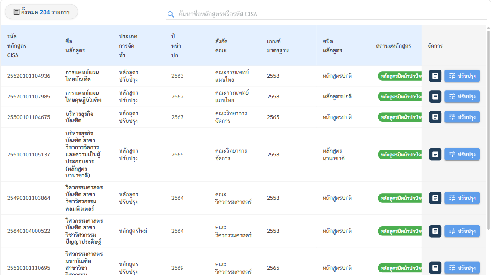
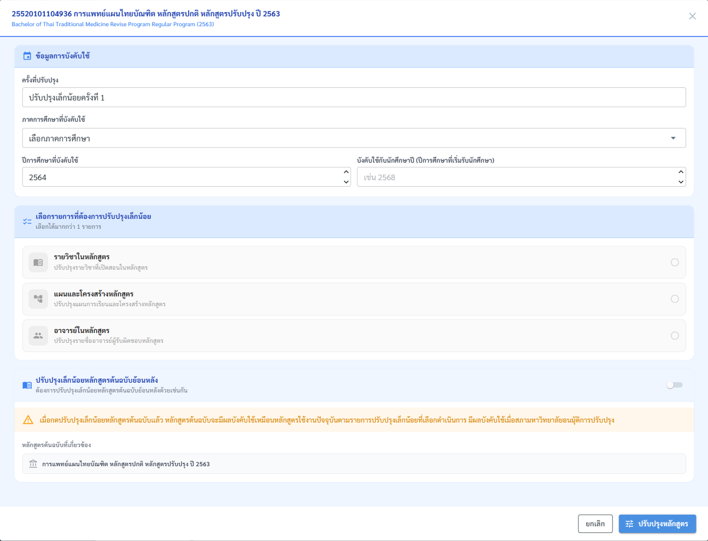

# 7. การปรับปรุงหลักสูตรเล็กน้อย

ใช้เมื่อต้องการแก้ไขข้อมูลในหลักสูตรที่ไม่กระทบโครงสร้างหลัก เช่น แก้ไขชื่ออาจารย์ ปรับเนื้อหารายวิชาเล็กน้อย หรืออัปเดตข้อมูลทั่วไป — เป็นช่องทาง "แก้เร็ว" ที่ไม่ต้องเดินกระบวนการอนุมัติยาวแบบการปรับปรุงปกติ

## ขั้นตอนการดำเนินงาน



### เปิดหน้าปรับปรุงเล็กน้อย

ไปที่เมนู **หลักสูตร → จัดการหลักสูตร** แล้วกดปุ่ม **"ปรับปรุงเล็กน้อย"** (สีฟ้า) มุมขวาบน



### เลือกหลักสูตร

ค้นหาด้วยรหัส CISA / ชื่อหลักสูตร หรือใช้ตัวกรอง แล้วกดปุ่ม **"ปรับปรุง"** ท้ายแถว

<figure><figcaption>
ปุ่มสีจาง = กดไม่ได้ เพราะการปรับปรุงเล็กน้อยครั้งก่อนของหลักสูตรนั้นยังไม่เสร็จสิ้น
</figcaption></figure>



### กรอกข้อมูลในหน้าต่างปรับปรุงเล็กน้อย

<figure><figcaption>
หน้าต่างกำหนดการบังคับใช้ และเลือกรายการที่ต้องการปรับปรุง
</figcaption></figure>

| ส่วน | ช่อง | วิธีกรอก |
| --- | --- | --- |
| **ข้อมูลการบังคับใช้** | ครั้งที่ปรับปรุง | ระบบตั้งให้อัตโนมัติ เช่น "ปรับปรุงเล็กน้อยครั้งที่ 1" |
| | ภาคการศึกษาที่บังคับใช้ | เลือกภาคการศึกษา |
| | ปีการศึกษาที่บังคับใช้ | ปี พ.ศ. ที่เริ่มใช้การปรับปรุง |
| | บังคับใช้กับนักศึกษาปี | ปีการศึกษาที่เริ่มรับนักศึกษากลุ่มที่ได้รับผล เช่น 2568 |
| **เลือกรายการที่ต้องการปรับปรุงเล็กน้อย** (เลือกได้มากกว่า 1) | รายวิชาในหลักสูตร | ปรับปรุงรายวิชาที่เปิดสอนในหลักสูตร |
| | แผนและโครงสร้างหลักสูตร | ปรับปรุงแผนการเรียนและโครงสร้างหลักสูตร |
| | อาจารย์ในหลักสูตร | ปรับปรุงรายชื่ออาจารย์ผู้รับผิดชอบหลักสูตร |
| **ปรับปรุงเล็กน้อยหลักสูตรต้นฉบับย้อนหลัง** | สวิตช์เปิด/ปิด | เปิดเมื่อต้องการให้หลักสูตรต้นฉบับ (เล่มก่อนหน้า) ได้รับการปรับปรุงเดียวกันด้วย ระบบแสดงชื่อหลักสูตรต้นฉบับที่เกี่ยวข้องด้านล่าง |


เมื่อเปิด "ปรับปรุงเล็กน้อยหลักสูตรต้นฉบับย้อนหลัง" หลักสูตรต้นฉบับจะมีผลบังคับใช้เหมือนหลักสูตรใช้งานปัจจุบันตามรายการที่เลือก **มีผลเมื่อสภามหาวิทยาลัยอนุมัติการปรับปรุง**


กด **"ปรับปรุงหลักสูตร"** เพื่อยืนยัน (หรือ **ยกเลิก** เพื่อปิดหน้าต่างโดยไม่บันทึก)



### แก้ไขข้อมูลส่วนที่เลือก

ระบบพาไปหน้ารายละเอียดหลักสูตร โดยเปิดให้แก้เฉพาะส่วนที่เลือกไว้ แก้ไขแล้วกดบันทึกในแต่ละแท็บย่อย



### ติดตามการอนุมัติ

หลักสูตรจะไปอยู่ในแท็บ **"หลักสูตรปรับปรุงเล็กน้อย"** ของหน้าจัดการหลักสูตร ดูประวัติการอนุมัติได้ที่แท็บ **ข้อมูลอนุมัติหลักสูตร → ปรับปรุงย่อย** ในหน้ารายละเอียดหลักสูตร (ดู [4. การดูข้อมูลหลักสูตร](view-curriculum.md))



## ข้อแตกต่างจากการปรับปรุงปกติ

| หัวข้อ               | ปรับปรุงปกติ                   | ปรับปรุงเล็กน้อย                   |
| -------------------- | ------------------------------ | ---------------------------------- |
| ขอบเขตการแก้ไข       | โครงสร้างหลักสูตร หน่วยกิต PLO | รายละเอียดปลีกย่อย                 |
| สร้างรุ่นใหม่หรือไม่ | สร้างรุ่นลูกใหม่ (แม่–ลูก)     | แก้ในหลักสูตรเดิม ไม่สร้างรุ่นใหม่ |
| ขั้นตอนอนุมัติ       | 8 ลำดับการอนุมัติ              | น้อยกว่า (ขึ้นกับประเภทที่เลือก)   |
| เวลาดำเนินการ        | นานกว่า (อาจหลายเดือน)         | รวดเร็วกว่า                        |

> ⚠️ เลือกประเภทให้เหมาะ: หากการแก้ไขกระทบสาระสำคัญ (เช่น เพิ่ม/ลดหน่วยกิต เปลี่ยน PLO) ต้องใช้ "ปรับปรุงปกติ" แม้จะช้ากว่า เพราะการแก้สาระสำคัญผ่านช่องทางเล็กน้อยอาจไม่เป็นไปตามระเบียบการอนุมัติ
