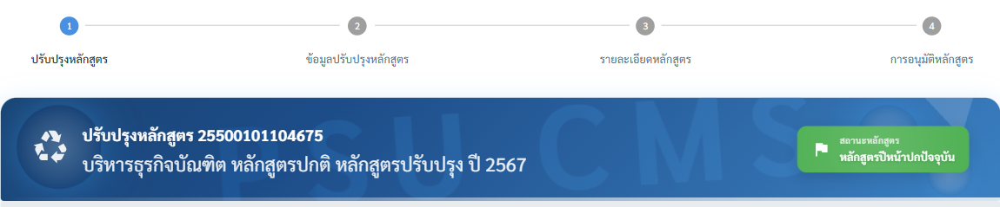
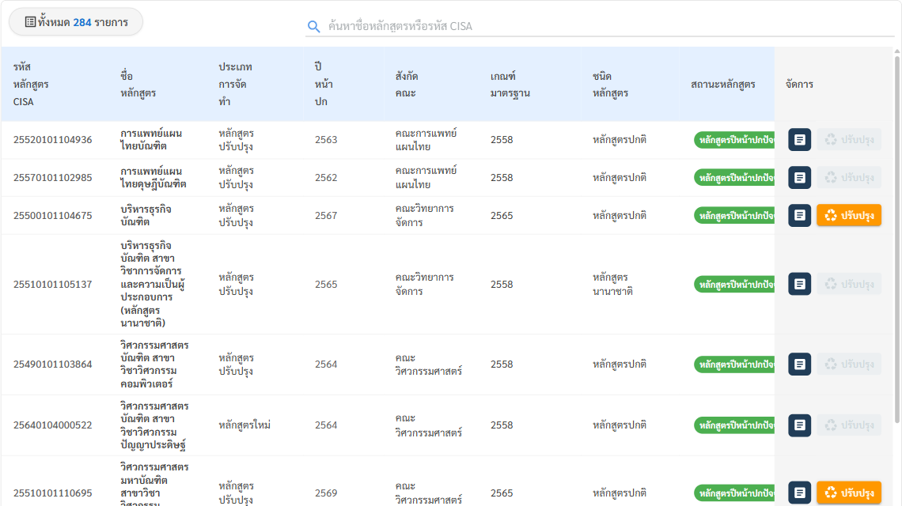
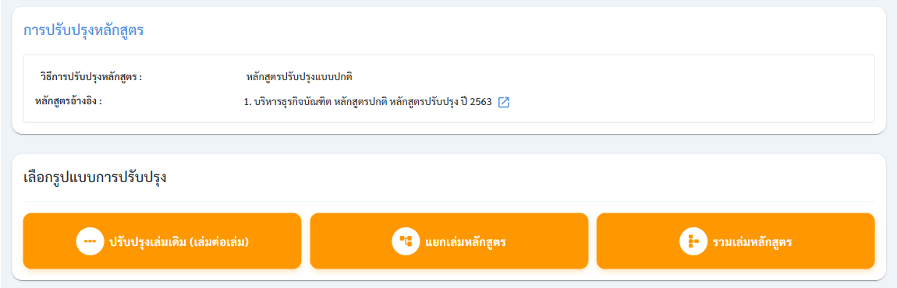

# 6. การปรับปรุงหลักสูตร

ใช้เมื่อต้องการปรับปรุงหลักสูตรที่มีอยู่แล้วอย่างมีนัยสำคัญ เช่น เปลี่ยนโครงสร้างหลักสูตร จำนวนหน่วยกิต หรือ PLO กระบวนการแบ่งเป็น 4 ขั้นตอน คล้ายการเพิ่มหลักสูตรใหม่ แต่เริ่มจากฐานข้อมูลเดิม


```html
[ขั้น 1: ปรับปรุงหลักสูตร] → [ขั้น 2: ข้อมูลปรับปรุงหลักสูตร] → [ขั้น 3: รายละเอียดหลักสูตร] → [ขั้น 4: การอนุมัติหลักสูตร]
```


<figure><figcaption><p>แถบ Stepper 4 ขั้นของการปรับปรุงหลักสูตร และแถบหัวแสดงหลักสูตรต้นฉบับที่จะปรับปรุง</p></figcaption></figure>

## แนวคิด "หลักสูตรแม่–ลูก"

การปรับปรุงไม่ใช่การแก้ทับของเดิม แต่เป็นการสร้าง "รุ่นลูก" (หลักสูตรปรับปรุง) ที่อ้างอิงกลับไปยัง "รุ่นแม่" (หลักสูตรเดิม) เมื่อรุ่นลูกได้รับอนุมัติถึงขั้นที่กำหนด รุ่นแม่จะกลายเป็น "หลักสูตรเดิม" และรุ่นลูกกลายเป็น "หลักสูตรปีหน้าปกปัจจุบัน" โดยอัตโนมัติ วิธีนี้ทำให้ระบบเก็บประวัติทุกรุ่นไว้ครบ ตรวจย้อนหลังได้

## ขั้นตอนการดำเนินงาน

**ขั้น 1 — เลือกหลักสูตรที่จะปรับปรุง**

1. ไปที่เมนู **หลักสูตร → จัดการหลักสูตร** แล้วกดปุ่ม **"ปรับปรุงหลักสูตร"** (สีส้ม) มุมขวาบน
2. หน้า "ปรับปรุงหลักสูตร" จะแสดงหลักสูตรที่ปรับปรุงได้ (หลักสูตรปีหน้าปกปัจจุบัน) ค้นหาด้วยรหัส CISA หรือชื่อหลักสูตร หรือใช้ตัวกรอง ระดับการศึกษา / วิทยาเขต / สังกัดคณะ / สาขาวิชา
3. กดปุ่ม **"♻ ปรับปรุง"** (สีส้ม) ท้ายแถวของหลักสูตรที่ต้องการ (ปุ่ม 📄 ข้างกันใช้เปิดดูรายละเอียดหลักสูตร)

<figure><figcaption><p>ปุ่ม "ปรับปรุง" สีส้ม = กดได้ ปุ่มสีเทาจาง = หลักสูตรนี้มีการปรับปรุงไปแล้ว (ชี้เมาส์จะขึ้น "ดำเนินการไปแล้ว")</p></figcaption></figure>

4. ระบบแสดงข้อมูลของหลักสูตรต้นฉบับ (ข้อมูลพื้นฐาน, ชื่อคุณวุฒิ/ปริญญา, การจำแนกหลักสูตรและเกณฑ์มาตรฐาน, ข้อมูลการศึกษา, การปรับปรุงหลักสูตรครั้งก่อน) ให้ตรวจสอบว่าเลือกถูกหลักสูตร
5. เลื่อนลงล่างสุด ที่ **"เลือกรูปแบบการปรับปรุง"** แล้วกดปุ่มรูปแบบที่ต้องการ

<figure><figcaption><p>ส่วน "การปรับปรุงหลักสูตร" (วิธีการปรับปรุงครั้งก่อน และหลักสูตรอ้างอิง) และปุ่ม 3 รูปแบบการปรับปรุง</p></figcaption></figure>

| ปุ่มบนหน้าจอ | รูปแบบ | เมื่อไหร่ควรใช้ |
| --- | --- | --- |
| **ปรับปรุงเล่มเดิม (เล่มต่อเล่ม)** | ปรับปรุงแบบปกติ (1 ต่อ 1) | ปรับปรุงต่อเนื่องจากหลักสูตรเดิมหลักสูตรเดียว ได้ผลเป็นหลักสูตรใหม่หลักสูตรเดียว |
| **แยกเล่มหลักสูตร** | ปรับปรุงแบบแยก (1 ต่อหลาย) | แยกหลักสูตรเดิมหนึ่งหลักสูตรออกเป็นหลายหลักสูตร |
| **รวมเล่มหลักสูตร** | ปรับปรุงแบบรวม (หลายต่อ 1) | นำหลักสูตรหลายหลักสูตรมารวมเป็นหลักสูตรเดียว |

> ⚠️ เลือกรูปแบบให้ตรง เพราะรูปแบบนี้กำหนดว่าหลักสูตรแม่ตัวใดบ้างจะถูกเปลี่ยนเป็น "หลักสูตรเดิม" เมื่ออนุมัติผ่านขั้นตอนสภามหาวิทยาลัยอนุมัติ

**ขั้น 2–3 — กรอกข้อมูลการปรับปรุง**

1. ระบบจะ คัดลอกข้อมูลเดิม (Extract) จากหลักสูตรแม่มาตั้งต้นให้ ผู้ใช้แก้เฉพาะส่วนที่เปลี่ยน ไม่ต้องกรอกใหม่ทั้งหมด
2. โครงสร้างการกรอกเหมือนการเพิ่มหลักสูตรใหม่ (8 หมวดหมู่) ทุกประการ
3. ตรวจสอบให้ดีว่าข้อมูลที่ยกมาจากของเดิมยัง "ใช้งานในปัจจุบัน" หรือไม่ (เช่น รายชื่ออาจารย์ ค่าธรรมเนียม)


**เคล็ดลับ:** หลังระบบดึงข้อมูลเดิมมาแล้ว ให้ไล่ตรวจทีละหมวดตามสถานะวงกลม โดยเน้นแก้ส่วนที่เป็นเหตุผลของการปรับปรุงก่อน แล้วค่อยตรวจส่วนที่ยกมาทั้งดุ้น


**ขั้น 4 — การอนุมัติ**

ส่งกระบวนการอนุมัติแบบเดียวกับหลักสูตรใหม่ (8 ลำดับการอนุมัติ, 7 แท็บ) เมื่อผ่านลำดับการอนุมัติที่ 5 (สภามหาวิทยาลัย) หลักสูตรลูกจะกลายเป็น "หลักสูตรปีหน้าปกปัจจุบัน" และหลักสูตรแม่กลายเป็น "หลักสูตรเดิม" อัตโนมัติ
