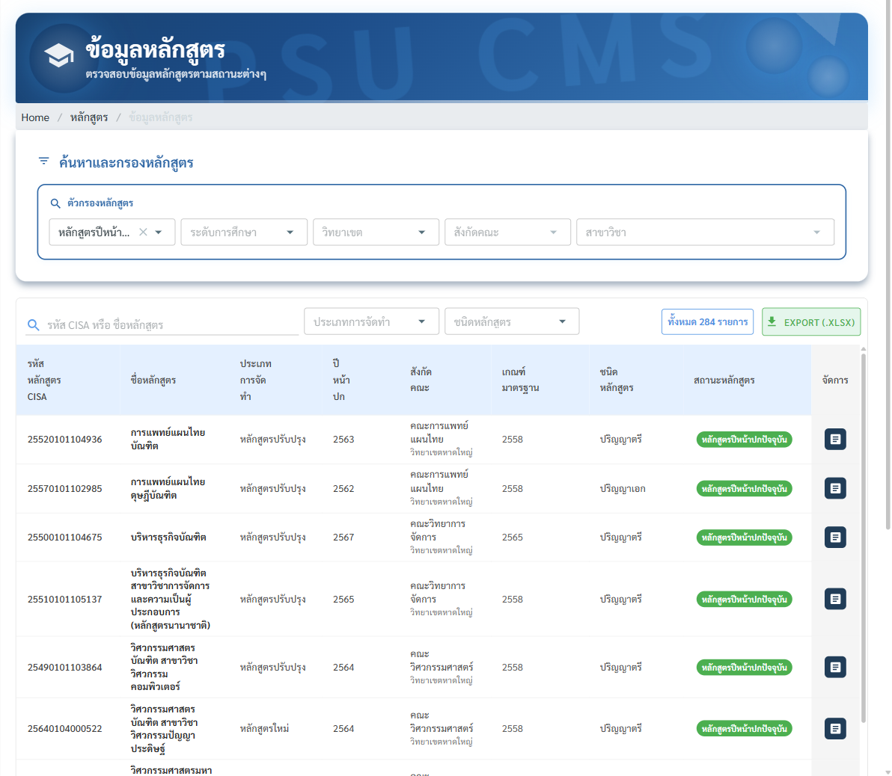
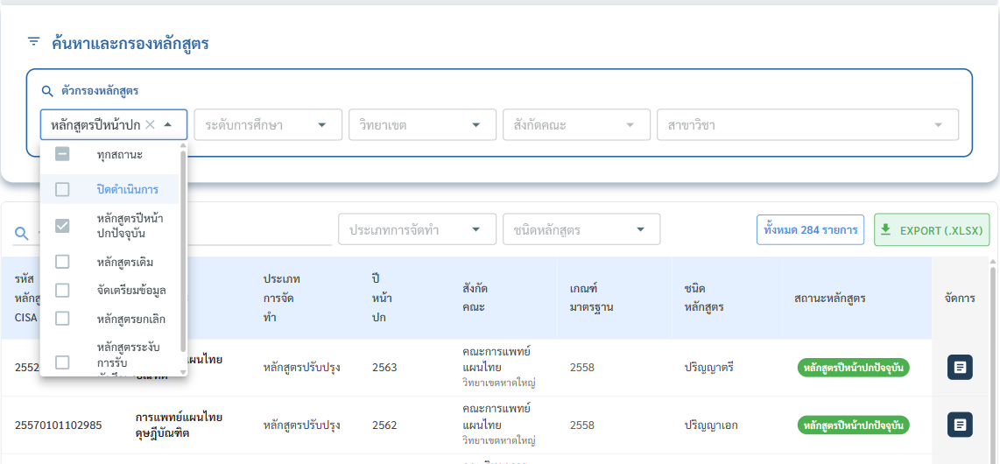
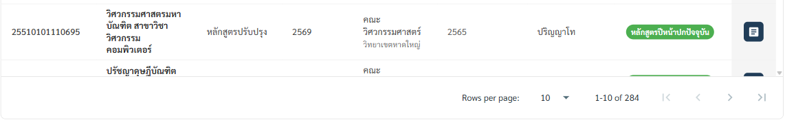
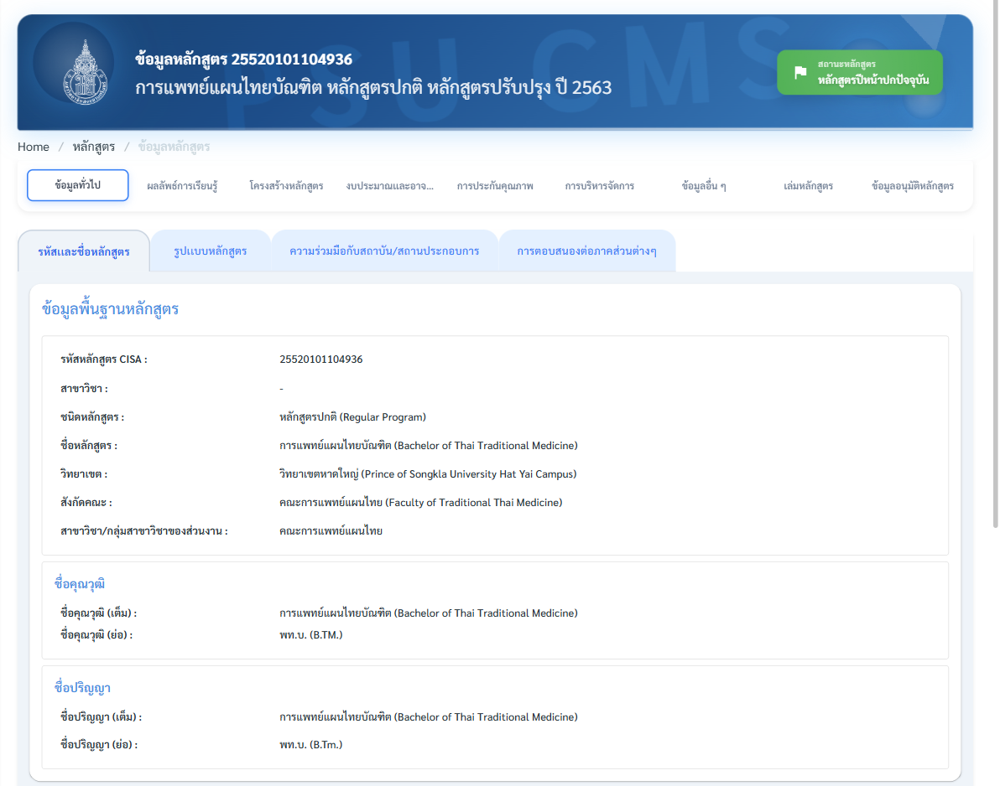
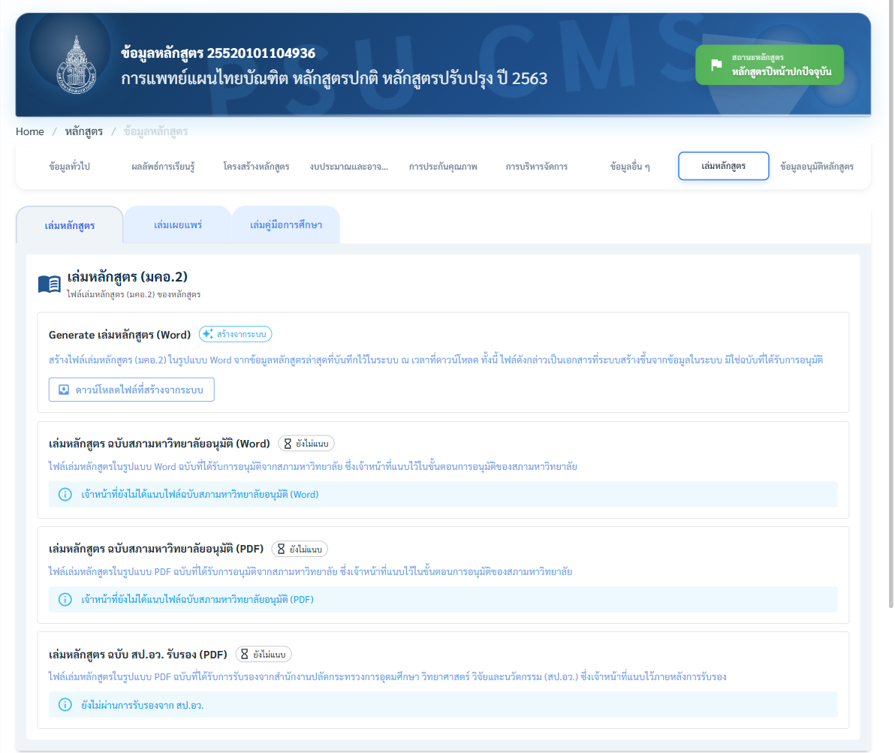
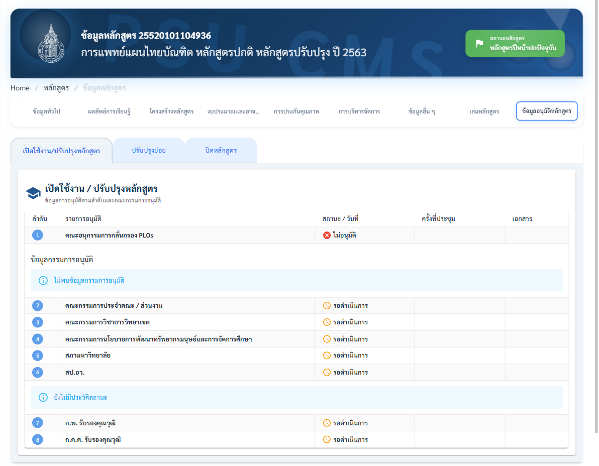

# 4. การดูข้อมูลหลักสูตร

เมนู **หลักสูตร → ข้อมูลหลักสูตร** ใช้ค้นหาและเปิดดูรายละเอียดหลักสูตรแบบ **อ่านอย่างเดียว** (แก้ไขไม่ได้) เหมาะกับการตรวจดูข้อมูล หรือดึงรายชื่อหลักสูตรไปใช้งาน


ถ้าต้องการ **แก้ไข** ข้อมูลหลักสูตร ให้เข้าทางเมนู **หลักสูตร → จัดการหลักสูตร** แทน (ดู [การกรอกข้อมูลรายละเอียดหลักสูตร](curriculum-form.md))


<figure><figcaption>
หน้า "ข้อมูลหลักสูตร": ตัวกรองด้านบน และตารางหลักสูตรด้านล่าง
</figcaption></figure>

## ค้นหาหลักสูตร



### เปิดหน้าข้อมูลหลักสูตร

คลิกเมนู **หลักสูตร** ที่แถบซ้าย แล้วเลือก **ข้อมูลหลักสูตร** ค่าเริ่มต้นจะแสดงหลักสูตรสถานะ **"หลักสูตรปีหน้าปกปัจจุบัน"**



### เลือกตัวกรอง

<figure><figcaption>
ช่อง "สถานะหลักสูตร" ติ๊กได้หลายสถานะพร้อมกัน
</figcaption></figure>

| ตัวกรอง | รายละเอียด | เคล็ดลับ |
| --- | --- | --- |
| **สถานะหลักสูตร** | ติ๊กได้หลายสถานะ: ปิดดำเนินการ, หลักสูตรปีหน้าปกปัจจุบัน, หลักสูตรเดิม, จัดเตรียมข้อมูล, หลักสูตรยกเลิก, หลักสูตรระงับการรับนักศึกษา หรือติ๊ก **ทุกสถานะ** | กด × ในช่องเพื่อล้างค่า (ดูสถานะของแต่ละค่าได้ที่ [11. สถานะหลักสูตร](statuses.md)) |
| **ระดับการศึกษา** | ปริญญาตรี โท เอก ประกาศนียบัตรบัณฑิต ฯลฯ | ใช้คู่กับคณะเพื่อให้ผลแคบลง |
| **วิทยาเขต** | เลือกวิทยาเขต | – |
| **สังกัดคณะ** | เลือกคณะ | – |
| **สาขาวิชา** | เลือกสาขาวิชา | – |
| **ช่องค้นหา** (เหนือตาราง) | พิมพ์รหัส CISA หรือชื่อหลักสูตร | ค้นด้วยรหัส CISA แม่นยำกว่า |
| **ประเภทการจัดทำ / ชนิดหลักสูตร** (เหนือตาราง) | หลักสูตรใหม่/ปรับปรุง, ชนิดหลักสูตร | – |

ตารางจะกรองทันทีที่เปลี่ยนค่า ไม่ต้องกดปุ่มค้นหา ปุ่ม **"ทั้งหมด N รายการ"** บอกจำนวนที่ตรงกับตัวกรอง



### อ่านและจัดการตาราง

* **เรียงลำดับ**: คลิกหัวคอลัมน์ (เช่น ปีหน้าปก) คลิกซ้ำเพื่อสลับน้อย→มาก / มาก→น้อย
* **เปลี่ยนหน้า**: ใช้ส่วนท้ายตาราง เลือก **Rows per page** (จำนวนแถวต่อหน้า) และปุ่ม ‹ › เพื่อเลื่อนหน้า

<figure><figcaption>
"1-10 of 284" = กำลังแสดงรายการที่ 1–10 จากทั้งหมด 284 รายการ
</figcaption></figure>



### ส่งออก Excel (ถ้าต้องการ)

กด **EXPORT (.XLSX)** เพื่อดาวน์โหลดรายชื่อหลักสูตรตามตัวกรองปัจจุบัน



### เปิดดูรายละเอียด

กดไอคอน **📄** ในคอลัมน์ **"จัดการ"** ท้ายแถวของหลักสูตรที่ต้องการ




**ตัวอย่าง:** หาหลักสูตรปริญญาโททั้งหมดของคณะวิศวกรรมศาสตร์ที่ยังใช้งานอยู่ → สถานะหลักสูตร = หลักสูตรปีหน้าปกปัจจุบัน, ระดับการศึกษา = ปริญญาโท, สังกัดคณะ = คณะวิศวกรรมศาสตร์ แล้วกด EXPORT (.XLSX) ถ้าต้องการไฟล์


## หน้ารายละเอียดหลักสูตร

<figure><figcaption>
แถบหัวบอกรหัส CISA ชื่อหลักสูตร และสถานะหลักสูตร (มุมขวา) ด้านล่างคือแท็บหลักและแท็บย่อย
</figcaption></figure>

ด้านบนเป็น **แท็บหลัก 9 แท็บ** กดแต่ละแท็บแล้วจะมี **แท็บย่อย** ด้านล่าง

| แท็บหลัก | แท็บย่อย |
| --- | --- |
| ข้อมูลทั่วไป | รหัสและชื่อหลักสูตร · รูปแบบหลักสูตร · ความร่วมมือกับสถาบัน/สถานประกอบการ · การตอบสนองต่อภาคส่วนต่างๆ |
| ผลลัพธ์การเรียนรู้ | ปรัชญาและวัตถุประสงค์ · ผลลัพธ์การเรียนรู้ (PLOs) · ระบบการจัดการศึกษา |
| โครงสร้างหลักสูตร | จัดการรายวิชา · แผนการศึกษา · แผนการรับนักศึกษา · PLOs & รายวิชา · กลยุทธ์และวิธีการสอน · PLOs & KAS (ดูรายละเอียดที่ [การกรอกข้อมูลโครงสร้างหลักสูตร](curriculum-structure.md)) |
| งบประมาณและอาจารย์ | งบประมาณตามแผน · อาจารย์ประจำหลักสูตร · อาจารย์ผู้สอน |
| การประกันคุณภาพ | การใช้เกณฑ์ประกันคุณภาพ · ตัวชี้วัด / ผลลัพธ์ · การรับรองโดยสภาวิชาชีพ/องค์กรอื่นๆ |
| การบริหารจัดการ | กรรมการและหน่วยงานบริหารหลักสูตร · การเปิดสอน |
| ข้อมูลอื่น ๆ | ข้อมูลประชาสัมพันธ์ · Skill Transcript · ค่าธรรมเนียมการศึกษา |
| **เล่มหลักสูตร** | เล่มหลักสูตร · เล่มเผยแพร่ · เล่มคู่มือการศึกษา |
| **ข้อมูลอนุมัติหลักสูตร** | เปิดใช้งาน/ปรับปรุงหลักสูตร · ปรับปรุงย่อย · ปิดหลักสูตร |

### แท็บ "เล่มหลักสูตร": ดาวน์โหลดเล่ม มคอ.2

<figure><figcaption>
เล่มที่ระบบสร้างให้ และเล่มฉบับอนุมัติที่เจ้าหน้าที่แนบไว้
</figcaption></figure>

| รายการ | คืออะไร |
| --- | --- |
| **Generate เล่มหลักสูตร (Word)** | กด **"ดาวน์โหลดไฟล์ที่สร้างจากระบบ"** เพื่อได้ไฟล์ มคอ.2 (Word) ที่สร้างจากข้อมูลล่าสุดในระบบ ณ เวลาที่กด **ไม่ใช่ฉบับที่ได้รับอนุมัติ** |
| **เล่มหลักสูตร ฉบับสภามหาวิทยาลัยอนุมัติ (Word / PDF)** | ไฟล์ที่เจ้าหน้าที่แนบไว้ตอนขั้นอนุมัติของสภามหาวิทยาลัย ถ้ายังไม่แนบจะขึ้นป้าย **"ยังไม่แนบ"** |
| **เล่มหลักสูตร ฉบับ สป.อว. รับรอง (PDF)** | ไฟล์ที่แนบหลังจาก สป.อว. รับรองหลักสูตรแล้ว |

แท็บย่อย **เล่มเผยแพร่** และ **เล่มคู่มือการศึกษา** ใช้ดาวน์โหลดเล่มสำหรับเผยแพร่และคู่มือการศึกษาของหลักสูตร

### แท็บ "ข้อมูลอนุมัติหลักสูตร": ดูว่าอนุมัติถึงไหนแล้ว

<figure><figcaption>
ลำดับการอนุมัติ 1–8 พร้อมสถานะ วันที่ ครั้งที่ประชุม และเอกสาร
</figcaption></figure>

ตารางแสดงลำดับการอนุมัติทั้งหมด (ลำดับที่ 1 คณะอนุกรรมการกลั่นกรอง PLOs ไปจนถึงลำดับที่ 8 ก.ค.ศ. รับรองคุณวุฒิ) แต่ละแถวบอก

* **สถานะ / วันที่**: ✅ อนุมัติ · ❌ ไม่อนุมัติ · 🕒 รอดำเนินการ
* **ครั้งที่ประชุม** และ **เอกสาร** ที่แนบไว้ตอนบันทึกผลการอนุมัติ
* ใต้บางลำดับจะแสดง **ข้อมูลกรรมการอนุมัติ** หรือ **ประวัติสถานะ** เพิ่มเติม

แท็บย่อย **ปรับปรุงย่อย** และ **ปิดหลักสูตร** แสดงข้อมูลการอนุมัติของการปรับปรุงเล็กน้อยและการปิดหลักสูตร (ถ้ามี)
